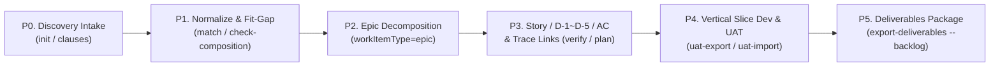

# Requirements Intake & Agile Backlog Lifecycle Skill

**Use this skill when:** Starting a new institutional project, normalizing unstructured customer discovery materials (RFP, interview notes, as-is screens/forms, regulations), performing Fit-Gap analysis against the eGov Enterprise IE ledgers, decomposing requirements into Epics/Stories/Decision Cards/Green-Red ACs, generating vertical-slice development task packages, or preparing UAT and audit deliverables.

**Project Authorities:** Always follow [Verification by change scope](../../../AGENTS.md#verification-by-change-scope) and the [Orchestration Protocol](../../../docs/03-guides/orchestration-protocol.md) for task grading, approval boundaries, and verification budgets. Detailed field contracts and examples live in [design-to-deliverables-guide.md](../../../docs/03-guides/design-to-deliverables-guide.md).

---

## 1. Core Boundary & Security Rules (Mandatory)

1. **Workspace Outside Checkout (`DEC-OPS-382 ②`, `DEC-OPS-399`)**:
   - Institutional requirements, RFP excerpts, and project backlogs must **never** be committed inside the public repository checkout or any Git working tree.
   - Always operate on an external workspace path (`--workspace <path-outside-any-git-worktree>`).
2. **PII & Secret Redaction Before Persistence**:
   - Before writing any excerpt, requirement, or UAT sign-off metadata to `backlog.json`, redact personal data (resident/foreigner registration numbers, mobile numbers, personal emails), credentials/tokens/JWTs, and specific internal host IPv4 addresses (use network CIDR notation like `10.10.0.0/24` for policy ranges).
   - `validateBacklogPack` blocks persistence when PII or secret patterns are detected.
3. **4-Layer Status Separation (`DEC-OPS-399`)**:
   - Never write manual completion flags (`status: "done"`, `implemented: true`, `progress: "100%"`) into `backlog.json`.
   - Keep the 4 layers distinct:
     1. **Plan & Scope Layer**: `solutionDisposition` (`fit` / `config` / `gap-dev` / `hybrid` / `undecided`), `scopeDisposition` (`proposed` / `included` / `deferred` / `excluded`), `linkIntent` (`candidate` / `planned` / `existing`)
     2. **Tool Observation Layer**: `found` (`true` / `false` in repository ledgers)
     3. **Ledger Review Layer**: `ledgerStatus` (`partial` / `unverified` / `unavailable` / `demo`) + `evidenceLevel` (`E0` ~ `E3`)
     4. **Institutional Acceptance Layer**: `acceptanceDisposition` (`pending` / `accepted` / `conditional` / `rejected`)

---

## 2. End-to-End P0 ~ P5 Workflow



### Step 1 (P0): Initialize External Workspace & Capture Discovery Clauses
1. Initialize a clean external workspace (do **not** pass `--sample` for real projects):
   ```bash
   node scripts/export-deliverables-workspace.mjs init --workspace ../my-agency-reqs
   ```
2. Record raw discovery sources in `sources[]` (`sourceType`: `rfp`, `interview`, `as-is-artifact`, `regulation`, `policy-memo`, `other`).
3. Include `locator` (page/section/line), optional `fileSha256` (64-hex SHA-256 of the original file), `classification` (`public`/`internal`/`confidential`/`restricted`), and `clauses[]` so every original RFP/interview clause has an explicit `disposition` (`included`, `merged`, `deferred`, `excluded`, `question`).

### Step 2 (P1): Normalize Atomic Requirements & Run Automated Fit-Gap Matching
1. Split compound customer statements into atomic `businessRequirements[]` (`functional`, `non-functional`, `data`, `interface`, `constraint`).
2. For `included` `non-functional`, `data`, or `constraint` requirements, always populate `nfrCriteria` (`metric`, `threshold`, `verificationMethod`). Avoid vague terms (`적절히`, `신속히`, `충분히`) without quantitative criteria or `openQuestions`.
3. Run the automated ledger matcher against `context.snapshot.json`:
   ```bash
   node scripts/export-deliverables-workspace.mjs match --workspace ../my-agency-reqs
   ```
   Inspect `<workspace>/FIT-GAP-MATCHES.md` to review candidate modules, capabilities (`route#capabilityId`), screens (`/admin/...`), interfaces (`METHOD /api/...`), and tables (`tb_...`), along with their `ledgerStatus` and `evidenceLevel`.
4. Verify bidirectional alignment with Project Composer module/preset selection:
   ```bash
   node scripts/export-deliverables-workspace.mjs check-composition --workspace ../my-agency-reqs --selection core,promotion,collaboration
   ```

### Step 3 (P2 ~ P3): Decompose into Epics, Stories, Decision Cards (D-1~D-5), Green/Red ACs, and 6-Kind Trace Links
1. **P2 (Epics)**: Group included requirements under `epic` work items (`workItemType: "epic"`, `parentEpicId: null`).
2. **P3 (Stories & ACs)**: Create actionable child items (`story`, `configuration`, `verification`, `enabler`) with `parentEpicId`, `priority` (`MUST`/`SHOULD`/`COULD`/`WONT`), `batch`, and optional `dependsOn`.
3. Every `story` requires `asA`, `iWant`, `soThat`, screen `archetype` (`A1`~`A7`), and `decisionCards`:
   - `D-1`: Screen archetype, layout density, modal/tab split
   - `D-2`: Authorization semantics (`H3` — exact permission code from `permission-catalog.json` or `new:<CODE>` for new permissions, plus `@PreAuthorize` or `SecurityUtil.assertPermission`)
   - `D-3`: Identifier axis & physical schema (`H1` — exact physical PK/column names from `db_columns.json` / live `information_schema`)
   - `D-4`: Input validation & integrity contract (`DTO ↔ OpenAPI ↔ Zod`, `READ_ONLY` fields, concurrency/locking)
   - `D-5`: Honest empty/error states & deliberate violation Red tests (`H5`)
4. Define `acceptanceCriteria[]` with both `allow` (Green) and `forbid` (Red) polarities. Keep 403 authorization rejection and 400 validation rejection in separate Red ACs.
5. Bind `traceLinks[]` across the 6 `targetKind` values:
   - `capability` (`/admin/...#cap.id`, e.g. `/admin/system/banner#promotion.popup-management`)
   - `screen` (`/admin/...`)
   - `interface` (`POST /api/v1/...`)
   - `table` (`tb_...`)
   - `gate` (`gate-id` from `config/governance/gates.json`)
   - `migration-mapping` (`migration:tb_...` when a migration-mapping ledger is present)
6. For non-developer stakeholder review via Excel/CSV round-trip:
   ```bash
   node scripts/export-deliverables-workspace.mjs sheets-export --workspace ../my-agency-reqs
   node scripts/export-deliverables-workspace.mjs sheets-import --workspace ../my-agency-reqs
   ```

### Step 4 (P4): Generate Development Task Package, Execute Vertical Slices, & Record UAT Sign-Off
1. Verify the workspace and generate `<workspace>/TASK-PACKAGE.md`:
   ```bash
   node scripts/export-deliverables-workspace.mjs verify --workspace ../my-agency-reqs
   node scripts/export-deliverables-workspace.mjs plan --workspace ../my-agency-reqs
   ```
2. Implement each work item in `<workspace>/TASK-PACKAGE.md` following the repository constitutions and `AGENTS.md` guardrails (`H1`~`H5`).
3. After registering new screens, capabilities, APIs, or tables in the repository ledgers, refresh the workspace snapshot and update `linkIntent` from `planned` to `existing`:
   ```bash
   node scripts/export-deliverables-workspace.mjs verify --workspace ../my-agency-reqs --refresh-context
   ```
4. Export the UAT checklist CSV (stamping context-bound `acContentHash` on every AC) and import institutional UAT sign-off (`uatSignedBy`, `uatVerifiedAt`, `uatEvidence`, `uatBuildRef`). Only changed rows create a new record; an unchanged row retains its original build:
   ```bash
   node scripts/export-deliverables-workspace.mjs uat-export --workspace ../my-agency-reqs
   node scripts/export-deliverables-workspace.mjs uat-import --workspace ../my-agency-reqs --build-ref BUILD-001
   ```

### Step 5 (P5): Audit Deliverables Package Export
1. Export the full audit/inspection deliverables package from a clean working tree (use `--allow-dirty` only for local draft previews, never for formal submission):
   ```bash
   node scripts/export-deliverables.mjs --backlog ../my-agency-reqs/backlog.json
   ```
   With `--backlog`, the default output is `<workspace>/deliverables/<commit>` outside Git; an explicit `--out` must be a new absolute external directory. The UI is available with `node tools/requirements-workspace/server.mjs --workspace <external-path>`, described in [the workspace guide](../../../docs/03-guides/requirements-workspace-guide.md).
