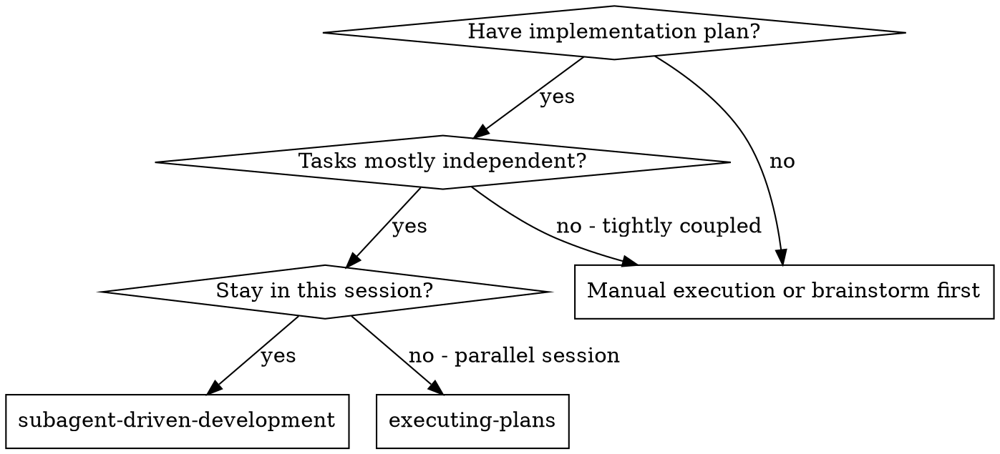

# Subagent-Driven Development

Execute a plan by delegating bounded tasks, then reviewing and independently verifying their results as the main agent.

**Core principle:** Clear task ownership, sufficient context, and main-agent verification.

Use [AGENTS.md Verification by change scope](../../../AGENTS.md#verification-by-change-scope) and [SOP §2.2–2.4 and §6](../../../docs/03-guides/orchestration-protocol.md). Additional spec or code-quality reviewers depend on risk and unresolved concerns; they are not mandatory twice for every task. The main agent's diff review and independent gate execution (§2.3), red/green proof, hooks and required CI remain required. A reviewer approval does not replace them.

## When to Use



**vs. Executing Plans (parallel session):**
- Same session (no context switch)
- Fresh subagent per task (no context pollution)
- Separate spec and code-quality reviewers when the task warrants them
- Faster iteration (no human-in-loop between tasks)

## The Process

1. Read the current plan and disk state. Give each implementer the SOP delegation packet, file ownership, allowed checks and completion criteria.
2. Delegate independent tasks without overlapping edits. Subagents run affected tests and light static checks; heavy checks are serialized by the main agent after integration (§6.3). Commits require the user's authorization and must include only the assigned changes.
3. The main agent reads each current diff, checks requirements and independently reruns the relevant gates (§2.3). Request an additional reviewer for a concrete risk or unresolved concern, rather than automatically running two reviews per task.
4. Fix findings and verify the affected behavior. Count failures by cause, including the first attempt; at three total failures, stop and report under §2.4. Main-agent repair or a replacement agent is allowed within the approved scope.
5. Integrate the batch and perform the scope checks required by §6. Report evidence and remaining limitations before completing it; review approval alone is not completion.

## Prompt Templates

- `./implementer-prompt.md` - Dispatch implementer subagent
- `./spec-reviewer-prompt.md` - Dispatch spec compliance reviewer subagent
- `./code-quality-reviewer-prompt.md` - Dispatch code quality reviewer subagent

## Example Workflow

This example chooses separate reviewers for a higher-risk plan and assumes commits were authorized. It is not a required reviewer count or a replacement for the main agent's independent verification in the process above.

```
You: I'm using Subagent-Driven Development to execute this plan.

[Read plan file once: <계획 문서 경로>]
[Extract all 5 tasks with full text and context]
[Create TodoWrite with all tasks]

Task 1: Hook installation script

[Get Task 1 text and context (already extracted)]
[Dispatch implementation subagent with full task text + context]

Implementer: "Before I begin - should the hook be installed at user or system level?"

You: "User level (~/.config/superpowers/hooks/)"

Implementer: "Got it. Implementing now..."
[Later] Implementer:
  - Implemented install-hook command
  - Added tests, 5/5 passing
  - Self-review: Found I missed --force flag, added it
  - Committed

[Dispatch spec compliance reviewer]
Spec reviewer: ✅ Spec compliant - all requirements met, nothing extra

[Get git SHAs, dispatch code quality reviewer]
Code reviewer: Strengths: Good test coverage, clean. Issues: None. Approved.

[Main agent reviews diff and independently runs relevant gates; mark Task 1 complete]

Task 2: Recovery modes

[Get Task 2 text and context (already extracted)]
[Dispatch implementation subagent with full task text + context]

Implementer: [No questions, proceeds]
Implementer:
  - Added verify/repair modes
  - 8/8 tests passing
  - Self-review: All good
  - Committed

[Dispatch spec compliance reviewer]
Spec reviewer: ❌ Issues:
  - Missing: Progress reporting (spec says "report every 100 items")
  - Extra: Added --json flag (not requested)

[Implementer fixes issues]
Implementer: Removed --json flag, added progress reporting

[Spec reviewer reviews again]
Spec reviewer: ✅ Spec compliant now

[Dispatch code quality reviewer]
Code reviewer: Strengths: Solid. Issues (Important): Magic number (100)

[Implementer fixes]
Implementer: Extracted PROGRESS_INTERVAL constant

[Code reviewer reviews again]
Code reviewer: ✅ Approved

[Main agent reviews diff and independently runs relevant gates; mark Task 2 complete]

...

[After all tasks]
[Dispatch final code-reviewer]
Final reviewer: All requirements met, ready to merge

Done!
```

## Advantages

**vs. Manual execution:**
- Subagents follow TDD naturally
- Fresh context per task (no confusion)
- Parallel-safe (subagents don't interfere)
- Subagent can ask questions (before AND during work)

**vs. Executing Plans:**
- Same session (no handoff)
- Continuous progress (no waiting)
- Review checkpoints automatic

**Efficiency gains:**
- No file reading overhead (controller provides full text)
- Controller curates exactly what context is needed
- Subagent gets complete information upfront
- Questions surfaced before work begins (not after)

**Quality gates:**
- Self-review catches issues before handoff
- Main-agent review covers spec compliance and code quality; additional reviewers address specific risks
- Review loops ensure fixes actually work
- Spec compliance prevents over/under-building
- Code quality ensures implementation is well-built

**Cost:**
- Additional reviewers cost time and model calls; choose them for the task's risks
- Controller does more prep work (extracting all tasks upfront)
- Review loops add iterations
- But catches issues early (cheaper than debugging later)

## Red Flags

**Never:**
- Start implementation on main/master branch without explicit user consent
- Skip the main agent's diff review or independent verification
- Proceed with unfixed issues
- Dispatch parallel implementers with overlapping file ownership or heavy checks
- Make subagent read plan file (provide full text instead)
- Skip scene-setting context (subagent needs to understand where task fits)
- Ignore subagent questions (answer before letting them proceed)
- Accept "close enough" on spec compliance (spec reviewer found issues = not done)
- Leave review findings unverified after correction
- Move to next task while a review you requested has open findings

**If subagent asks questions:**
- Answer clearly and completely
- Provide additional context if needed
- Don't rush them into implementation

**If reviewer finds issues:**
- Implementer (same subagent) fixes them
- Reviewer re-checks major findings; verify minor fixes yourself (§2.3)
- Stop and report at three failures for the same cause under SOP §2.4

**If subagent fails task:**
- Use the evidence to repair directly or delegate a targeted fix within the approved scope
- Preserve the same-cause failure count when changing agents

## Integration

**Related workflow skills (select when relevant):**
- **using-git-worktrees** - Use when isolation is needed; preserve the current workspace and other agents' changes
- **writing-plans** - Creates the plan this skill executes
- **requesting-code-review** - Code review template for reviewer subagents
- **finishing-a-development-branch** - Complete development after all tasks

**Subagents should use:**
- **test-driven-development** - Subagents follow TDD for each task

**Alternative workflow:**
- **executing-plans** - Use for parallel session instead of same-session execution
