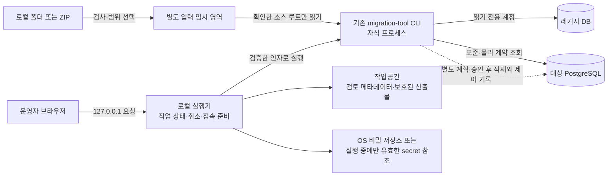
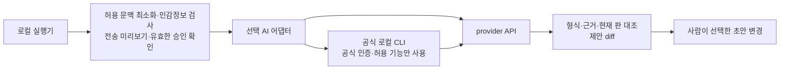

# 레거시 데이터 이관 작업공간 설계와 화면 시뮬레이션

> **상태: A1~A8 사용자 승인(2026-10-24), ADR-0041 Accepted.** 이 문서는 이관 작업공간의 제품 설계와 합성 시뮬레이션이다. 승인된 구현·AI 정책의 정본은 [ADR-0041](../02-architecture/decisions/ADR-0041-local-migration-workspace-and-ai.md), 실제 실행 방법·지원 한계는 [실행 안내](../03-guides/migration-workspace-guide.md)다. 프로토타입의 시스템·수치·표준·성공 표시는 여전히 합성 예시다. 기관 전송·운영 적재·DB 물리 모델 확정을 대신하지 않는다.

권장 배치는 **별도 URL로 여는 독립 로컬 이관 작업공간**이다. 최초 이관도 분석과 리허설은 여러 번 필요하므로, **리허설 N회 + 최종 전환 1회 + 인수·보관**을 한 작업공간에서 관리한다. 직접 설정과 AI 질문 진행을 함께 제공하며 두 모드가 같은 입력·검토 상태를 사용한다. 기존 온라인 업무 앱의 상시 메뉴와 실행 권한을 늘리지 않고, 실제 실행 연동은 현재 `migration-tool`의 승인·검증 경로를 유지하는 후속 구현으로 둔다.

기능 구현의 추천안·대안·장단점과 승인 범위는 [§13 승인 검토안](#13-기능-구현-착수를-위한-승인-검토안)에 정리한다. **사용자가 A1~A8 전체를 승인했다.** §1~12의 현행 정책·후속 구현 언급은 최초 시뮬레이션 작성 당시의 설명이며, 정책 충돌 시 후속 ADR-0041과 실행 안내를 따른다. 실제 구현은 `tools/migration-workspace/`, 합성 화면은 `tools/migration-workspace-prototype/`로 분리한다.

화면 예시는 [이관 작업공간 시뮬레이터](../../tools/migration-workspace-prototype/index.html)다. 파일을 브라우저로 열거나 해당 디렉터리를 loopback에서 정적으로 제공해 볼 수 있다. DB 연결·스키마 파일 분석·소스 분석·적재·운영 승인은 실행하지 않는다. 화면에서 바꾸는 선택과 진행 상태는 설명용이며, 실행 가능한 이관 원장이나 승인 artifact로 사용할 수 없다.

### 화면 열기와 체험 순서

Node.js 22 이상이 준비되어 있으면 저장소 루트에서 아래 명령을 실행한다. 추가 패키지 설치 없이 정적 서버를 시작하고 기본 브라우저에서 `http://127.0.0.1:8769/#start`를 연다.

```powershell
node tools/migration-workspace-prototype/serve.mjs
```

`--port <번호>`로 포트를 바꾸고 `--no-open`으로 자동 브라우저 열기를 끌 수 있다. 예를 들어 `node tools/migration-workspace-prototype/serve.mjs --port 8770 --no-open`으로 시작하면 `http://127.0.0.1:8770/#start`를 직접 연다. 종료할 때는 실행한 터미널에서 Ctrl+C를 누른다.

이 launcher는 **도구 디렉터리의 정적 파일만 제공**한다. 실제 DB 연결, 기존 Java CLI 호출, ZIP 해제·소스 분석, AI 인증·모델 호출을 수행하는 로컬 실행기가 아니다. 아래 §3·§12의 실행기 구조와 구분한다. 업무 앱 로그인·업무 서버·운영 메뉴 없이 시뮬레이션을 열 수 있으며 현재 운영 메뉴는 바꾸지 않는다.

HTML을 브라우저로 직접 열어도 된다. Python 정적 서버를 선호하면 `python -m http.server 8769 --bind 127.0.0.1 --directory tools/migration-workspace-prototype`로 실행하고 같은 시작 URL을 직접 연다. 다음 주소 예시는 기본 포트 기준이며 포트를 변경했다면 함께 바꾼다. 시작 화면에서 직접 설정 또는 AI 질문 진행을 선택하고 중간에도 전환할 수 있다.

1. 용어 검토 화면의 컬럼을 선택하고 후보·소스 근거를 비교한다. 검토 사유를 입력해 6개 컬럼을 저장한다. `ETC1`은 외부 보관 또는 표준 등록 요청으로 분류한다.
2. 변환 설계에서 코드·일자·조직 키 정책을 검토한다. 등록 요청이 남아 있으면 리허설을 진행할 수 없다.
3. 리허설을 실행하고 전환 준비 항목을 확인한다. 모의 실행에서 청크 처리, 일시 중단, 실패와 재개를 체험한다.
4. 대사 결과와 인수 항목을 확인한 뒤 읽기 전용 보관으로 종료한다. 검토 예시는 JSON으로 다운로드할 수 있다.
5. 초기화 후 ‘원천 자료 준비 → 스키마 파일’ 경로를 선택하면 데이터 미측정과 실행 차단을 비교할 수 있다. 입력 변경·원천 변경 감지·후보 수정은 검토와 리허설을 무효화한다.
6. `http://127.0.0.1:8769/#collect`에서 ‘DB · 스키마’ 탭의 DBMS를 바꾸면 PostgreSQL·Oracle·SQL Server·MySQL·MariaDB의 입력 예시가 달라진다. Oracle service/SID/TNS, SQL Server 고정 포트/인스턴스를 선택하고 연결 진단에서 driver·네트워크·TLS·인증·가시성·권한 실패를 체험한다. 일반 필드 값은 읽기 전용 합성 예시이며 실제 접속정보를 받지 않는다.
7. ‘레거시 소스’ 탭에서 ZIP 선택 → 목록·사전 점검 → 루트 선택 → 로컬 해제 → 근거 분석을 순서대로 체험한다. 경로 이탈·암호화·해제량 초과는 해제를 차단하며, 모듈이나 인코딩을 바꾸면 후속 검토를 다시 요구한다. 폴더 경로는 압축 해제 대신 분석 범위를 확정한다.
8. `http://127.0.0.1:8769/#assistant`에서 AI 제공자·공식 연결 경로를 선택하고 모의 인증을 완료한다. 각 단계의 도우미에서 전송 후보 확인 → 모의 요청 → 제안 비교 → 초안 반영을 체험한다. 용어 초안 적용은 기존 메모를 보존하며 마지막 적용을 취소할 수 있다. 인증 만료·한도 초과·표준 미등록·자료 속 실행 지시·전송 검사 차단과 AI 없이 진행하는 경로도 비교한다.
9. 각 작업 화면의 상시 표시되는 ‘지금 도움받기’ 카드에는 단계별 질문 두 개가 있다. 연결 전에도 질문을 눌러 DB 설정·ZIP 준비·미측정·용어 선택·날짜 변환·청크 재개·대사와 보관의 고정 답변 예시를 볼 수 있다. ‘내 작업에 AI 제안 요청’은 기존 전송 확인·제안 검토 패널을 연다. 예시 보기로 계정 연결이나 자료 전송을 대신하지 않는다.
10. `http://127.0.0.1:8769/#guided` 또는 상단 ‘AI와 대화하며 진행’을 선택한다. 현재 입력 재사용 또는 질문에 답하며 연결 준비 → 읽기 범위 확인 → 모의 자동 진행 → 업무 의미 답변 → 검토 초안 인계를 체험한다. ‘직접 설정’으로 전환하면 입력·검토를 이어 쓰며 진행 중 작업은 멈춘다. 조회 권한 부족 시나리오와 직접 설정의 연결 오류도 진행을 중단한다.

상태는 메모리에만 남으므로 새로고침하면 초기화된다. 다운로드한 JSON은 `simulationOnly: true`, `executableLedger: false`인 검토 자료이며 CLI 원장 형식이 아니다. CSS는 저장소에 설치된 Tailwind로 미리 생성했으며 외부 CDN을 사용하지 않는다. HTML·JS의 클래스나 스타일 원본을 바꿨을 때는 프런트엔드 의존성 설치 후 `node tools/migration-workspace-prototype/build-styles.mjs`로 다시 만든다.

다음은 기존 시뮬레이터의 검증 기록이다. 새 Node launcher와 시작 화면의 검증 결과를 대신하지 않으며, 그 결과는 별도 실행 후 기록한다.

2026-10-24 로컬 검증에서는 격리된 headless Chromium으로 당시 작업 흐름, 사유/기한/등록 요청 차단, 변경 후 재검토, 파일 직접 열기, 외부 요청 부재를 확인했다. 확장한 DB 5종의 분기·연결 실패 6종·ZIP 차단 3종·폴더/ZIP 단계 전이·루트/인코딩 변경도 확인했다. 390·768·1440px에서 여섯 화면과 새 입력 탭의 문서 가로 넘침이 없었으며 대표 데스크톱·모바일 렌더를 검토했다. 첫 용어 화면과 DB/소스 입력 화면의 axe 자동 A/AA 검사에 위반이 없었지만, 전체 화면낭독기·고대비·실사용자 평가 또는 접근성 준수 인증은 아니다. 제품 서버·실DB를 사용한 E2E나 기관 이관 검증도 아니다.

같은 날 AI 확장도 모의 인증·provider 변경 시 확인 해제·전송 payload 허용 필드·현재 판 검사·초안 적용/취소·기존 메모 보존·리허설/실행 확인 무효화·오류/한도/수동 경로를 Chromium에서 확인했다. 7개 화면의 390·768·1440px 가로 넘침과 AI 설정/용어 제안 화면의 axe 자동 A/AA 위반은 없었다. 실제 OAuth·모델 호출·외부 전송 검증은 수행하지 않았다.

안내형 진행은 두 모드의 검토 상태 공유, 네 단계 모의 실행, 추가 질문·초안 인계, 중복 반영 차단, 입력 변경 후 재확인, 일시 중단·재개, 연결 실패 6종과 소스 미준비 중단을 Chromium에서 확인했다. 안내형 대표 화면의 axe 자동 A/AA 검사, 질문 화면의 390·768·1440px 가로 넘침 검사와 초기화 후 이전 타이머 중단도 통과했다. 이는 로컬 실행기나 실제 LLM agent의 검증이 아니다.

독립 시작 화면과 새 Node launcher도 2026-10-24 별도로 검증했다. `node --test tools/migration-workspace-prototype/serve.test.mjs`의 6개 검사는 정적 파일·GET/HEAD 제한, 잘못된 Host/Origin·경로·쓰기 요청 거부, 사용자 링크 진입, 포트 충돌·종료를 확인한다. 시작 화면의 두 모드 진입·검토 상태 공유·진행 중 복귀 시 중단과 390·768·1440px 표시·axe 자동 검사를 통과했으며, 새 서버에서 기존 수동·DB/소스 입력·안내형 흐름도 재검증했다. 서버 기동은 `--no-open`으로 확인했으며 OS 기본 브라우저 자동 실행 자체는 검증하지 않았다.

## 1. 사용자 과업과 이번 범위

### 사이트 디자인 적용 기준

시뮬레이터는 `design-md`의 의미 중심 디자인 정리 방식에 따라 **현행 사이트의 premium 라이트 테마·기본 밀도**를 적용한다. 저장소에 별도 `design.md` 또는 `DESIGN.md`는 없으므로, 정본인 [디자인 토큰 안내](../03-guides/design-tokens.md), [프런트엔드 디자인 시스템](../02-architecture/frontend-design-system.md)과 실제 컴포넌트를 기준으로 삼았다. 이 절은 시뮬레이터의 대응 관계이며 새 디자인 정책이 아니다. 기관별 `krds-aligned` 프로필과 다크 모드 선택은 이번 화면 범위에 포함하지 않는다.

| 디자인 요소 | 화면 적용 |
|---|---|
| 분위기·색상 | 흰색 작업면, 짙은 본문, 연한 회청색 보조면과 얇은 경계. 주요 행동·선택은 파란색 `primary`, 성공·완료는 별도의 `success`로 구분 |
| 토큰 원본 | [premium.css](../../frontend/src/styles/themes/premium.css)를 [스타일 원본](../../tools/migration-workspace-prototype/styles.input.css)에서 직접 import하고 정적 CSS로 빌드. 런타임 외부 리소스 요청 없음 |
| 글꼴·위계 | 현행 Pretendard Variable 재사용, 본문 14px, 제목 24/30px·900 두께와 청색 강조선. 폰트와 [OFL 라이선스](../../tools/migration-workspace-prototype/fonts/OFL.txt)를 시뮬레이터에 함께 보관 |
| 공통 틀 | [사이트 식별자](../../frontend/src/config/site-identity.ts)의 EG·전자정부 5.0 브랜드, 밝은 56px 헤더와 256px 사이드바. 작은 화면은 ‘이관 단계’ 버튼으로 메뉴를 펼치며 단계 선택·Escape로 닫음 |
| 카드·컨트롤 | 시작 카드 16px, 작업 카드 12px, 버튼 8px 반경. 기본 컨트롤 높이 36px, 얇은 테두리·약한 그림자, 청색 주 행동과 보조 버튼 구분 |
| 정보 밀도 | 본문 최대폭 1280px, 화면 크기에 따른 여백, 두 진행 방식의 동등한 진입과 상태 공유. 모바일은 한 열로 배치하고 작업 표만 내부 스크롤 |

공통 헤더·페이지 제목·단계 메뉴·입력·카드·AI 패널까지 같은 토큰을 사용한다. 연한 성공 배지의 글자는 원본 성공색과 본문색에서 파생해 대비를 보완했다. 모의 상태 안내와 직접 설정/AI 질문 진행, DBMS별 입력·소스 준비·용어 근거·검토·리허설·보관 흐름은 유지한다.

2026-10-24 스타일 변경 후 Chromium에서 9개 화면 × 390·768·1440px의 가로 넘침 및 axe A/AA 자동 검사, 로컬 폰트 로딩·테마 값, 320px 메뉴 열기/닫기·Escape·초점, 고대비·동작 줄이기와 200% 확대에 해당하는 reflow를 확인했다. 직접 설정·AI 진입과 검토 상태 공유, 검토→변환→리허설→대사·보관 회귀도 통과했다. 실제 브라우저 확대 조작·화면낭독기·기관별 테마의 수동 평가는 포함하지 않는다.

사용자는 레거시 시스템의 DB 또는 스키마 자료를 가져오고, 애플리케이션 소스에서 실제 업무 의미를 찾은 뒤, 프로젝트 표준에 맞는 용어와 변환 방법을 선택해야 한다. 이를 위해 다음 질문에 순서대로 답하게 한다.

1. 어느 시스템의 어떤 자료를 가져왔으며, 아직 보지 못한 범위는 무엇인가?
2. 레거시 컬럼은 화면·SQL·코드에서 어떤 뜻으로 쓰였는가?
3. 어느 표준 용어와 대상 컬럼이 적합하며, 반대 근거와 데이터 위반은 무엇인가?
4. 무엇을 옮기고, 변환하고, 별도 보관하거나 제외할 것인가?
5. 리허설에서 누락·중복·참조·공통코드 문제가 없는가?
6. 최종 전환 후 누가 결과를 인수하고 어떤 근거를 얼마나 보관할 것인가?

이번 산출물은 문서와 정적 화면 예시다. 실DB 분석, 데이터 전송, 표준 메타 등록, Flyway 추가, 업무 테이블 변경, 실제 이관 실행 및 기관 승인은 포함하지 않는다. 2026-10-24 조사에서 DB 브리지는 `DB_HOST` 미설정으로 연결되지 않아 live 표준 메타와 물리 스키마를 확인하지 못했다. 따라서 화면 예시의 명칭·타입을 실제 표준으로 확정하지 않는다. 구현 전 [DB 헌법 제2·5·9조](../../.agent/knowledge/db-standard-constitution/artifacts/constitution.md)에 따라 live 표준 단어·용어·도메인과 대상 물리 스키마를 조회하고, 없는 용어는 등록 요청으로 처리한다.

## 2. 현행 기능과 새로 연결할 기능

현재 CLI 명령의 정본은 [WorkflowCommand](../../migration-tool/src/main/java/nuri/migration/WorkflowCommand.java), 동작과 제약은 [이관 도구 설계](../02-architecture/legacy-migration-tool-design.md)다. 아래의 ‘현행’은 소스와 문서를 확인했다는 뜻이며 이번 작업에서 실DB 실행을 재검증했다는 뜻이 아니다.

| 사용자 과업 | 현행 기능과 근거 | 신규 제안 |
|---|---|---|
| DB 조사 | `discover`가 객체·컬럼·가시성·driver/scope를 inventory로 수집 | 읽기 전용 연결 설정, 범위 선택, 권한 부족과 실제 부재를 구분하는 화면 |
| 값의 모양 확인 | `profile`이 NULL·공백·길이·날짜/코드 모양 등을 집계 | 원시 값을 노출하지 않는 품질 요약과 미측정 사유 |
| 레거시 소스의 의미 확인 | `app-scan`이 SQL 매퍼·Java·화면 사용처를 수집하며 해석 못한 범위는 `PARTIAL` | 컬럼별 근거 탐색, 파일·위치·라벨·충돌을 나란히 보는 검토 화면 |
| 용어 후보와 적합성 | `term-suggest`, [TermSuggester](../../migration-tool/src/main/java/nuri/migration/suggest/TermSuggester.java), [ConformanceEstimator](../../migration-tool/src/main/java/nuri/migration/suggest/ConformanceEstimator.java)가 규칙 기반 후보·충돌·적합성 추정을 제공 | 후보 선택, 반대 근거, 검토 사유, 표준 등록 요청을 편집하는 UI |
| 사람의 확정 | 형식 2 [용어 매핑 원장](../../migration-tool/src/main/java/nuri/migration/validate/ledger/TermLedger.java)과 검증기가 상태·변환·예외·이력을 검사 | 원장 편집·diff·검증 결과를 보여주되 기존 파일 SSOT 유지 |
| 실행 계획 | `mapping-generate → plan → validate → load`가 원장·mapping·target·실행 계약을 대조 | 변경 영향과 재승인이 필요한 이유를 보여주는 준비 화면 |
| 복구·대사 | checkpoint/keymap 재개, chunk 실패 중단, 적재 후 제약·집계·코드 대사 | 실행 상태·중단 경계·복구 선택·업무 인수 화면 |
| 스키마 파일로 시작 | 현행 승인 CLI에는 범용 DDL 파일 importer 명령이 없음 | 실행하지 않는 DDL 구조 분석기와 제한된 분석 모드 |
| 한 번의 도입 작업 관리 | 산출물과 실행 기록은 있으나 이 문서의 통합 작업공간은 신규 제안 | 작업공간 색인, 담당 검토, 리허설 비교, 종료·보관 절차 |

적합성은 현재 독립 `conformance` CLI 명령이 아니라 후보 생성 과정의 추정 기능이다. 외부 LLM 후보 생성도 현재 구현이 아니다. UI에서 ‘AI가 확정’, ‘모든 DB 자동 전환’ 또는 ‘스키마 파일만으로 적재 준비 완료’로 표현하지 않는다. vendor별 공개 COMMIT 제한과 실제 도입 검증 범위는 [도구 설계](../02-architecture/legacy-migration-tool-design.md) 및 [운영 실측 기록](../04-operations/readiness-followups.md)이 정본이다.

## 3. 도구 위치와 메뉴 추천

[ADR-0008](../02-architecture/decisions/ADR-0008-multi-source-approved-migration-workflow.md)은 온라인 API에 범용 이관기를 통합하는 방안을 기각하고 독립 offline `bootJar`를 선택했다. [프로젝트 생성기](../03-guides/project-composer-guide.md)는 업무 앱과 별도로 loopback UI를 제공하며, [단일 모듈 출력 설계](../02-architecture/project-composer-design.md)에서도 온라인 실행물과 이관 실행물을 분리한다. 이 선례를 따르는 것이 작은 변경이다.

이번 배치는 사용자가 선택한 **별도 URL + 독립 로컬 작업공간** 방향을 반영한다. 메뉴 위치와 실행 구조는 별개이므로 새 URL만으로 보안·권한 분리가 완성됐다고 보지 않는다. 실제 연동에서도 실행 프로세스·DB 자격·driver·승인 경계를 온라인 앱과 분리하는 방향이며, 현재 정적 서버는 실행 권한을 갖지 않는다. 프로젝트 생성 완료 진입점과 관리 센터의 결과 링크는 후속 선택 사항으로 두고 이번 변경에서 운영 메뉴·권한을 추가하지 않는다.

| 배치안 | 판단 | 사용자에게 미치는 영향 |
|---|---|---|
| 온라인 관리 센터에 연결·분석·적재 전체 내장 | 비추천 | 일회성 고위험 실행 기능과 driver가 상시 업무 앱의 책임으로 들어옴 |
| 같은 저장소에서 별도 URL의 독립 로컬 작업공간 제공 | **권장·이번 배치 방향** | 지금은 정적 시뮬레이션을 제공하고, 후속 CLI 실행기 연동도 독립 경계를 유지 |
| 완전히 별도 저장소·제품으로 분리 | 초기에는 불필요 | 독립 배포 산출물로 충분하며 새 저장소는 엔진/UI 버전 정합 비용을 늘림 |
| 프로젝트 생성 완료 화면의 ‘레거시 이관 준비’ 진입점 | 후속 편의 기능 | 선택 도메인과 생성된 대상 계약을 작업공간으로 전달 |
| 관리 센터의 ‘이관 결과’ 읽기 전용 링크 | 기관에 필요할 때만 | 완료 보고서·담당자·인수 근거를 조회하고 실행 권한은 부여하지 않음 |

‘별도의 필드’가 별도 영역을 뜻한다면 독립 작업공간이 필요하다. 별도 프로젝트를 뜻한다면 동일 저장소의 선택 실행 도구로 충분하다. 데이터 필드를 뜻한다면 기존 업무 테이블에 이관 상태나 레거시 키 컬럼을 일괄 추가할 필요가 없다. 운영 중에도 레거시 식별자를 사용해야 하는 개별 업무 요구가 생겼을 때만 DB 설계 대상으로 다룬다.

향후 온라인에 결과 링크를 넣더라도 [ADR-0017](../02-architecture/decisions/ADR-0017-task-oriented-menu-navigation.md)의 정본 진입점 하나와 명시 인가 원칙을 따른다. 메뉴를 숨기는 것만으로 실행 권한이 사라졌다고 판단하지 않는다. 이번 시뮬레이션은 메뉴·권한 정의를 바꾸지 않는다.

### 3.1 기본 배포: 브라우저와 로컬 실행기

기본은 **운영자 PC의 브라우저 + 같은 PC의 로컬 실행기**다. 일회성 도입을 위해 상시 서버·공유 로그인·운영 메뉴를 새로 유지할 필요가 없고, 운영자가 이미 접근할 수 있는 소스 폴더와 DB 연결을 이용하기 쉽다. 브라우저는 입력·검토·진행 표시를 담당하고, 신규 실행기가 기존 CLI를 인자 검증 후 자식 프로세스로 호출하는 구조를 제안한다. 아래는 후속 구현 구조이며 현재 정적 화면에는 실행기나 실제 연결이 없다.



작업의 수명은 브라우저 탭이 아니라 실행기가 관리한다. 브라우저를 닫아도 실행 중인지 다시 조회할 수 있어야 하며, 연결이 끊겼다는 이유로 같은 적재를 새로 시작하지 않는다. 실행기나 PC가 종료되면 단계별 내구 기록을 확인해 실패·중단을 판정하고, 적재는 기존 checkpoint·승인 계약을 대조한 뒤 재개한다. 모든 분석 단계가 현재 CLI에서 자동 재개된다는 뜻은 아니다. 분석 파일을 완성하기 전에 중단했다면 불완전 산출물을 완료로 사용하지 않고 해당 단계를 다시 수행한다.

작업공간에는 검토용 메타데이터와 비밀값이 제거된 산출물만 둔다. 접속 비밀은 후속 구현의 OS 비밀 저장소 또는 실행 중 참조로 분리하고, 평문을 명령행·보고서·로그·브라우저 저장소에 복사하지 않는다. 원본 ZIP과 압축을 푼 소스는 검토 artifact와 다른 접근 통제된 입력 임시 영역에 두며, 원시 덤프·격리 키는 기존 외부 보관 경로를 사용한다. loopback 바인딩에 더해 출처/Host 확인, 로컬 세션 보호, 경로·명령 허용 범위 검사를 실행기에서 갖춰야 한다.

### 3.2 로컬이 적합한 조건과 예외

로컬 실행이 항상 더 빠르다는 뜻은 아니다. DB 행을 브라우저로 전부 가져오거나 전체 덤프를 노트북 메모리에 올리는 방식은 피하고, 실행기가 원천 DB에서 제한된 배치로 읽어 변환한 뒤 대상 DB로 보내는 흐름을 유지한다. 브라우저에는 집계와 진행 상태만 전달한다. 실제 처리량은 DB 부하·지연·VPN·대역폭·driver의 읽기 방식·LOB 크기·PC 전원/절전·메모리·임시 디스크와 백업/보관 공간에 영향을 받으므로 리허설 측정으로 실행 위치를 정한다.

| 조건 | 권장 실행 위치 | 전제 |
|---|---|---|
| 개발·분석·소규모 리허설, PC에서 원천과 대상에 안정적으로 접근 가능 | 운영자 PC의 로컬 실행기 | 전원·절전·VPN 유지와 입력/산출물 공간 확인 |
| 대용량/장시간 이관, 느리거나 끊기는 VPN, PC에서 DB에 접근할 수 없음 | DB와 가까운 기관망의 임시 실행기 | 허용된 호스트·접속 경로·계정·저장 위치와 기관 실행 승인 확보 |
| 여러 검토자가 결과를 공유해야 함 | 원장·비식별 보고서를 기존 검토 경로로 공유 | 이 이유만으로 적재 엔진을 상시 웹 서비스로 배포하지 않음 |

임시 실행기는 온라인 업무 서버에 이관 API를 추가하는 방식이 아니라 같은 독립 CLI의 실행 위치를 옮기는 선택지다. 로컬 브라우저에서 원격 실행기에 연결하려면 인증·암호화·허용된 터널을 별도로 준비하며 포트를 공개하지 않는다. 소스 파일을 원격으로 옮기는 경우에는 ‘이 컴퓨터에서만 처리’ 안내를 철회하고 전송 대상·범위·보관 위치를 먼저 확인한다. 이번 시뮬레이터는 원격 실행기 배포·터널 생성·파일 전송을 제공하지 않는다.

### 3.3 선택 기능: AI 제안 어댑터

AI는 로컬 실행기의 선택 어댑터로 분리하고 모델에 기존 CLI의 실행·승인 권한을 직접 주지 않는다. 사용자가 범위를 확인한 읽기 전용 계획은 §12의 로컬 실행기가 허용된 형식의 도구 호출로 이어서 수행하는 방안을 제안한다. 입력 선별과 개인정보/비밀 검사는 모델 호출 전에 실행기에서 수행한다. provider API와 공식 로컬 CLI는 서로 다른 연동 방식이며, 어느 방식도 현재 구현됐다는 뜻이 아니다.



공식 CLI를 로컬에서 호출해도 cloud 모델에 문맥이 전달되면 외부 처리다. 계정 로그인·사용량 권한과 기관 데이터 전송 승인은 별개로 판정한다. [ADR-0029 결정 5](../02-architecture/decisions/ADR-0029-legacy-standardization-migration.md)의 현행 전송 범위는 검사한 테이블·컬럼 이름과 코멘트뿐이다. 원시 ZIP·소스 사용처 원문·DB 행·프로파일·접속정보·비밀은 보내지 않는다. 기관 내부 LLM도 같은 문맥 제한을 유지한다. 더 넓은 문맥을 쓰는 설계는 별도 정책 검토 대상이며 이 문서는 이를 승인하지 않는다.

OAuth/access/refresh token은 공식 인증 클라이언트가 관리하는 저장소 또는 지원되는 OS 비밀 저장소에 남기고, 어댑터가 토큰 파일을 읽어 다른 endpoint나 브라우저로 재전송하지 않는다. API 연동의 비밀도 실행 환경에서 참조한다. 공식 CLI를 쓰는 경로는 모델의 임의 shell·파일/네트워크 접근을 열지 않고, 허용 도구·경로·전송 범위를 강제할 수 있는지 먼저 검증한다. 강제할 수 없으면 해당 연동을 제공하지 않고 API의 제한된 문맥 요청 또는 수동 경로를 선택한다.

## 4. 입력 경로: DB 연결·스키마 파일·레거시 소스

### 4.1 원천 DB 연결 화면

원천 연결 설정, 연결 확인, 조사 범위 선택, 분석 시작을 별도 행동으로 제공한다. 설정 입력만으로 접속하거나, 연결 확인 성공만으로 전체 분석을 시작하지 않는다. 아래는 신규 UI 설계 항목이며 실제 인증/TLS 지원 여부는 선택한 JDBC driver·버전과 기관 환경에서 검증한다. 연결 폼이나 포트 기본값의 존재는 해당 vendor의 COMMIT 자격을 의미하지 않는다.

| 입력 묶음 | 화면에서 받을 정보 | 확인 결과와 경계 |
|---|---|---|
| DBMS 템플릿 | PostgreSQL·Oracle·Tibero·MySQL·MariaDB·SQL Server·CUBRID 선택, 제품/버전, 연결 별칭 | 현행 adapter 구분과 맞추고 지원·미검증·제약을 표시; DBMS별 기본값은 편집 가능 |
| 접속 대상 | 호스트, 포트, DB 이름; Oracle 계열의 service/SID 등 선택 제품에 필요한 항목 | 원천과 대상의 역할을 지속 표시하고 연결 결과의 실제 제품/버전과 입력을 대조 |
| 인증 | 읽기 전용 계정, 지원되는 인증 방식, 비밀의 일시 입력 또는 보안 저장소 참조 | 보고서에는 비밀을 싣지 않으며 JDBC read-only 신호와 실제 계정 권한 증거를 구분 |
| TLS | 암호화/서버 인증 요구, 신뢰 인증서·필요한 client 인증서의 로컬 참조 | TLS 사용과 인증서·호스트명 검증을 따로 확인; 연결 실패를 인증서 검증 해제로 해결하지 않음 |
| 네트워크 경로 | 직접 연결 또는 이미 준비된 VPN/터널, 실행기에서 접근할 주소 | ‘터널 준비 필요’와 ‘DB 인증 실패’를 구분; 이 화면이 터널·방화벽·권한을 자동 생성하지 않음 |
| JDBC 고급 설정 | driver 클래스·로컬 JAR·허용한 속성·timeout, 비밀 없는 URL 미리보기 | 기본 폼으로 표현하기 어려울 때 펼침; URL 속 자격증명은 거부하고 driver 검증/승인 경계를 유지 |
| 조사 범위 | catalog/schema, 포함할 테이블·객체 종류, 프로파일 범위와 행 제한 | 가시성 부족·미지원·선택 제외를 구분; 표본 분석은 전체 확정 근거가 아님 |

템플릿에서는 PostgreSQL의 접속 DB와 조사 schema를 구분하고, Oracle은 service name·SID·TNS 별칭을 선택하며, SQL Server는 고정 포트와 명명 인스턴스 경로를 구분한다. SQL Server에서 인스턴스와 포트를 함께 지정하면 포트가 우선하므로 입력의 충돌을 알려야 한다. MySQL과 MariaDB도 별도 제품/driver로 선택한다. TLS 기본값은 제품·driver 버전에 따라 다르므로 화면의 보안 권장값과 driver 기본값을 구별한다. [PostgreSQL 연결 속성](https://jdbc.postgresql.org/documentation/use/?lang=en), [Oracle JDBC URL](https://docs.oracle.com/en/database/oracle/oracle-database/21/jjdbc/data-sources-and-URLs.html), [SQL Server 연결 URL](https://learn.microsoft.com/en-us/sql/connect/jdbc/building-the-connection-url), [MySQL TLS 속성](https://dev.mysql.com/doc/connectors/en/connector-j-connp-props-security.html), [MariaDB Connector/J](https://mariadb.com/docs/connectors/mariadb-connector-j/about-mariadb-connector-j).

현행 [DbConfig](../../migration-tool/src/main/java/nuri/migration/model/MappingSpec.java)는 URL·사용자·비밀번호·driver·endpoint 식별자만 가진다. 임의 속성 편집기·보안 저장소 연계·터널 관리가 이미 있다는 뜻이 아니며 새 입력은 기존 실행 계약으로 안전하게 연결할 설계가 필요하다. 런타임 번들 driver는 PostgreSQL이고 다른 제품은 [현행 외부 driver 절차](../02-architecture/legacy-migration-tool-design.md)에 따라 로컬 JAR를 준비해야 한다. 현재 PostgreSQL adapter의 `EXPERIMENTAL`과 다른 vendor의 `UNVERIFIED` 등급을 연결 성공이나 폼 선택으로 높이지 않는다.

연결 확인은 `접근 경로 → driver → TLS → 인증 → 제품/버전 → 권한·가시성`의 결과를 분리해 보여준다. 실패 시 접속 비밀이나 원시 예외 문자열 대신 원인 분류와 다음 행동을 제공한다. 일시 중단·취소·재시도도 현재 어느 단계까지 수행됐는지 표시한다. 조사 전 예상 범위를 확인하고 사용자가 ‘분석 시작’을 선택해야 기존 `discover/profile` 경로를 호출한다.

표준 사전과 대상 계약 조회용 연결은 원천 연결과 별도로 설정한다. 원천 분석 단계에서 대상 쓰기 계정을 요구하지 않으며, 실제 적재와 기존 실행 제어 스키마 변경은 이후의 계획·검증·명시적 실행 경계로 남긴다. UI 입력은 DB 물리 모델을 새로 정하는 행위가 아니다.

### 4.2 DB 연결과 스키마 파일의 근거 차이

두 입력은 같은 출발점이 아니다. 자료 출처·추출 일시·분석 범위·미확인 항목을 계속 표시한다.

| 구분 | DB 연결로 수집 | 스키마 파일로 수집하는 신규 경로 |
|---|---|---|
| 얻을 수 있는 근거 | 현재 객체·권한 가시성, 허용한 범위의 값 집계, 제품/버전/driver 정보 | 파일에 있는 테이블·컬럼·타입·제약·주석·관계 |
| 확인할 수 없는 것 | 계정에 보이지 않는 범위, 스냅샷/동결을 증명하지 못한 시점 간 정합 | 현재 DB와의 일치, 실제 행 수·값 분포·NULL/중복·허용값·권한·적재 가능성 |
| 화면 상태 | 조사 완료/부분 조사/권한 부족/실패를 구분 | ‘구조 분석만 완료·데이터 미검증’을 지속 표시 |
| 다음 단계 | 소스 분석·후보 검토 후 live target 계약과 plan 검증 | 용어 후보 초안까지 탐색한 뒤 실DB 또는 별도로 승인된 데이터 검증 경로 보완 |

신규 importer의 초기 범위는 지원 DBMS·문법을 명시한 텍스트 DDL과 사전에 정한 메타데이터 파일이다. 파싱하지 못한 문장·객체는 원인과 함께 남기고, 파일 일부를 이해한 것을 전체 분석으로 표시하지 않는다. 압축 dump·독자 백업 형식·실행 가능한 스크립트를 자동 복원하는 기능은 별도 범위다.

PostgreSQL 공식 문서에서 `pg_dump --schema-only`는 데이터와 통계를 제외한 객체 정의를 출력한다. 따라서 그 파일만으로 값 적합성을 측정할 수 없다. 같은 문서는 dump 복원이 원천 superuser가 선택한 코드를 대상에서 실행할 수 있고 부분 dump/복원도 이 위험을 없애지 않는다고 설명한다. 이 근거를 바탕으로 제안 importer는 **SQL을 실행하거나 DB에 복원하지 않고 구조만 분석**하도록 분리한다. [PostgreSQL pg_dump 공식 문서](https://www.postgresql.org/docs/current/app-pgdump.html) (확인: 2026-10-24).

원천 DDL을 읽는 일과 표준 대상 DDL을 만드는 일도 구분한다. 대상 테이블이 없으면 ‘표준 설계 필요’ 항목으로 내보내고 DB 거버넌스/Flyway 절차로 넘긴다. 이관 UI가 기존 target schema를 자동 생성·수정하지 않는 [ADR-0029](../02-architecture/decisions/ADR-0029-legacy-standardization-migration.md)의 경계를 유지한다. 파일만 읽은 결과를 기존 승인 inventory로 가장해 `plan`에 넣는 우회 경로도 두지 않는다.

### 4.3 소스 폴더와 ZIP 가져오기

원천 자료 준비 화면을 ‘DB · 스키마’와 ‘레거시 소스’ 탭으로 나눠 애플리케이션 입력을 독립된 영역으로 둔다. **‘이 컴퓨터의 폴더 선택’**은 로컬 실행기가 허용된 소스 디렉터리를 읽는 방식이고, **‘이 컴퓨터의 ZIP 가져오기’**는 사용자가 선택한 파일 바이트를 같은 PC의 실행기로 전달하는 신규 방식이다. 기본 로컬 모드의 가져오기는 클라우드 업로드가 아니다. 브라우저가 선택한 폴더 이름만으로 실행기가 임의 경로를 읽도록 허용하지 않고 경로·소유 범위를 확인한다.

현재 [AppSourceScanner](../../migration-tool/src/main/java/nuri/migration/appscan/AppSourceScanner.java)는 디렉터리만 입력받고 심볼릭 링크를 따라가지 않으며 압축본을 풀지 않는다. [ADR-0029 결정 9](../02-architecture/decisions/ADR-0029-legacy-standardization-migration.md)에 따른 현행 방법은 운영자가 별도 디렉터리에 푼 뒤 `app-scan --app-source`로 읽는 것이다. 아래 ZIP 입력 어댑터와 로컬 폴더 선택기는 **신규 제안**이며 이번 정적 UI는 실제 파일 검사·압축 해제·분석을 실행하지 않는다.

현행 스캐너의 파일당 상한은 4 MiB이며 UTF-8을 먼저 시도하고 실패하면 MS949로 읽는다. 다른 인코딩 선택이나 복수 루트를 묶는 UI는 이 기존 동작과 새 어댑터의 지원 범위를 구분해 안내한다. ZIP/배포 압축본은 현재 `ARCHIVE_NOT_EXTRACTED`와 `PARTIAL`로 남는다.

| 단계 | 표시할 내용 | 다음 단계로 넘어가는 조건 |
|---|---|---|
| 1. 선택 | 폴더/ZIP, 크기·출처·접근 가능한 위치 | 사용자가 선택한 로컬 입력만 접수; 선택 즉시 분석하지 않음 |
| 2. 사전 점검 | ZIP 항목 수, 선언된/실제 읽은 확장 크기, 압축률, 경로·링크·암호화·중첩 여부 | 정책 한도를 넘거나 판정할 수 없는 입력은 중단; 검사 중에도 시간·바이트 한도 집행 |
| 3. 범위 미리보기 | 디렉터리 트리, 분석 후보/제외/미지원 파일 수, 제외 사유 | 사용자가 소스 루트·포함 범위를 확인; 미지원 항목을 전체 분석에 포함했다고 표시하지 않음 |
| 4. 안전한 준비 | 원본과 다른 새 임시 디렉터리, 선택한 항목의 준비 상태 | 경로 재검증과 제한된 압축 해제를 마치고 원본·기존 파일을 덮어쓰지 않음 |
| 5. 분석 설정 | 문자 인코딩, 여러 모듈의 소스·리소스·화면 루트, 설정/생성물 제외 | 인코딩 실패·루트 중복·빠진 모듈을 확인한 뒤 사용자가 분석 시작 |
| 6. 분석·결과 | 단계별 진행, 취소·실패·부분 분석, 소스 근거·누락 목록 | 기존 `app-scan`에 확인된 디렉터리만 전달; 산출물 검사를 통과한 결과만 후보 검토에 사용 |

ZIP 사전 점검은 확장자만 보는 검사가 아니다. 절대 경로·드라이브/UNC 경로·`..` 탈출, 심볼릭 링크 등 입력 영역 밖을 가리키는 항목, 중복/대소문자 충돌 경로를 거부한다. 초기 지원에서는 암호화 ZIP과 중첩 압축본을 자동 해제하지 않고 미지원으로 남긴다. 파일 수·항목별/전체 확장 크기·압축률·중첩 깊이·처리 시간에 제한을 두며, 중앙 디렉터리의 선언값만 신뢰하지 않고 해제 도중에도 실제 값을 센다. 구체 한도는 지원 환경의 검증으로 정하고 화면에 보인다. 경로 정규화 후 추출 디렉터리 안에 있는지 확인하는 근거는 [CodeQL Zip Slip 설명](https://codeql.github.com/codeql-query-help/java/java-zipslip/), 압축 해제 후 크기 제한의 근거는 [OWASP File Upload Cheat Sheet](https://cheatsheetseries.owasp.org/cheatsheets/File_Upload_Cheat_Sheet.html)다.

비밀을 담을 수 있는 설정·키 파일, 버전 관리/IDE 정보, 의존성·빌드 산출물은 기본 제외 후보와 이유를 보여준다. 파일명 미리보기 자체도 민감할 수 있으므로 공유 보고서에 전체 경로를 복제하지 않는다. 원본 소스는 신뢰하지 않는 데이터로 읽으며 스크립트 실행, 빌드, dependency 설치, package hook 실행은 하지 않는다. 해석하지 못한 파일이나 동적 SQL은 계속 부분 분석으로 남긴다.

취소는 ‘요청됨’과 ‘중단됨’을 구분하고 분석·압축 해제가 어디까지 진행됐는지 알린다. 실패 후 재시도는 입력 fingerprint·검사 결과와 준비 상태를 대조하고, 검사 전 입력을 자동 해제하거나 해제 직후 자동 분석하지 않는다. 정리 대상은 실행기가 만든 임시 영역으로 한정해 절대 경로·소유권을 확인하며 원본 ZIP·원본 폴더를 삭제하지 않는다. 실행기 재시작 후에는 불완전 결과를 확인하고 사전 점검 또는 해당 단계부터 다시 시작한다.

## 5. 용어 검토 화면과 편의 기능

주 화면은 **원천 목록 → 의미 근거 → 표준 후보와 선택**의 세 영역으로 구성한다. 좁은 화면에서는 같은 과업을 목록과 상세의 순서로 제공한다. 표준 용어 선택과 대상 컬럼 선택은 각각 확인하며, 말이 자연스럽다는 판단과 타입·길이·허용값·업무 역할 적합성을 함께 본다.

| 화면 요소 | 제공할 내용과 행동 |
|---|---|
| 검토할 컬럼 목록 | 업무 영역·테이블·상태·충돌·미확인·보호대상 필터, 남은 검토 수, 다음 미확정 항목 이동 |
| 원천 근거 | 원천 코멘트와 추출 상태, SQL 별칭·조인/조건·resultMap, VO 주석, 화면 라벨·선택값, 상대 파일 경로와 위치 |
| 값의 모양 | 허용된 집계·마스킹 프로파일, 조사 범위, 적합률의 분모와 미측정 사유; 실제 원시 행 미노출 |
| 후보 비교 | 표준 용어·도메인·대상, 일치/동의어/추정/미상 등급, 추천 근거, 충돌과 지원되지 않는 변환 |
| 처분 선택 | 이관 확정, 표준 등록 요청, 외부 보관, 이관 제외; 사유·확인 이력·보관 기한을 상황에 맞게 입력 |
| 변환 미리보기 | 내장 변환·코드 대응·NULL 처리의 효과를 합성 값 또는 승인된 비민감 예시로 확인; 값 손실과 날짜 절삭을 명시 |
| 검토 비교 | 이전 선택과 새 선택의 차이, 영향받는 mapping/plan, 다시 확인할 행 목록 |

예를 들어 같은 ‘등록일’ 라벨도 실제 SQL이 신청 접수 시각을 넣는지, 단순 DB 레코드 생성 시각을 넣는지에 따라 용어가 달라진다. 이 예는 의미 검토 방법을 설명하며 실제 표준 용어를 확정하지 않는다. 근거가 충돌하면 추천을 확정으로 올리지 않고 업무 담당자에게 확인한다. 사용처가 발견되지 않았다는 이유로 미사용·이관 제외를 자동 판단하지 않는다.

다음 편의 기능은 신규 제안이다.

- 같은 개념 후보를 묶어 비교하되, 일괄 적용 전에 대상별 근거와 예외를 펼친다. 선택한 행의 검토 초안을 함께 바꾸는 것과 사람의 최종 확정을 구분한다.
- 입력이 바뀌면 영향받는 선택을 재검토 대상으로 표시한다. 소스·사전·대상 계약·원장·실행기 변경이 기존 승인에 미치는 영향을 안내한다.
- 표준 등록 요청과 미해결 질문을 별도 목록으로 모아 누가 답해야 하는지 보여준다. 등록 요청이 새 용어 등록을 실행하지는 않는다.
- 리허설별 처리 건수·위반·격리·변환 결과를 비교하고, 새로 늘어난 실패를 먼저 보여준다.
- 작성 중 검토를 도구 작업공간에 저장·불러오는 기능을 제공한다. 이는 후속 구현 제안이며 시뮬레이터의 브라우저 상태를 운영 원장으로 취급하지 않는다.

## 6. 필요한 기록과 저장 위치

[ADR-0029 결정 3](../02-architecture/decisions/ADR-0029-legacy-standardization-migration.md)에 따라 용어 매핑 원장은 기관 이관 저장소의 YAML/JSON 파일을 SSOT로 유지한다. UI용 리뷰 테이블을 대상 업무 DB에 새로 만들지 않는다. 아래 영문 필드는 현재 코드의 필드를 인용한 것이며 신규 물리 컬럼 명명안이 아니다.

| 기록 | 현재 재사용할 필드/자산 | UI에서의 의미 |
|---|---|---|
| 매핑 정체성 | `Entry.id`, `source`, `target`, `mapping`, `via` | 어떤 원천·대상·분할/조회 매핑의 결정인지 식별 |
| 표준 선택 | `term`, `nonStandardTarget`, `grade`, `status` | 표준 후보와 사람의 결정, 비표준 대상 사유 구분 |
| 실행할 처리 | `load.transform/type/codemap/nullify` | 이름만 바꾸는지, 값을 변환하는지 명시 |
| 적합성·예외 | `conformance.rate/unmeasured/violations/approvedExceptions` | 참고 추정과 실제 실행 처리·승인 예외 구분 |
| 확인·보관 | `note`, `history`, `archive.retainUntil/personalData` | 결정 사유·확인자·날짜, 원시 덤프의 보관 책임 |
| 실행과 재개 | 기존 `migration_control`의 run·keymap·checkpoint | 실행 상태, 원천 키와 새 키 대응, 무중복 재개 근거 |
| 승인과 대사 | inventory·mapping·plan·실행 JSON | 입력/계약 digest, 검증 결과와 완료 근거 |

원장 형식은 [TermLedger](../../migration-tool/src/main/java/nuri/migration/validate/ledger/TermLedger.java), 실행 제어 테이블은 [V1](../../migration-tool/src/main/resources/db/migration-tool/V1__create_migration_runtime_schema.sql)과 [V2](../../migration-tool/src/main/resources/db/migration-tool/V2__add_mapping_id_to_checkpoint.sql)가 현재 근거다. 화면 선택이 기존 원장 검증을 통과해야만 실행용 mapping으로 이어지며, UI 자체 판단으로 원장의 상태·예외 범위를 넓히지 않는다.

작업공간 초안에 추가할 정보는 다음 **개념 수준**으로 제안한다. DB 테이블·컬럼·타입·길이·PK는 정의하지 않는다.

- 작업공간 이름과 대상 프로젝트/구성 버전, 담당자와 현재 검토 단계
- 입력 방식·원천 별칭·자료 추출 시점·자료 fingerprint와 분석 가능한 범위
- 소스 분석 위치와 artifact 참조, 미지원·누락 항목, 담당 검토 메모
- 리허설 목록, 최종 실행 근거 참조, 업무 인수 결과와 재검토 요청
- 보관 책임자·기한·보고서 위치, 실행 종료와 접속 권한 회수 확인

이 초안은 원장의 결정 내용을 복제하는 두 번째 SSOT가 아니라 탐색·진행용 색인이다. 현재 원장에 표현할 수 없는 결정은 화면이 임의 필드를 끼워 넣지 않고 별도 설계로 보낸다. 접속 비밀·원시 데이터·보호 키를 초안·원장·URL·브라우저 저장소·다운로드 보고서에 넣지 않는다. 런타임 접속 설정과 secret 참조는 승인된 실행 환경에서 분리한다.

## 7. 리허설, 중단·재개, 최종 인수

권장 작업 흐름은 `자료 준비 → 분석 → 용어·처리 검토 → 리허설 → 전환 준비 → 최종 실행 → 대사·업무 인수 → 보관`이다. 검토나 리허설에서 앞 단계로 돌아갈 수 있으며, 재진입할 때 기존 증거의 유효성을 다시 확인한다. 다음 표는 향후 실제 UI가 제공할 행동 계약이며 이번 화면의 실행 상태는 모두 모의다.

| 상황 | 화면이 알려야 할 사실 | 다음 행동 |
|---|---|---|
| 구조만 분석함 | 데이터 적합성·행 수·중복·참조 결과 미확인 | 초안 검토 계속, 실DB 검증 준비; 최종 실행 준비 완료로 표시하지 않음 |
| 일부만 profile함 | 표본 적합률이 전체 적합성을 증명하지 않음 | 전체 근거 보완; `SAMPLED`로 원장 확정하지 않음 |
| 분석 실패/권한 부족 | 객체 없음·미지원·읽지 못함을 구분 | 입력을 보존하고 해당 단계만 다시 조사 |
| 리허설 위반 | 위반 유형·영향 범위·처리 가능한 내장 규칙 | 원천 정정 또는 검토한 규칙으로 원장/mapping 수정 후 재검증 |
| 일시 중단 요청 | 요청 접수와 실제 중단을 구분, 마지막 확정 chunk 표시 | 후속 실행기에서 안전 중단 경계를 구현·검증한 뒤 재개 제공 |
| 적재 쓰기 실패 | 실패 chunk는 롤백되지만 이전 커밋은 남음 | 원인 해결 후 같은 run의 checkpoint·checksum 대조로 재개 |
| 원장/대상/실행 계약 변경 | 이전 계획과 입력이 달라짐 | 계획을 다시 만들고 필요한 검토/승인 갱신 |
| 통신 끊김/브라우저 종료 | 화면 연결 상태와 실행기 상태가 다를 수 있음 | 실행 근거를 다시 조회하고 새 적재를 중복 시작하지 않음 |
| 적재 후 대사 실패 | 쓰기 완료를 이관 성공으로 처리하지 않음 | 서비스 전환 보류, 원인 해결·재대사 또는 승인 백업 복구 |
| 대사 통과 | 기술 PASS와 업무 인수는 별개 | 미대사 코드·예외/격리·첨부·권한 등 담당자 확인 |

[ADR-0031](../02-architecture/decisions/ADR-0031-migration-ledger-confirmation-followup.md)의 원장 확정·chunk 실패 규칙과 [복구 런북](../04-operations/migration-recovery-runbook.md)을 그대로 따른다. 적합률은 참고값이며 기록된 위반별 실행 처리가 필요하다. 비표준 대상은 live 메타에 용어가 없다는 증거가 있을 때만 기존 예외 경로로 처리한다. `UNRECONCILED`는 ‘확인 완료’로 번역하지 않는다.

최종 전환 준비 화면에는 source freeze, 대상 온라인 쓰기 중지, 버전/driver 자격, 검토한 원장·계획, 백업 세트·복원 검증, 실행 대상과 영향 범위를 모은다. 이 화면은 기관의 승인 절차를 대체하지 않는다. 행 수·checksum·참조·제약·공통코드·첨부/키·서비스 smoke와 담당 업무 인수를 확인한 뒤 종료한다. 전체 되돌리기는 승인된 백업 복원이며 UI에 자동 역방향 DML이나 ‘모두 되돌리기’를 제공하지 않는다.

## 8. 한 번 사용한 뒤 종료와 보관

최종 인수 후 작업공간은 읽기 전용으로 전환하고 실행기를 종료한다. 연결 계정·일시 권한 회수와 최종 보고서 보관을 종료 항목으로 제안한다. 작업공간 재개는 새 운영 실행의 권한을 자동으로 부여하지 않으며 입력·계약·승인 유효성을 다시 확인한다.

검토 원장·승인 계획·실행 및 대사 근거는 기관 이관 저장소와 보고서 보관 위치에 남긴다. 원시 덤프·격리 키는 Git 저장소 밖의 접근 통제 저장소에 두고 기관 보존 정책을 적용한다. ‘작업 완료’ 버튼이 실제 파일·테이블을 삭제하지 않는다.

특히 [복구 런북](../04-operations/migration-recovery-runbook.md)의 `keymapRetention`이 있으면 가장 늦은 덤프 보존 기한까지 keymap을 유지해야 한다. 덤프 키와 대상 행의 대응이므로 제어 스키마를 자동 청소하지 않는다. 만료 후 삭제도 필요한 복구·추적 의무와 정확한 대상을 확인하는 별도 승인 작업이다. 의미 불명 데이터용 범용 컬럼을 업무 테이블에 추가하는 대신 기존 `ARCHIVE` 경로로 분리한다.

## 9. 보안·접근성·표시 원칙

실제 UI는 [프론트엔드 헌법 제4·9·16조](../../.agent/knowledge/frontend-ux-constitution/artifacts/constitution.md)에 따라 다음을 구현·검증해야 한다. 정적 예시가 이 기준의 운영 준수 인증은 아니다.

- 자격증명·개인정보·원시 SQL 값은 URL·브라우저 저장소·로그에 남기지 않는다. 파일·소스·DB 코멘트는 명령이 아닌 데이터로 다루며 소스 코드를 실행하지 않는다.
- 실제 연결은 별도 로컬 실행기가 담당한다. loopback 바인딩만으로 모든 보호가 끝났다고 보지 않고 출처 확인·경로 허용 범위·명령 인자 검증·파일 크기/형식 제한을 후속 구현에서 갖춘다.
- 분석기 지원 범위와 누락을 보이고 외부 LLM 전송을 기본 기능처럼 제시하지 않는다. 신규 외부 전송은 [ADR-0029](../02-architecture/decisions/ADR-0029-legacy-standardization-migration.md)의 승인·최소 전송 경계를 별도로 구현한다.
- 모든 입력에 label과 오류 연결을 두고 키보드로 선택·상세 열기·닫기·다음 검토까지 수행할 수 있게 한다. 상태는 색 외에도 문구로 전달하고 변경 결과를 보조기술에 알린다.
- 긴 용어·경로와 확대·좁은 폭에서 결정에 필요한 내용을 읽을 수 있게 한다. 필수 근거를 hover-only tooltip에 감추지 않는다.
- 시뮬레이션임을 상시 표시하고 연결 성공·분석 완료·확정·최종 실행은 모의 결과로 구분한다. 모의 다운로드가 있으면 실행에 쓸 수 없는 검토용 자료임을 표시한다.

## 10. 후속 구현 순서와 완료 조건

| 단계 | 범위 | 완료 조건 |
|---|---|---|
| 화면 검토 | 이번 설계와 합성 시뮬레이터 | DB/스키마 경로 차이, 근거를 보고 용어 선택, 미확정 차단, 리허설/실패/재개/보관 흐름을 사용자가 검토 가능 |
| 읽기 전용 연결 | 기존 discover/profile/app-scan/term-suggest 결과를 로컬 UI에 연결 | 기존 CLI와 동일 입력/판정, 비밀 미노출, 누락·부분 실패 표시, supported stack/vendor 한계 검증 |
| 원장 편집 | 형식 2 원장 가져오기·편집·검증·검토 diff | 모든 결정이 기존 검증기를 통과하고 위반·표본 확정·오래된 입력을 거부; 승인 계보 유지 |
| DDL importer | 실행 없는 제한 문법 구조 분석과 초안 작성 | 미지원 문장 누락 없음, 데이터 미검증 표시, 파일 분석 결과로 승인 inventory/실DB 검증 우회 불가 |
| 실행 연결 | 계획·리허설·중단/재개·대사·인수 화면 | 정확한 실행 대상/승인 결속, 중복 실행 방지, 실제 장애 재개·실패 red 증거, 부분 커밋과 복원 경계 검증 |
| 기관 도입 | 실제 DB/driver·규모·동결·cutover와 보관 절차 | 기관 환경의 운영 증거·업무 인수·승인 확보; 합성 화면과 로컬 테스트로 대체하지 않음 |

읽기 전용 화면부터 연결하면 현재 엔진의 표준화 기능을 먼저 활용할 수 있다. 이후 원장 편집과 파일 입력을 추가하고, 운영 실행 UI는 기존 실행·승인 경계를 유지한다는 증거를 갖춘 뒤 연결한다. 이 순서는 구현 제안이며 신규 정책·DB 변경·기관 실행에 대한 승인 기록으로 사용하지 않는다.

## 11. AI 보조: 시작부터 인수까지 같은 검토 방식

이 절은 사용자의 판단을 돕는 **AI 제안 패널**을 다룬다. 읽기 작업을 이어서 수행하는 안내형 실행 흐름은 §12에서 별도로 다룬다. [AI 도우미 설정 화면](../../tools/migration-workspace-prototype/index.html#assistant)과 여섯 단계의 공통 패널을 제안한다. 이번 화면은 합성 응답을 보여주는 시뮬레이션으로 실제 OAuth 로그인·API 호출·소스 전송·모델 실행을 하지 않는다. 설정 화면의 연결·전송 확인도 모의 상태이며 기관 승인 원장에 기록되지 않는다.

### 11.1 여섯 단계에서 무엇을 돕는가

| 단계 | AI 패널의 도움 | 사용자가 결정할 것 |
|---|---|---|
| 원천 자료 준비 | 연결/자료 유형별 준비 순서와 연결 실패 시 확인할 항목 | 연결·ZIP 범위와 분석 계획 확인; 실제 읽기 작업은 §12의 로컬 실행기가 수행 |
| 구조·품질 분석 | 조사 누락·부분 분석·미측정의 의미와 확인 순서 | 로컬 프로파일·관계 분석의 범위와 품질 문제 판정 |
| 용어 검토 | 허용된 이름·코멘트로 후보와 모호한 개념 설명, 확인 질문 제안 | 표준 사전과 소스 근거를 대조해 용어·대상·사유 선택 |
| 변환 설계 | 내장 변환의 의미·손실 가능성·대안 비교와 검토 초안 | 코드 대응·NULL/날짜 처리·키 정책; 임의 코드 생성·실행 없음 |
| 리허설·최종 전환 | 실패 유형·확인 순서·준비사항·부분 커밋·재개 조건 설명 | 원인 확인·재리허설·실행 대상·운영 승인·최종 실행/복구; AI가 실행 버튼을 누르지 않음 |
| 대사·인수·보관 | 대사 항목의 의미, 인수 확인 질문과 보고서 구성 제안 | 미대사 항목 판정·업무 인수·보관 기한·작업 종료 |

패널은 모든 단계를 돕지만 모든 단계의 자료를 외부 모델에 전송한다는 뜻은 아니다. 현재 전송 범위를 벗어나는 소스 근거·프로파일·실행 로그·대사 자료는 로컬 UI와 기존 검증기가 처리한다. AI는 일반적인 안내와 허용된 명칭 문맥으로 제한하고, 자료가 없어 판단할 수 없으면 그 한계를 표시한다. 규칙 기반 `term-suggest`와 수동 검토는 AI 연결 여부와 무관하게 계속 사용할 수 있다.

### 11.2 요청 → 근거 확인 → diff → 초안 적용

1. 사용자가 현재 항목에서 도움을 요청한다. 패널은 작업 단계·입력 판·선택 범위와 필요한 결과를 명시하고 전체 작업공간을 자동 수집하지 않는다.
2. 전송 미리보기에서 provider·처리 위치·모델·보낼 필드·제외된 자료·예상 사용량을 확인한다. 원시 값과 비밀은 미리보기에도 복사하지 않는다. 유효한 기관 전송 승인을 검사한 뒤 이번 요청의 범위를 확인해야 호출할 수 있다.
3. 응답은 ‘제안’으로 표시하고 현재 선택과 변경 후 초안, 사유·근거 참조·확인하지 못한 내용을 나란히 보여준다. 설명의 근거가 없는 항목은 추정으로 표시하며 모델의 자신감 수치를 검증 결과로 취급하지 않는다.
4. 사용자는 제안별로 선택하거나 수정·거절한다. ‘초안에 적용’은 선택한 가역적 편집만 바꾸며 `CONFIRMED` 전이·기관 승인·DB/파일 실행을 만들지 않는다. 현재 판이 달라졌으면 적용을 막고 다시 비교한다.
5. 기존 원장·타입·대상 계약 검증을 통과한 뒤 사람이 원래 검토 절차로 확정한다. 관련 초안이 바뀌면 기존 리허설/계획의 유효성을 다시 확인하고, 적용 취소도 새 판으로 기록한다.

현재 모의 화면은 기존 담당자 메모를 보존하고 AI 제안을 덧붙이며, 사전에 존재하는 제안 후보를 검토 초안에 선택한다. 해당 용어의 검토 완료·리허설 상태는 해제한다. 마지막 적용 취소는 후속 입력이 바뀌지 않았을 때 기존 후보·메모를 복원하고 재검토를 요구한다. 다른 단계의 제안은 실행 상태를 바꾸지 않고 검토 계획 초안으로 보관한다. 원장의 사람 확인 이력이나 실제 실행 artifact를 쓰지 않는다. 전송 미리보기에서 하는 확인 역시 시나리오 확인이며 실제 기관 승인을 생성하지 않는다.

표준 단어·용어·도메인의 SSOT는 live 메타 사전이다. 모델이 만든 이름을 표준으로 등록하거나 실제 대상 컬럼이 존재한다고 가정하지 않는다. 후보가 사전에 없으면 등록 요청 초안으로만 남기고, 소스 문맥이 충분하지 않으면 확인 질문으로 돌린다. 비표준 대상과 예외 처리는 기존 [ADR-0031](../02-architecture/decisions/ADR-0031-migration-ledger-confirmation-followup.md)의 조건을 그대로 따른다.

### 11.3 모델 출력과 도구 호출의 경계

소스 주석·DDL·로그·문서와 모델 응답은 신뢰하지 않는 데이터다. 그 안의 ‘파일을 전송하라’, ‘검증을 끄라’ 같은 문구를 실행 지시로 승격하지 않는다. 허용된 읽기 도구는 고정된 사전 조회·선택 항목의 비민감 설명처럼 범위를 제한하며, §12의 로컬 제어기가 검증한 계획으로 호출한다. 모델이 직접 DB 접속정보·임의 SQL·shell·파일 경로·외부 URL을 지정하도록 하지 않는다. 도구 결과·실행 상태·연결 참조는 현재 외부 LLM 전송 허용 필드가 아니므로 자동 전달하지 않는다. 범위 밖 자료가 필요하면 도구를 확장하는 대신 사용자에게 필요한 확인 항목을 제안한다.

응답은 허용 필드·길이·대상 ID·근거 참조·제안 작업 종류를 검사한다. JSON 형식이 맞는다는 사실만으로 내용이 안전하거나 정확하다고 판단하지 않는다. 실행 가능한 코드·SQL·링크가 들어오면 자동 실행하지 않으며, 실행 기능에 해당하는 제안을 초안 적용으로 우회하지 않는다. 이 제약을 검사할 수 없는 provider/CLI 연동은 비활성으로 둔다.

### 11.4 설정, 인증과 전송 확인

설정에는 `사용 안 함`, 지원되는 provider API, 공식 CLI 연결 방식을 구분해 표시한다. 모델·연결 방식·처리 위치, 인증 상태, 사용량 상태, 기관 전송 승인 범위/만료와 provider 보존 설정의 확인 여부를 따로 보여준다. 계정 연결 완료는 데이터 전송 승인이나 DB 실행 승인으로 표시하지 않는다.

provider·계정/조직·endpoint·처리 위치·모델 또는 허용 필드가 바뀌면 이전 전송 확인을 무효화하고 승인 범위와 이번 요청을 다시 확인한다. 구독에 로그인할 수 있다는 사실만으로 임의 OAuth 클라이언트나 API에서 같은 자격증명을 사용할 수 있다고 약속하지 않는다. 실제 지원 범위는 해당 공식 도구·SDK·API의 인증 계약과 조직 설정을 확인한 뒤 제공한다.

| 연결 후보 | 공식 문서에서 확인한 경계와 이번 설계 |
|---|---|
| OpenAI API / 공식 Codex | 제품 API 연동과 공식 Codex 계정 연결을 구분한다. Codex app-server의 managed ChatGPT 로그인은 Codex가 OAuth·자격 저장/갱신을 관리하는 경로이며, 비대화형 CLI는 기존 CLI 인증을 사용하는 경로다. 구독 토큰을 추출해 일반 API 인증으로 재사용하지 않는다. [Codex app-server](https://developers.openai.com/codex/app-server), [비대화형 실행](https://developers.openai.com/codex/noninteractive), [인증과 데이터 정책 구분](https://developers.openai.com/codex/auth) |
| Gemini API / 공식 Gemini CLI | 공식 CLI는 대화형 로그인으로 준비한 인증을 headless 실행에서도 사용할 수 있으며 API key·Vertex AI 경로도 구분한다. 이를 임의 Google OAuth 토큰 재사용 기능으로 구현하지 않는다. [Gemini CLI 인증](https://geminicli.com/docs/get-started/authentication/), [headless 실행](https://geminicli.com/docs/cli/headless/) |
| Claude API / 공식 CLI로 수동 이동 | API 연동을 기본 제안으로 두고 이번 예시에는 내장 구독 OAuth 선택을 제공하지 않는다. 공식 CLI를 사용자가 직접 여는 경로도 미수정 공식 binary·기본 인증 유지·사용자 본인의 인증/과금 등 최신 조건을 확인해야 하며, 자체 앱의 로그인 모방이나 토큰 수집/중계는 제공하지 않는다. 이것은 모든 공식 CLI 구독 사용이 금지됐다는 주장이 아니다. [Claude Code 법률·준수 안내](https://code.claude.com/docs/en/legal-and-compliance), [Agent SDK 개요](https://code.claude.com/docs/en/agent-sdk/overview) |

위 표는 2026-10-24 확인한 공식 문서를 기반으로 한 연동 후보이며 실제 계정 자격·지원 모델·quota·보존 조건은 실행 환경에서 다시 확인한다. provider 연결 가능 여부와 기관에서 해당 서비스를 써도 되는지는 별개의 판단이다. 공식 CLI로 수동 이동할 때도 승인하지 않은 원본 ZIP·소스·DB 자료를 붙여 넣도록 안내하지 않는다.

### 11.5 실패·비용·기록·수동 전환

| 상태 | 화면 행동과 복구 |
|---|---|
| 인증 만료/계정 연결 실패 | 편집 초안을 보존하고 공식 로그인 경로로 재연결; 토큰 입력/복사를 요구하지 않음 |
| 전송 승인 없음·만료·범위 변경 | 요청 전 차단하고 확인해야 할 대상·범위를 표시; 로그인 재시도로 우회하지 않음 |
| 사용량/요금 한도 또는 일시 제한 | 사용량 상태와 가능한 재시도 시점을 표시; 자동 provider 변경이나 비용 증가 없음 |
| timeout·네트워크 오류·취소 | 진행 중/취소 요청/종료/결과 불명을 구분; 불명 요청을 완료로 기록하거나 즉시 중복 호출하지 않음 |
| 형식 오류·근거 없는 응답 | 적용을 막고 이유를 설명; 원래 선택을 보존하고 수동 검토 또는 제한된 재요청 제공 |
| 입력 판 변경 | 오래된 응답 표시·적용 차단; 새 문맥 미리보기와 검토 후 다시 요청 |

요청마다 timeout·재시도 횟수·token/비용 예산을 제한하고 남은 예산을 넘으면 멈춘다. 같은 요청 ID·입력 digest의 중복 제출을 로컬 실행기에서 막고, provider가 멱등 처리를 지원할 때만 그 보장을 이용한다. 네트워크 오류가 과금되지 않았다는 뜻으로 표시하지 않는다. 사용자는 언제든 AI를 끄고 기존 규칙 후보와 수동 편집으로 같은 과업을 끝낼 수 있다.

모델 실행 기록은 provider/모델·연결 방식·시각·입력 판/digest·전송 승인 참조·결과 상태·사용량·제안 판·선택한 변경·검토자를 남기는 개념으로 제안한다. 프롬프트 원문·DB 행·소스 본문·토큰을 기본 로그로 남기지 않으며 물리 테이블/컬럼은 신설하지 않는다. 로컬 기록과 provider 측 보존은 별개로 안내하고, ‘학습에 사용하지 않음’과 ‘저장하지 않음’을 같은 뜻으로 표현하지 않는다. 보존 기간·삭제 경로·조직 정책이 확인되지 않았으면 미확인으로 표시한다.

공통 패널은 기존 시맨틱 색상 토큰을 사용하고 제안·적용·실패를 색과 문구로 함께 구분한다. 전송 미리보기·diff·적용 취소·오류 복구는 키보드로 수행할 수 있게 하고, 단계 전환이나 재인증 때문에 작성한 유효 입력을 지우지 않는다. 이 화면의 모의 상태나 자동 접근성 검사만으로 실제 인증·데이터 통제·접근성 준수를 주장하지 않는다.

효율 개선은 아직 측정하지 않은 설계 가설이다. 최초 파일럿은 같은 합성/허용 데이터의 수동 검토와 비교해 검토 시간, 담당자 수정 비율, 잘못 채택한 용어, 재리허설 횟수, 실제 호출 비용을 확인한다. 단순 제안 채택률을 정확도로 해석하지 않고, 의미가 모호한 컬럼의 오확정이 늘면 자동화 범위를 줄인다.

## 12. 안내형 실행: 필요한 정보만 묻고 읽기 작업은 이어서 수행

사용자는 ‘이 레거시 시스템을 분석해 표준 매핑 초안을 준비해 줘’라는 목표와 연결 프로필·소스 범위를 정한다. 이후 화면은 매 단계의 조작법을 설명하는 데 그치지 않고 **확인한 계획 안의 연결·조사·소스 분석을 로컬 실행기로 이어서 수행**하고, 누락 정보·권한 실패·업무 의미처럼 사람의 판단이 필요한 지점에서만 묻는 방식을 제안한다. 연결 비밀은 채팅 대신 별도 보안 입력으로 받고, 최종 적재는 읽기 계획과 분리한다.

**직접 입력 모드와 AI 질문 진행 모드를 함께 제공하고 중간에 전환할 수 있게 한다.** 두 모드는 같은 작업공간의 연결 프로필·수집 범위·소스 입력·검토 결과를 사용하며 별도 프로젝트나 복제한 원장을 만들지 않는다. 직접 입력 화면에도 단계별 도움을 유지한다.

[안내형 실행 화면](../../tools/migration-workspace-prototype/index.html#guided)은 이 흐름의 정적 시뮬레이션이다. 보안 프로필·누락 항목·계획 확인·자동 단계 진행·질문·재개는 합성 예시이며 실제 자격증명을 입력받거나 인증·네트워크 요청·DB/파일 분석을 하지 않는다. 아래 도구·권한 구조도 구현 제안이며 기존 정책이나 DB 물리 모델을 변경하지 않는다.

### 12.1 목표에서 초안까지

| 순서 | 화면과 로컬 실행기의 행동 | 사용자에게 묻는 시점 |
|---|---|---|
| 1. 목표 선택 | 이관 대상 업무와 원하는 결과를 정하고 이미 입력한 자료를 재사용 | 목표나 범위가 결과를 크게 바꿀 정도로 모호할 때 |
| 2. 보안 프로필 확인 | 원천 DB 제품/접속 방식과 소스 입력 준비 상태를 검사 | 선택 DBMS에 필요한 service/DB 이름 등 필수값이 없거나 프로필이 만료됐을 때 |
| 3. 실행 계획 확인 | 읽을 schema·테이블·소스 루트, 도구 목록, 시간·행/파일/용량·재시도 한도와 만료를 한 번에 제시 | 이 읽기 전용 배치를 시작할 때 한 번; 같은 범위의 각 도구마다 반복 확인하지 않음 |
| 4. 읽기 작업 실행 | 연결 확인 → 객체 조사 → 준비된 소스 분석을 순차 수행하고 로컬 진행·산출물 상태 표시 | 권한 부족·미지원 입력·한도 초과·범위 변경으로 계획대로 진행할 수 없을 때 |
| 5. 의미 질문 | 충돌한 근거와 후보, 질문이 필요한 이유를 함께 보여줌 | 예: 같은 등록자 표현이 실제 신청자와 입력 담당자 중 누구를 뜻하는지 결정할 때 |
| 6. 초안·검증 | 답을 반영한 용어/변환 초안을 만들고 기존 로컬 검증기로 확인 | 미해결 의미·표준 부재·예외 처분처럼 자동 확정할 수 없는 항목만 |
| 7. 인계 | 초안 diff와 미확정 목록을 기존 용어 검토·리허설 화면으로 전달 | 사람의 원장 확정과 이후 실제 적재 계획·대상·영향의 별도 승인 |

질문에는 원래 입력을 보존하고 가능한 선택지·판단 근거·‘나중에 검토’를 제공한다. 같은 답을 다시 요구하지 않되 자료나 계획이 바뀌면 어떤 기존 답의 재확인이 필요한지 표시한다. 답을 모르면 미확정 상태로 남기고 용어를 추측해 확정하지 않는다. 연결이 성공했다는 사실만으로 표준 적합성이나 적재 준비가 완료됐다고 표시하지 않는다.

### 12.2 접속정보와 로컬 도구 권한

원본 host·사용자·비밀번호·인증서/키는 실행기와 지원되는 OS 비밀 저장소가 관리한다. 채팅·AI 프롬프트·URL·JavaScript 영속 저장소·보고서에는 넣지 않는다. 로컬 제어기는 원문을 포함하지 않는 불투명 연결 참조(opaque reference)로 준비된 프로필을 선택하며, 화면에는 필요한 별칭과 상태만 표시한다. 채팅에 접속정보를 붙여 넣게 유도하지 않고 전용 보안 입력으로 안내한다. 현재 모의 화면의 프로필은 실제 비밀 저장 기능도 아니다.

도구 권한은 프로젝트·연결 프로필 판·대상 scope·계획 digest·허용 도구·한도·만료에 결속한 짧은 수명의 권한으로 제안한다. 브라우저가 임의 경로·URL·SQL을 요청해도 실행기가 이 결속을 검사해야 한다. 입력 JSON의 형식과 허용값, 참조의 소유 프로젝트, 현재 계획 판을 매 호출마다 확인한다. 아래 명칭은 기능 설명이며 현재 API나 신규 DB 필드가 아니다.

| 허용할 로컬 도구 | 읽기 범위와 거부 조건 |
|---|---|
| 연결 확인 | 선택한 프로필의 제품·driver·TLS·인증·권한/가시성만 검사; 임의 endpoint 변경이나 권한 상승 금지 |
| 스키마 조사 | 선택한 catalog/schema·객체 종류에서 기존 `discover` 경로 사용; 자유 SQL 입력이나 새 범위 자동 추가 금지 |
| 값 프로파일 | 계획에 명시한 테이블·행/시간 한도에서 기존 읽기 경로 사용; 결과와 원시 값을 외부 모델에 전달하지 않음 |
| 소스 분석 | §4.3의 사전 점검과 범위 확인을 마친 디렉터리만 `app-scan`에 전달; 임의 ZIP 자동 해제·빌드·설치·script 실행 금지 |
| 후보·초안 검증 | 기존 사전 조회·규칙 후보·원장 검증 사용; 표준 등록·대상 DDL/DML·사람 확정 이력 생성 금지 |

원천은 최소 권한의 읽기 전용 계정을 사용하고 실제 권한·가시성 증거를 확인한다. JDBC `readOnly` 플래그나 화면 체크 하나를 읽기 전용 보장으로 신뢰하지 않는다. 권한이 부족하면 해당 범위에서 중단하고 부족한 권한을 보고하며 계정 권한을 자동 변경하지 않는다. 대상 DB 조회도 표준 사전·물리 계약 확인으로 제한하고, 적재·제어 스키마 변경·보관 파일 처분 권한은 이 읽기 배치에 포함하지 않는다.

### 12.3 현행 정책 안의 자동화와 향후 LLM agent 구분

현재 [ADR-0029 Q3](../02-architecture/decisions/ADR-0029-legacy-standardization-migration.md)는 LLM에 테이블·컬럼 이름과 검사한 코멘트만 보내는 범위를 정한다. **opaque reference·도구 호출 결과·실행 상태도 이 허용 목록에 없으므로 외부 LLM에 자동 전송하지 않는다.** 원본 소스·DB 행·프로파일·dump·비밀은 계속 제외한다. 연결 참조를 쓴다는 이유로 모델에 접속 제어권이 생기지 않는다.

따라서 현재 정책에 맞는 첫 구현은 로컬의 결정적 제어기가 준비 상태·계획·도구 결과에 따라 다음 단계를 선택하고, 허용된 명칭/코멘트를 쓰는 AI 후보 제안과 일반 안내를 별도로 결합하는 방식이다. 사용자는 한 흐름에서 도움과 실행 결과를 보지만 화면은 ‘AI 제안’과 ‘로컬 도구 실행’을 구분한다. 외부 LLM이 실제 도구 결과를 받아 다음 호출을 계획하는 더 넓은 agent 연동은 별도 정책 검토안이며 이번 문서·모의 계획 확인으로 허용되지 않는다. AI를 끄거나 provider 연결이 실패해도 로컬 읽기 배치와 수동 검토를 계속할 수 있다.

### 12.4 중단·질문·재개와 실제 적재 경계

사용자는 진행 중 언제든 중단을 요청할 수 있다. 실행기는 새 도구 호출을 막고 실행 중 요청의 취소 가능 여부와 마지막 완료 단계를 표시한다. 취소 요청·취소 완료·결과 불명을 구분하고, 연결 실패나 권한 부족이 나면 뒤 단계를 자동 진행하지 않는다. 실패를 해결한 뒤 같은 프로젝트·프로필·scope·계획·한도가 유효한지 확인해 필요한 단계부터 재개한다. 범위·프로필·입력 판 변경 또는 권한 만료 때는 갱신된 계획만 다시 확인한다.

같은 작업/단계 요청 ID와 입력 digest로 중복 시작을 막고, 완료된 동일 단계의 유효 산출물은 재사용한다. 읽기 작업이라도 네트워크 재시도는 시간·횟수 예산 안에서만 수행하며 부하가 큰 프로파일을 무제한 반복하지 않는다. 재시작 후에는 내구 기록과 실제 프로세스 상태를 대조하고, 결과가 불명확하면 완료로 가정하지 않는다. 사용자의 목표·답·초안은 보존하고 자격증명 재입력이나 원본 재수집을 불필요하게 요구하지 않는다.

초안 인계는 사람이 승인했다는 뜻이 아니다. 기존 원장 확정·live 표준/대상 계약 검증·리허설을 통과한 뒤, 실제 적재 대상과 영향·백업/복구·승인 유효성을 별도 미리보기로 확인한다. 읽기 배치의 한 번 확인을 DB 쓰기·최종 전환·실제 적재 재개·삭제 승인으로 확대하지 않으며, 기존 실행기의 실패·checkpoint·대사 규칙을 우회하지 않는다.

### 12.5 직접 입력과 AI 진행 사이의 전환

모드 선택은 항상 접근할 수 있는 두 버튼으로 제공하고, 현재 모드와 작업 상태를 함께 표시한다. 모드 전환 자체는 입력이나 검토 결과를 초기화하지 않는다. 직접 입력한 값은 AI 질문 진행에서 다시 묻지 않고 이미 준비된 항목으로 보여주며, AI 흐름에서 준비한 값은 직접 설정 화면에서 확인·수정할 수 있다. 연결 정보 입력은 두 모드 모두 같은 보안 입력 경로를 사용한다. 현재 시뮬레이터의 연결 필드는 읽기 전용 합성 예시로 유지하며 실제 자격증명을 받지 않는다.

| 전환 시점 | 유지할 상태와 다음 행동 |
|---|---|
| 입력·검토 중 | 입력값·검토 메모·후보·완료 결과를 보존하고 상대 모드의 같은 자료로 이동 |
| 실행 중 | 먼저 일시 중단 요청·중단 상태를 확인한 뒤 전환; 현재 예시에서는 모의 일시 중단으로 표현하고 유효한 같은 계획에서 재개 |
| 연결·범위·소스 입력 수정 후 | 값은 공유 작업공간에 반영하되 오래된 계획 확인과 영향받는 후속 검증을 무효화하고 변경 이유를 표시 |
| 새 시나리오 또는 분석 결과로 교체 | 기존 검토가 초기화되거나 수집 자료가 대체되는 범위를 먼저 보여주고 명시적으로 확인한 뒤 반영 |

작업공간 데이터가 단일 원본이며 안내형 진행 상태에는 아직 답하지 않은 질문·실행 계획·단계 상태만 둔다. 두 모드가 연결 설정이나 검토 결과를 각각 보관해 서로 다른 값을 갖지 않도록 한다. AI 진행이 준비한 초안이나 읽기 결과를 기존 수집 자료에 반영할 때도 변경 diff와 영향 범위를 확인하며, 모드 변경을 새 데이터 적용 동의로 취급하지 않는다.

## 13. 기능 구현 착수를 위한 승인 검토안

**상태: A1~A8 전체 승인. 검토·승인일: 2026-10-24.** 사용자가 “네가 추천한대 진행해 모두 승인할께”라고 승인했다. 구조·정책 결정은 [ADR-0041](../02-architecture/decisions/ADR-0041-local-migration-workspace-and-ai.md)에 기록한다. 아래 장단점·대안은 승인 당시의 판단 근거다. 특정 기관의 실제 자료 전송·운영 적재·스키마/권한 변경·adapter 자격 확대까지 일괄 승인한 것은 아니다.

### 13.1 A1 — 독립 로컬 실행기와 배포

**추천:** 같은 저장소의 별도 도구 경계에 Node.js 22 이상 실행기 + 기존 Java 21 이관 CLI + 모듈형 정적 HTML/JavaScript UI를 둔다. Windows를 첫 지원 OS로 하고, 현재 디자인 토큰·Pretendard·미리 빌드한 CSS를 포함한다. 기존 시뮬레이터는 합성 모드로 보존하며 실제 작업은 별도 진입점과 작업공간을 사용한다. 첫 배포는 UI·Node 서비스·CLI JAR·버전 명세·실행 스크립트를 묶고 설치된 Node/Java를 사전 점검한다. 실행 때 패키지를 설치하거나 온라인 앱을 빌드하지 않는다.

- **장점:** 기존 이관 엔진과 검증을 재사용하고 업무 앱의 메뉴·인증·빌드에 미치는 영향을 작게 유지한다. 현재 시뮬레이션 화면을 옮기기 쉽고 최초 사용 후 실행기를 종료하면 된다.
- **단점:** Node와 Java 두 런타임이 필요하다. 정적 UI도 상태·화면·API·입력 검증을 모듈로 나눠 관리해야 한다. 현재 긴 `app.js`를 그대로 제품 코드로 삼지 않는다.
- **대안:** Java 단일 웹 서버는 런타임을 하나로 줄이지만 새 HTTP·세션 계층이 CLI 안으로 들어온다. 기존 Next.js 앱에 넣으면 UI 구성요소 재사용은 쉽지만 업무 라우팅·인가·배포와 결합한다. React/Vite 전환은 복잡한 편집기·대형 표 요구가 확인될 때 다시 판단한다.
- **근거:** [로컬 생성기 서버](../../scripts/project-composer-server.mjs)도 Node 내장 HTTP를 사용한다. [이관 모듈 빌드](../../migration-tool/build.gradle)는 독립 JAR와 PostgreSQL 드라이버를 제공한다. 생성기의 메모리 작업 관리만으로 이관 복구를 대신하지는 않는다.

실행기는 `127.0.0.1`에만 바인딩하고 Host/Origin·로컬 세션·요청 종류를 검증한다. CLI는 고정된 명령과 인자 배열로 호출하며 임의 shell 명령·SQL 실행 API를 만들지 않는다. Node/CLI 버전과 artifact 형식이 맞지 않으면 작업 시작 전에 멈춘다. 비개발자용 런타임 동봉 설치 패키지는 배포 용량·라이선스·업데이트 책임을 별도로 검토한 뒤 제공한다.

### 13.2 A2 — 첫 DB 지원 순서와 지원 수준 표시

**추천:** PostgreSQL 원천→PostgreSQL 대상의 합성 데이터 흐름으로 UI/CLI 연결을 먼저 완성하고, Oracle 원천의 읽기·분석·DRY_RUN을 다음 검증 대상으로 삼는다. 실제 원천이 Oracle로 확인되면 첫 현장 검증은 Oracle에 맞춰 앞당긴다. MySQL·MariaDB·SQL Server 등은 같은 연결 어댑터 계약에 순차 추가한다. 현재 실제 원천 DB 제품·버전·접속 방식은 제공되지 않았다.

- **장점:** 번들 PostgreSQL 드라이버와 기존 테스트를 이용해 연결·원장·복구의 공통 문제부터 해결한다. Oracle 특유의 service/SID·Owner·문자/시간/LOB 차이는 별도 실증할 수 있다.
- **단점:** 첫 실제 원천이 다른 제품이면 현장 검증까지 시간이 더 필요하다. PostgreSQL 성공만으로 다른 DB의 동작을 보장할 수 없다.
- **대안:** 처음부터 전 DB를 동시에 구현하면 선택지는 넓지만 인증·driver·metadata·타입 조합별 검증 비용이 커진다. 실제 원천 한 종이 확정돼 있다면 그 제품을 우선하는 편이 유리하다.
- **근거:** [PostgreSQL adapter](../../migration-tool/src/main/java/nuri/migration/adapter/PostgreSqlSourceAdapter.java)도 현재 `EXPERIMENTAL`이고, [실행 게이트](../../migration-tool/src/main/java/nuri/migration/MigrationWorkflowRunner.java)는 `UNVERIFIED` adapter의 공개 COMMIT을 거부한다. 외부 DB 드라이버의 테스트 의존성이 배포 JAR의 번들 지원을 뜻하지 않는다.

화면은 DB별로 **연결/분석 가능, 리허설 검증, 실제 적재 허용**을 분리해 표시한다. Oracle 읽기 시험 통과나 엔진 직접 호출 테스트를 공개 COMMIT 허용 근거로 사용하지 않는다. driver 추가와 UI 구현이 adapter 등급을 자동 승격시키지 않는다. 실제 적재까지 필요한 vendor의 자격 확대는 별도 증거와 후속 결정이 필요하다.

### 13.3 A3 — 폴더·ZIP 우선, 스키마 파일은 명시적 부분 지원

**추천:** 첫 분석 흐름에 로컬 폴더와 일반 ZIP을 포함한다. ZIP은 로컬 실행기가 목록 점검→범위 미리보기→새 임시 영역에 제한 해제→기존 `app-scan` 호출 순서로 처리한다. 초기에는 암호화 ZIP·중첩 압축·RAR/7z 자동 해제를 지원하지 않는다. DDL 파일 입력은 다음 배치에서 PostgreSQL·Oracle의 테이블/PK/FK/코멘트 중심 지원 문법을 명시하고, 이해하지 못한 문장을 누락 목록으로 남긴다. DDL은 실행하지 않는다.

- **장점:** 사용자가 가진 소스 폴더·압축본을 바로 활용하며 기존 스캐너를 재사용한다. DB에 접속할 수 없는 경우에도 스키마 검토 초안을 준비할 수 있다.
- **단점:** ZIP 검사와 해제는 신규 구현이고 임시 디스크가 필요하다. DDL 파일만으로 데이터 품질·권한·실제 대상 정합성을 확인할 수 없다.
- **대안:** 사용자가 직접 압축을 풀게 하면 구현은 빠르지만 준비·오류 처리 부담이 남는다. 모든 SQL dialect를 한 번에 받으면 미해석 문장을 정상으로 오인할 위험과 검증 범위가 커진다.
- **근거:** [AppSourceScanner](../../migration-tool/src/main/java/nuri/migration/appscan/AppSourceScanner.java)는 디렉터리 입력, 파일당 4 MiB, UTF-8/MS949 경로를 제공하며 ZIP 해제기는 아니다. 원천 입력 제한은 §4.3을 따른다.

ZIP 기본 제한의 최초 제안은 압축본 250 MiB, 실제 해제 합계 2 GiB, 항목 20,000개, 항목별/전체 압축률 100:1, 준비 시간 5분이다. 이는 성능 보장이 아닌 검증 시작값이며 정상 대형 소스·압축 폭탄·경로 탈출 fixture로 확인한다. 한도 초과 시 파일을 조용히 생략하거나 자동 상향하지 않고 이유와 폴더 입력 대안을 표시한다. 기존 분석 파일당 4 MiB 제한은 유지한다. 설정·키·의존성·빌드 산출물 제외와 부분 분석 보고도 함께 제공한다.

### 13.4 A4 — 파일 기반 작업공간과 두 모드의 단일 상태

**추천:** 실행용 작업공간은 Git·온라인 업무 DB 밖의 사용자 전용 로컬 디렉터리에 둔다. 최초에는 **버전 있는 JSON 작업 색인 + 기존 형식 2 YAML/JSON 용어 원장의 작업 사본 + 기존 CLI artifact**를 사용한다. 기관 Git에서 검토·확정한 원장의 SSOT는 [ADR-0029 결정 3](../02-architecture/decisions/ADR-0029-legacy-standardization-migration.md)대로 유지한다. JSON은 단계·입력 판·artifact 참조·작업 상태의 색인이며 직접 입력과 AI 진행이 같은 API와 revision을 사용한다.

- **장점:** 별도 DB 서버나 SQLite 스키마를 운영하지 않아도 되고, 기존 CLI 산출물과 검토 내용을 확인·보관하기 쉽다. 일회성 이관의 인수 자료로 남기기 좋다.
- **단점:** 파일 형식만으로 동시 쓰기나 여러 파일의 원자성을 얻을 수 없다. 잠금·revision/digest 대조·불완전 저장 복구를 구현해야 한다. 대량 이력 검색에는 불리하다.
- **대안:** SQLite는 여러 레코드의 트랜잭션·검색에 유리하지만 초기 배포·스키마 버전·백업 책임이 늘고 기존 CLI 원장과 중복 저장하기 쉽다. 다중 사용자 동시 편집이 실제 요구가 되면 작업 색인용으로 재검토한다.
- **근거:** [ArtifactFileStore](../../migration-tool/src/main/java/nuri/migration/artifact/ArtifactFileStore.java)는 같은 디렉터리의 임시 파일·fsync·atomic replace와 symlink/크기 검사를 제공한다. 이는 다중 파일 트랜잭션이나 작업공간 잠금의 구현 증거는 아니다.

초기에는 작업공간당 단일 작성자 잠금과 단일 실행 작업을 허용한다. 두 번째 작성자는 읽기 전용으로 열고, 오래된 revision의 저장은 충돌로 거부한다. 산출물은 새 판에 완성·검증한 뒤 작업 색인의 참조를 교체하며, 끊긴 임시 결과는 완료 결과로 승격하지 않는다. 작업 재개 기록은 실행기 재시작 후에도 남기고, 입력·검토 변경은 영향받는 계획·리허설을 무효화한다. 자동 저장은 초안 저장이며 사람의 확정·승인과 분리한다. **로컬 초안→검토용 diff 내보내기→기관 Git 검토·확정→확정 판/digest를 다시 가져와 실행 계획에 결속**하는 흐름으로 연결한다. UI가 기관 Git에 자동 push하거나 로컬 저장만으로 승인 원장을 대체하지 않는다.

### 13.5 A5 — 접속 비밀은 세션 보관부터 시작

**추천:** 첫 버전은 DB 비밀번호·API key를 로컬 실행기 메모리에만 보관하고, 필요한 CLI 자식 프로세스에 최소 환경변수로 전달한다. 프로필의 비밀이 아닌 설정은 사용자 전용 로컬 파일에 저장하되 AI 문맥·공유 보고서에서는 제외한다. Windows 자격 증명 저장소를 이용한 영구 보관은 후속 선택 기능으로 둔다. AI 공식 로그인 정보는 해당 공식 클라이언트가 관리한다.

- **장점:** 자체 암호화 키·복호화 파일·OS별 native 연동을 먼저 만들 필요가 없다. 기존 CLI 입력 계약과 맞고 일회성 도입에 적합하다.
- **단점:** 실행기/PC를 재시작하면 비밀번호를 다시 입력해야 한다. 프로세스 메모리나 자식 환경변수가 완벽한 비밀 격리를 보장하는 것은 아니므로 계정 권한과 로그 통제가 필요하다.
- **대안:** Windows 자격 증명 저장소는 재실행이 편하지만 사용자/OS 결속, 만료·삭제·패키징 시험이 추가된다. 평문 파일·브라우저 localStorage·명령행 인자로 비밀을 저장하는 방안은 채택하지 않는다.
- **근거:** [MappingLoader](../../migration-tool/src/main/java/nuri/migration/model/MappingLoader.java)는 비밀번호에 `${NAME}` 전체값 환경변수 참조만 허용한다. 새 UI가 평문 mapping을 만들어 이 경계를 우회하지 않는다.

사용자는 두 진행 방식에서 같은 보안 입력창을 사용한다. AI는 빠진 항목을 질문하고 준비 상태를 안내하며, 실제 host·계정·비밀번호·인증서/키를 모델에 전달하지 않는다. AI 프로세스에는 DB 자격증명 환경변수를 상속하지 않고, 공식 인증 저장 파일을 읽어 토큰을 중계하지 않는다. 브라우저를 닫는 것과 실행기 종료를 구분해 실행 중 작업 및 자격증명 수명을 안내한다.

### 13.6 A6 — Codex 공식 로그인부터, 제공자 어댑터는 분리

**추천:** OAuth 선호를 반영해 첫 AI 연결 후보를 **공식 Codex app-server의 managed ChatGPT 로그인**으로 정한다. 로그인·갱신은 공식 프로세스에 맡기고 UI는 로그인 시작·성공/실패·계정 변경 상태만 연동한다. 이어 Gemini 공식 CLI 연결을 추가하고, Claude는 API 또는 인증 기능을 유지한 공식 Claude Code 연동을 별도 어댑터로 검증한다. 모든 제공자 지원을 첫 완료 조건으로 묶지 않는다.

- **장점:** 사용자가 원하는 계정 로그인 흐름을 먼저 검증할 수 있다. 제공자 차이를 어댑터에 가두고 수동 작업·검토 원장을 유지한다.
- **단점:** CLI/프로토콜 버전과 계정 자격·사용량 제한에 영향을 받는다. OAuth가 일반 API 사용 권한이나 무료 사용을 보장하지 않는다. 공식 도구의 자동 문맥 수집과 실행 권한을 제한할 수 있는지도 확인해야 한다.
- **대안:** API 직접 호출은 요청 문맥·도구 정의를 통제하기 쉽지만 별도 API key·과금이 필요하다. 첫 통합에서 공식 도구를 충분히 제한할 수 없으면 해당 연결을 비활성화하고 API 방식을 대안으로 제시한다. 사용자 확인 없이 API 과금이나 다른 제공자로 자동 전환하지 않는다.
- **공식 근거:** [Codex app-server](https://developers.openai.com/codex/app-server)는 managed ChatGPT 로그인·토큰 갱신과 앱 통합 프로토콜을 문서화한다. [인증 안내](https://developers.openai.com/codex/auth)는 구독 로그인과 API key의 권한·보관/과금 경계를 구분한다. [Gemini 인증](https://geminicli.com/docs/get-started/authentication/)은 기존 캐시 인증의 headless 사용을 설명한다. [Claude Code 안내](https://code.claude.com/docs/en/legal-and-compliance)는 공식 binary·기본 인증 유지와 사용자 본인 인증/과금 등 제품 연동 조건을 명시한다. 모든 구독 OAuth를 자체 범용 토큰으로 재사용하는 설계는 아니다.

첫 기술 검증에서는 실제 업무 자료 대신 합성 문맥으로 인증 수명·스트리밍 응답·취소·사용량 한도·구조화 결과·오래된 응답 차단을 확인한다. CLI 버전과 지원 기능을 고정해 기록하고, 내장 shell/파일 읽기/네트워크·자동 확장 도구·사용자 설정의 문맥 혼입을 제한할 수 있는지 부정 시험한다. 원본 소스 폴더를 AI의 작업 디렉터리로 지정하지 않는다. 제한을 강제할 수 있어야 업무 연결을 활성화한다. 모델명·요금·계정 자격은 현재 환경에서 조회하며 문서의 고정값으로 약속하지 않는다.

### 13.7 A7 — 제한된 문맥과 읽기 도구를 쓰는 적극적 AI 지원

**추천: 별도 정책 승인을 거쳐 확장 모드를 추가한다.** AI가 필요한 정보를 질문하고, 범위가 정해진 읽기 작업을 제안하고, 정제된 결과에 따라 다음 질문·도구·용어 초안을 선택하도록 한다. 로컬 실행기는 모든 제안을 형식·입력 판·허용 범위·한도와 대조한 뒤 실행한다. 직접 입력 모드는 같은 도구/API를 사용하고 AI 연결 없이도 완료할 수 있다.

- **장점:** 연결 실패 설명, 실제 소스 사용처 비교, 추가 확인 질문까지 문맥에 맞게 도울 수 있다. 사용자는 이미 답한 내용을 반복 입력하지 않고 필요한 판단에 집중할 수 있다.
- **단점:** 일부 소스와 진단 정보가 모델 제공자에서 처리되므로 기관 전송 승인·보존 조건과 노출 위험 검토가 필요하다. 마스킹으로 모든 민감정보 제거를 보장할 수 없고 모델의 제안도 틀릴 수 있다. 현재 이름·코멘트만 쓰는 방식보다 검증 비용이 크다.
- **대안:** 현행 제한을 유지하면 로컬 제어기가 정해진 순서로 작업하고 AI는 이름·코멘트에 기초한 후보를 제안한다. 정책 변경 부담은 작지만 실제 소스·진단 결과에 따라 AI가 판단하는 범위는 제한된다.
- **현행 근거와 변경점:** [ADR-0029 결정 5](../02-architecture/decisions/ADR-0029-legacy-standardization-migration.md)는 이름·검사한 코멘트만 허용한다. 아래 자료·도구 상태·참조는 현행 허용 목록 밖이므로 **A7 승인과 후속 ADR 수용 전에는 보내지 않는다.** §3.3·11·12의 현행 설명은 그때까지 유지된다.

| 확장 모드의 자료 | 제안하는 경계 |
|---|---|
| 기존 이름·코멘트·표준 후보 | 전송 전 검사와 표준 사전 근거 유지; 새 표준을 모델이 확정하지 않음 |
| 소스 근거 발췌 | 사용자가 선택한 코드/SQL/JSP/XML 사용처 일부만 문맥 패키지로 준비. 초기에는 요청당 5개 발췌·발췌당 40줄·전체 UTF-8 32 KiB 상한. 경로는 로컬 근거 ID로 대체하고 원본 파일·ZIP 전체를 보내지 않음 |
| 진단·진행 요약 | 고정된 오류 코드, 권한/가시성 확인 결과, 단계 성공·실패·부분 결과와 필요한 비민감 집계만. 원시 로그·stack trace·JDBC URL·계정·실제 행/값 분포는 제외 |
| 작업 참조 | 실제 경로/endpoint와 무관한 짧은 수명의 근거·범위·연결 별칭 ID만. 이 ID는 자격증명이나 실행 권한이 아니며 실행기 내부의 현재 계획과 대조 |
| 모델의 읽기 요청 | 연결 진단·선택 schema 조사·허용된 프로파일 작업·준비한 소스 분석·후보/초안 검증만. 프로파일의 원시 값·빈도는 응답 문맥에서 제외하고 로컬 집계/판정으로 처리 |

전송할 발췌·요약은 사용자가 미리보고 제외할 수 있다. 비밀·개인정보·허용 밖 literal을 제거하거나 해당 문맥을 보류하며, 원문을 남긴 채 ‘마스킹 완료’라고 표시하지 않는다. 소스 주석과 모델 답변의 명령문은 데이터로 취급한다. 한 번 확인한 읽기 계획 안에서는 매 단계 재확인을 요구하지 않되 범위·프로필·입력 판·제공자·정책이 바뀌면 새 계획을 확인한다. 사용자가 질문에 자유 입력한 답도 전송 정책을 다시 검사한다.

DB 쓰기·DDL·임의 SQL/shell·권한 변경·파일 삭제·사람의 원장 확정·기관 승인 생성은 AI 도구에 넣지 않는다. AI가 만든 변경은 diff로 확인한 초안이며 확정과 실행은 기존 검증기를 지난다. 이 모델은 적극적인 진행 지원을 위한 제한적 agent이며 무제한 컴퓨터 제어가 아니다.

**A7에 대한 사용자 승인은 이 제품 정책의 후속 ADR 작성·구현 범위를 승인하는 뜻이다. 특정 기관의 소스·DB 정보를 특정 서비스에 실제 전송하는 승인을 대신하지 않는다.** 실제 프로젝트에서는 서비스·자료 범위·처리 위치·보존·유효기간이 포함된 기관 승인을 별도로 결속한다. 이름·코멘트만 보내는 현행 제한 모드도 유효한 기관 전송 승인이 필요하다. 그 범위만 승인돼 있으면 제한 모드를, 유효한 전송 승인이 없으면 외부 AI 호출 없이 로컬 규칙·수동/로컬 안내 경로를 사용한다.

### 13.8 A8 — 실행 상태·안전 중단·적재 승인

**추천:** 읽기 분석과 실제 적재를 분리하고, 첫 구현 완료점을 ‘실제 읽기 분석→후보 검토→로컬 저장→재실행 후 이어가기’로 둔다. 그다음 계획·DRY_RUN·적재·대사·보관을 연결한다. 실행 상태는 작업 ID, 입력 digest, 실제 자식 프로세스, 검증된 artifact로 판정하고 CLI stdout 문자열을 완료 원장으로 사용하지 않는다.

- **장점:** 먼저 실제로 쓸 수 있는 분석·검토 기능을 확보하며 기존 승인·중복 방지·복구 계약을 보존한다. UI 종료나 통신 끊김으로 같은 적재를 다시 시작하는 일을 막을 수 있다.
- **단점:** PC/실행기 종료 뒤 모든 단계가 이어지는 것은 아니다. 불완전한 분석은 다시 수행하고, 적재는 checkpoint와 승인 입력을 재대조해야 한다. 이미 커밋된 이전 chunk는 취소 버튼으로 되돌아가지 않는다.
- **대안:** UI에서 프로세스를 바로 강제 종료하고 ‘일시정지 완료’라고 표시하는 방식은 빠르지만 실제 종료·결과 불명을 숨긴다. 자동 전체 rollback을 약속하면 현재 엔진 계약과 맞지 않는다.
- **근거:** [WorkflowCommand](../../migration-tool/src/main/java/nuri/migration/WorkflowCommand.java)에 별도 pause/resume 명령은 없다. [ADR-0031](../02-architecture/decisions/ADR-0031-migration-ledger-confirmation-followup.md)과 [복구 런북](../04-operations/migration-recovery-runbook.md)은 부분 커밋·동일 run 재개·백업을 통한 전체 복구를 구분한다.

첫 상태 계약은 대기·실행 중·사용자 답변 대기·중단 요청·중단 확인·실패·결과 불명·완료를 구분한다. 취소 접수만으로 성공/안전 중단을 표시하지 않는다. 적재의 chunk 경계 중단은 협력적 중단을 구현·검증한 뒤 활성화하며, 그전에는 실행 capability와 허용되는 복구 경로를 그대로 표시한다. PC 종료 후 적재를 자동 재개하지 않고 동일 입력·계획·대상·승인과 checkpoint를 확인한다.

### 13.9 승인 범위와 단계별 인수 기준

| 배치 | 구현 내용 | 통과해야 할 증거 |
|---|---|---|
| 1. 기반·실제 읽기 | A1~A5·A8의 실행기/작업공간, PostgreSQL 읽기, 폴더·ZIP, 기존 후보·원장 연결 | 합성 DB와 소스의 화면→CLI→artifact 흐름, 비밀/범위 검사, ZIP 거부 사례, 저장 충돌, 브라우저 재연결·실행기 재시작 복구 |
| 2. AI·다음 DB | A6의 공식 인증 통합, A7 승인 시 확장 문맥·읽기 제안, Oracle 읽기/DRY_RUN | 합성 문맥 인증·권한 차단·오래된 응답 거부, 실제 driver/버전별 읽기 결과, 수동/AI 전환 상태 보존. 모델 품질은 기준 답이 있는 합성 업무 사례에서 수동 검토와 비교 |
| 3. 파일 분석·실행 | 명시한 DDL 문법 지원, 계획·DRY_RUN·중단/재개·대사·보관 UI | 미지원 DDL 보고, 실제 지원 capability와 일치하는 실행, 프로세스 종료/중복 요청/부분 커밋 재개 시험, 건수·FK·코드 대사와 인수 기록 |

실제 기관의 원천 DB 제품/버전·접속 경로·규모는 첫 현장 연결 전에 확인한다. 이를 모르더라도 합성 PostgreSQL 기반의 1차 개발은 가능하다. 표준 사전·물리 대상은 live 읽기 검증으로 확인하며 화면 예시를 실제 표준으로 사용하지 않는다.

승인 선택은 **A1~A8 전체**, **A7을 제외한 A1~A6·A8**, 또는 **수정할 번호와 내용 지정**으로 남길 수 있다. A7 제외 시 로컬 읽기 자동화와 현행 이름/코멘트 기반 AI 도움을 구현한다. 승인 후 기능 개발·합성 격리 검증은 진행하되 실제 기관 데이터 전송·운영 적재·스키마/권한 변경·adapter COMMIT 자격 확대는 그 대상·영향의 별도 승인 범위다.
