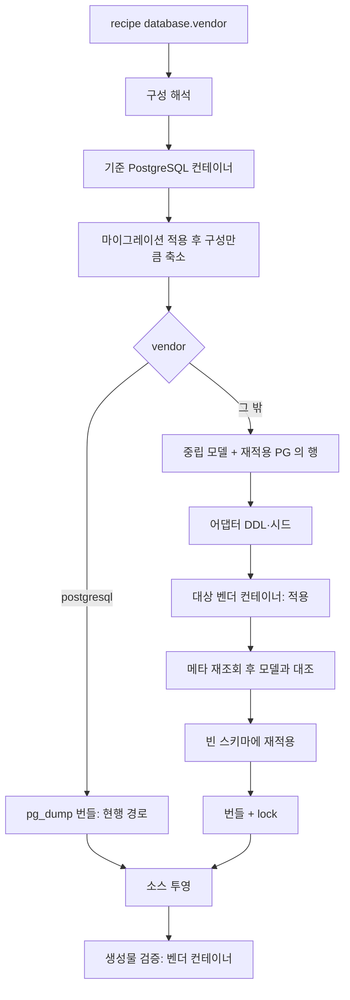

# 프로젝트 생성기 다중 DB 설계

- 상태: 승인([ADR-0047](decisions/ADR-0047-multi-database-composer-and-vendor-sql-boundary.md)). 단계 0~5 완료. Oracle(23·19c)·MariaDB(11.4)·MySQL(8.4)·SQL Server(2022)·CUBRID(11.4, 제한 지원)를 인증해 고를 수 있다. 다음은 Tibero 다(D-15, §16~§20)
- 기준 커밋: 첫 실측 `a3a3b182f`, 수정안 실측 `ce06495c7`(V2_146까지 포함).
- 실측: 2026-10-30~31, 이 기계의 일회용 컨테이너. 저장소 변경 없음.
- 관련: [생성기 설계](project-composer-design.md) §6·§8 E, ADR-0020, ADR-0008, DEC-OPS-239·262·263

## 결론

PostgreSQL을 유일한 스키마 원본으로 두고, 생성할 때마다 **기준 PostgreSQL에서 구성한 최종 스키마와 시드 행**을 벤더 중립 모델로 뽑아 벤더 어댑터가 DDL·시드·런타임 설정을 만든다. 그 결과를 해당 벤더의 일회용 DB에 적용해 재검증을 통과해야 생성이 끝나고, 적합성 시험을 통과한 벤더만 화면에서 고를 수 있다.

- 마이그레이션 146개는 이식하지 않는다. 생성물은 지금도 V2 체인이 아니라 `V1_0` 기준선에서 시작하므로([generate-reusable-base-db.mjs:294](../../scripts/generate-reusable-base-db.mjs)) 벤더마다 최종 상태 하나만 만들면 된다.
- 어려운 일은 DDL이 아니라 앱과 의미다. DDL과 시드는 시제품으로 5개 벤더에 거의 들어갔다(아래 실측). 그러나 DDL이 들어갔다고 저장 범위까지 같은 것은 아니다. 남은 일은 네이티브 SQL 105문장 중 PostgreSQL 전용 구문, 벤더마다 다른 의미(빈 문자열, 잠금, 트리거, 오류 코드), Oracle 저장 용량을 원본과 어댑터에서 먼저 정리하는 것이다.
- **스키마 적용 실패는 측정한 5개 벤더 모두 0으로 해결했다**(§2의 수정안 적용 결과). 최신 main의 전체 기능 구성을 적용하고 시드를 넣은 뒤, 실제 테이블에서 받아야 할 값과 거부해야 할 값을 벤더별 36~44개 시험으로 확인했다.
- 다만 적용 성공과 호환은 다르다. 문장은 성공했는데 PostgreSQL과 다른 값을 받는 번역이 실측에서 여럿 나왔고, 벤더 고유 한계는 없앨 수 없어 §6.1에 남긴다. 시제품 실측은 앱을 기동하지 않았다. 앱은 단계 2 에서 Oracle 23·19c 위에서 통합 시험과 대표 E2E 로 돌렸고 다른 벤더는 아직이다(§17).
- Oracle·MariaDB·MySQL·SQL Server는 이 길로 도달할 수 있다. CUBRID는 쓸 수는 있으나 저하가 가장 크고, Tibero는 라이선스 파일이 없어 지금은 아무것도 잴 수 없다.

## 결정 카드

| D-n | 결정 | 관련 H | 영향 계약 파일 | 부정 시험 |
|---|---|---|---|---|
| D-1 | 벤더 id 는 이관 도구와 같은 7종(`postgresql`·`oracle`·`tibero`·`mysql`·`mariadb`·`mssql`·`cubrid`)으로 고정한다. 인증된 벤더만 고를 수 있고, 나머지는 화면에 사유와 함께 비활성으로 보인다. | H2 | `config/db-vendors.json`(신설), `project-composer-recipe.mjs`, `project-composer-server.mjs`, `index.html` | 미인증 벤더 recipe 가 생성기 입구에서 `UNSUPPORTED_DATABASE`, 엔진·서버 응답에서 `INVALID_RECIPE` 로 거부된다 |
| D-2 | 스키마 정본은 PostgreSQL 마이그레이션 하나다. 벤더별 마이그레이션 체인·Liquibase·Hibernate DDL 생성을 두지 않는다. `postgresql` 출력 경로는 그대로 `pg_dump` 를 쓴다. | H1 | `generate-reusable-base-db.mjs`, `project-composer-db.mjs` | `postgresql` 의 번들 파일 해시·구성 해시가 변경 전후 같다 |
| D-3 | 중립 모델은 닫힌 문법이다. 모르는 타입·기본값·CHECK·인덱스·트리거가 나오면 건너뛰지 않고 `VENDOR_TRANSLATION_GAP` 으로 실패한다. 트리거는 호출 함수 본문까지 입력으로 읽고, 검토한 함수 해시와 의도를 묶는다. | H2·H3·H4 | `project-composer-vendor-ir.mjs`(신설), `project-composer-db.mjs` 의 `schemaSnapshotSql` | 새 CHECK 모양 픽스처, **트리거 선언은 두고 함수 본문만 바꾼 픽스처**(V2_143 과 같은 형태)가 빨갛다 |
| D-4 | 어댑터는 Node 내장 모듈만 쓰는 순수 함수 묶음이다. 생성은 기준 PostgreSQL + 대상 벤더 컨테이너 두 개로 돌고, 대상에 적용한 결과를 다시 읽어 모델과 대조한다. | H1 | `project-composer-vendor-*.mjs`(신설), `project-composer-postgres.mjs` | 벤더 DDL 에서 인덱스 하나를 빼면 대조가 빨갛다 |
| D-5 | 시드는 SQL 이 아니라 **재적용을 통과한 PostgreSQL 의 행**을 옮긴다. FK 위상 순서로 넣고, 적용 뒤 시퀀스·식별 컬럼의 다음 값을 최대값 뒤로 맞춘다. 초기 DB 시드와 권한 코드 재생성은 분리한다(§3). | H1·H3 | `generate-reusable-base-db.mjs`, `reusable-reference-data.mjs`, `project-composer-source.mjs:71`, `generate-permissions.mjs:64`, `reusable-governance-projection.mjs:128` | 벤더 DB 의 다음 값이 최대 ID 이하면 빨갛다. 벤더 프로젝트에서 권한 재생성이 기존 `V1_*` 체크섬을 바꾸면 빨갛다 |
| D-6 | 앱 SQL 은 원본에서 먼저 중립화한다. 이식 가능한 문장은 이식 가능한 형태로 고치고, 벤더마다 달라야 하는 일만 `VendorSqlDialect` 포트 뒤로 옮긴다. PostgreSQL 구현은 지금 SQL 그대로다. "이식 가능" 은 PostgreSQL CI 가 아니라 벤더 DB 실행으로 판정한다. 범위는 네이티브 SQL·JDBC·JPQL·QueryDSL 전부다. | H3·H4 | `foundation` 포트(신설), 아래 §4 표의 파일, `config/governance/vendor-sql-ledger.json`(신설) | 포트 밖에 `pg_advisory`·`pg_catalog`·`ON CONFLICT`·`CAST(... AS varchar`·SQL 문자열 연결 `||`·JPQL `''` 비교를 넣으면 신규 린터가 빨갛다 |
| D-7 | 의미는 벤더 기본값에 맡기지 않고 어댑터가 고정한다. **저장 범위를 먼저 보존한다**(DDL 을 Hibernate 기본값에 맞춰 줄이지 않고, 어긋나면 ORM 매핑을 고친다). 문자열 비교, 빈 문자열, 격리 수준, NULL 순서, 오류 분류를 §5 표대로 맞춘다. | H1·H3 | 어댑터, 엔티티 매핑, `GlobalExceptionHandler.java`, `OnlinePollService.java` | 벤더마다 §5 항목별 시험. 한글 4,000자·보충 문자·255바이트 초과 바이너리 저장·재조회 |
| D-8 | CHECK·FK·UNIQUE·보호 트리거는 조용히 떨어뜨리지 않는다. 번역은 문장 성공이 아니라 **PostgreSQL 차등 시험**으로 판정한다(같은 값을 넣어 받아들인 값이 같아야 한다). 감사 원장 허가는 PostgreSQL 밖에서 트랜잭션 범위 허가 표 하나로 통일한다. 대체가 없으면 벤더별 저하 목록에 올리고 승인·표시해야 인증된다. | H2·H3 | 어댑터의 `degradations`, `config/db-vendors.json` | 선언 없는 축소가 있으면 대조가 빨갛다 |
| D-9 | 인증은 벤더·버전 단위 원장이다. 상태는 `certified`·`preview`·`blocked` 이고 증거 실행 ID 와 **입력 해시**(중립 모델·어댑터·포트 구현·벤더 의존 SQL·엔티티 매핑·시험 코드와 원장)를 갖는다. 입력이 바뀌면 증거는 낡은 것이다. | H2 | `config/db-vendors.json`, `npm run regen`, 계약 시험 | 증거 없는 `certified`, 입력 해시가 다른 `certified` 가 빨갛다. 이미지 BLOB 매핑만 되돌린 변경도 빨갛다 |
| D-10 | 생성물 검증은 지금의 7단계를 유지하되 `schemaValidationTest` 를 그 벤더 컨테이너로 돌린다. 벤더에서 못 도는 시험은 원장에 사유와 대체 시험을 적는다. | H2·H5 | `verify-reusable-artifact.mjs`, `SharedPostgresMigrationTestSupport.java`, `config/governance/vendor-test-ledger.json`(신설) | 원장에 없는 시험이 빠지면 빨갛다 |
| D-11 | 생성물의 드라이버·방언·Flyway·설정·compose 는 벤더별로 투영한다. PostgreSQL 전용 자산(이관 도구 target, 백업·복원 도구, ZDM 린터 등)은 벤더 프로젝트에서 빼고 lock 에 기록한다. 번들 파일 집합 검사도 벤더별로 바꾼다. | H2 | `generate-reusable-base-source.mjs`, `project-composer-source.mjs:71`, `reusable-single-module.mjs`, `build.gradle` | 승인 목록과 다른 제거, 벤더 집합과 다른 번들 파일이 있으면 빨갛다 |
| D-12 | recipe 는 `schemaVersion: 1` 그대로 `database.vendor` 값만 늘린다. lock 에 벤더(`composition.recipe.database.vendor`·`vendorProjection.vendor`), 번역 입력 해시(`vendorInputSha256`·`vendorProjection.inputSha256`), 벤더 기준선 해시(`vendorProjection.migrationSha256`)를 남긴다. 어댑터 판은 `sourceCommit` 이 가리키고 엔진 버전은 남기지 않는다(§9). | H2 | `project-composer-recipe.mjs`, `project-composer-db.mjs:25`, `verify-reusable-artifact.mjs` | 벤더가 다른 DB 번들을 소스 생성기가 거부한다 |
| D-13 | 생성기 화면은 벤더 선택·저하 표시·이미지·메모리 사전 점검·두 컨테이너 정리를 지원한다. | - | `tools/project-composer/public/*`, `project-composer-preflight.mjs`, `project-composer-recovery.mjs` | 벤더 컨테이너가 남으면 기동 시 정리 시험이 빨갛다 |
| D-14 | CI 는 재사용 생성 잡(`reusable-base`·`reusable-custom`)이 도는 변경마다 모든 벤더의 **순수 번역**을 돌리고(생성마다 번역한다. 문서만 고친 PR 처럼 그 잡을 고르지 않는 변경에서는 돌지 않는다), 인증 벤더의 입력이 바뀐 PR 은 기존 required context 안에서 그 벤더의 동작·동시성 시험까지 돌린다. 비필수 검증만 받는 벤더는 `preview` 를 벗어나지 못한다. required context 수는 늘리지 않는다. | H2·H5 | `ci-change-scope.mjs`, `ci.yml`, `reusable-nightly.yml` | 번역 불가 CHECK 를 넣은 PR 이 빨갛다. 인증 벤더 upsert 를 덮어쓰기로 바꾼 PR 이 빨갛다 |
| D-15 | 순서는 공통 기반 → Oracle → MariaDB·MySQL → SQL Server → CUBRID → Tibero 다. | - | 설계서·ADR | 해당 없음 |

## 1. 지금 PostgreSQL 이 묶여 있는 곳

현재 차단 지점은 네 곳뿐이다: [recipe.mjs:46](../../scripts/project-composer-recipe.mjs), [recipe.mjs:128](../../scripts/project-composer-recipe.mjs), [db.mjs:25](../../scripts/project-composer-db.mjs), [server.mjs:64](../../scripts/project-composer-server.mjs). 여기를 풀어도 나머지가 PostgreSQL 전제다.

| 층 | 실측 | 근거 |
|---|---|---|
| 생성 파이프라인 | `pg_dump` 기준선, psql, 컨테이너 수명, 메타 조회 | `generate-reusable-base-db.mjs`, `reusable-db-postgres.mjs`, `project-composer-postgres.mjs:9` |
| 최종 스키마(전체 기능, `ce06495c7`) | 테이블 98, 컬럼 1,107, CHECK 134, FK 86, UNIQUE 24, 인덱스 208, 트리거 7(보호 5 + V2_145 동기화 2), 시퀀스 62(식별 52 + 독립 10), 시드 18,143행 | `schema-contract.json` 집계 |
| 컬럼 타입 | varchar 694(전부 4000 이하), timestamp 205, bigint 138, integer 41, numeric 17, `text` 4, `jsonb` 2, `date` 2, `uuid` 1, `bytea` 1 | 같음 |
| 앱 SQL | 네이티브 `@Query` 28 + `createNativeQuery` 6 + JDBC 호출 71 | `foundation`·`business-*`·`api-server` main |
| 생성물 | 4,301개 파일 중 454개가 PostgreSQL 언급(이관 도구 147, 문서 80, api-server 72, scripts 68 등) | 실제 생성한 `demo` 투영 |
| 통합 시험 | 생성물의 `schema-validation` 시험 52개 중 40개가 시험 코드에 PostgreSQL 전용 SQL 을 담고, 16개가 V2 번호를 참조한다 | `api-server/src/test/java/nuri/api/schema` |

유리한 점도 분명하다. `text`·`jsonb`·`uuid`·`bytea` 합쳐 8개뿐이고, 테이블·컬럼 이름은 최대 27자라 30자 제한에도 걸리지 않는다. 뷰·사용자 정의 타입·파티션·행 수준 보안이 없다. 다만 varchar 가 4000 이하여도 Oracle 저장 용량은 같지 않다. 기본 설정(`MAX_STRING_SIZE=STANDARD`)에서 `VARCHAR2(4000 CHAR)` 는 4,000바이트까지만 저장하므로 한글은 약 1,333자에서 잘린다. 길이가 2,000 이상인 컬럼이 50개 테이블에 66개 있고 게시글 본문(`tb_bbs_item.pst_cn`)도 그중 하나다.

## 2. 실측 결과

시제품은 저장소 밖의 일회용 코드다. `schema-contract.json` 과 재적용 DB 의 행만 입력으로 썼다. 벤더 컨테이너 하나씩 적용했고 대상은 전체 기능(`demo`, 22개) 구성이다.

### 수정안 적용 결과

최신 main(`ce06495c7`)을 실제 생성기로 다시 만들어 적용했다. 시험은 입력 허용·거부, 두 세션 허가 경합, 메뉴·작업·토큰·스크랩·로그 동기화·감사 원장을 실제 테이블로 본다.

| 벤더 | 스키마 문장 | 실패 | 시드 18,143행 | 동작 시험 | 비고 |
|---|---:|---:|---|---:|---|
| Oracle 19.3 EE | 445 | 0 | 오류 0 | 38/38 | 커뮤니티 이미지 |
| Oracle 23.26 Free | 445 | 0 | 오류 0 | 38/38 | CLOB 전환 포함, 트리거 컴파일 오류 0 |
| SQL Server 2022 | 446 | 0 | 오류 0 | 38/38 | 경고 1(토큰 키 1700바이트, 값은 64자) |
| MariaDB 11.4 | 454 | 0 | 오류 0 | 36/36 | 트리거 16개 |
| MySQL 8.4 | 464 | 0 | 오류 0 | 36/36 | 토큰 `=` 조회 인덱스 사용 확인 |
| CUBRID 11.4(ko_KR.utf8) | 612 | 0 | 오류 0 | 44/44 | FK 86개 전부 엔진 집행, 트리거 300개, CHECK 134개 전부 실제 평가. 동작 시험 뒤 키 전용 표로 바꿔 FK 시험을 따로 다시 돌렸다 |
| Tibero 7.2.6 | - | - | - | - | `license.xml` 부재로 미측정 |

CHECK 번역은 PostgreSQL 차등 시험으로 따로 판정했다. 규칙 8종, 값 104개를 같은 순서로 넣어 받아들인 값을 비교했다.

| 벤더 | 시제품 번역 불일치 | 수정안 불일치 | 수정안 |
|---|---:|---:|---|
| MySQL, MariaDB | 6 | 0 | `$` 는 끝 줄바꿈 앞에도 맞아 `20261030\n` 이 통과했다. `(?s)^...(?!.)` 로 끝을 표현한다. 백슬래시가 없어 `NO_BACKSLASH_ESCAPES` 에도 흔들리지 않는다(`\z` 는 이 모드에서 정상값까지 거부했다) |
| Oracle | 13 | 5 | `\z`, `c` 플래그, `COALESCE` 제거 시 `IS NOT NULL` 명시. 남은 5는 `''`=NULL 고유 동작 4와 실제로는 NOT NULL 인 컬럼의 표본 1 |
| SQL Server | 번역 없음(생략) | 0 | `LIKE` + `DATALENGTH`, 글자 수는 `_SC` 콜레이션 |
| CUBRID | 2 | 0 | `REGEXP BINARY`, NULL 가드가 붙은 위반 조건. 생성에 쓰는 번역기를 그대로 통과시킨 결과다 |

첫 실측의 CUBRID 는 이미지 기본 로케일이 `iso88591` 이어서(한글 3글자를 9글자로 센다) 문자열 결과를 믿을 수 없었다. 위 표는 `ko_KR.utf8` 로 다시 쟀다. 아래 첫 실측 표는 수정 전 실패가 무엇이었는지 보이는 기록이다.

### 첫 실측(수정 전)

| 벤더(이미지 기준) | 스키마 문장 | 실패 | 원인 | 의도적 생략 | 시드 18,140행 | 엔티티 컬럼 대조 |
|---|---|---:|---|---:|---|---|
| Oracle 23.26 Free | 436 | 0 | - | 3 | 오류 0 | 1,058/1,063 |
| Oracle 19.3 EE(커뮤니티 이미지) | 436 | 1 | boolean 등식 CHECK | 3 | 오류 0 | 미측정 |
| SQL Server 2022 | 428 | 1 | boolean 등식 CHECK | 11 | 오류 0 | 1,060/1,063 |
| MariaDB 11.4 | 436 | 2 | 자동 증가 참조 CHECK, 긴 키 | 4 | 오류 0 | 1,061/1,063 |
| MySQL 8.4 | 446 | 5 | 긴 키 4, 자동 증가 참조 CHECK | 4 | 오류 0 | 1,067/1,070 |
| CUBRID 11.4 | 436 | 6 | FK 가 PK 아닌 UNIQUE 참조 6 | 3 | 오류 0(행 수 미대조) | 미측정 |
| Tibero 7.2.6 | 미측정 | - | `license.xml` 부재로 기동 불가 | - | - | - |

의도적 생략은 부분·표현식·GIN 인덱스, DEFERRABLE, SQL Server 의 정규식 CHECK 8개다. 시제품은 이름 단축, COMMENT, 시퀀스 다음 값 맞춤을 다루지 않았다.

엔티티 대조는 Hibernate 7.4 메타모델을 각 벤더 DB 메타데이터와 전 컬럼 비교했다. 어긋난 컬럼은 다음이 전부다.

- `tb_cms_conts.conts_doc_cn`, `tb_cms_conts_rvsn.conts_doc_cn`: Oracle 시제품이 CLOB 로 만들었으나 Hibernate 는 JSON 을 기대한다.
- `tb_inst_cd.inst_cycl`, `tb_inst_cd_rcptn_log.inst_cycl`: 4개 벤더 공통. 엔티티가 `columnDefinition = "numeric(2)"` 인 Integer 다.
- `tb_srvy_tmplt.srvy_tmplt_img_info`: Oracle 에서 Hibernate 는 RAW(255), DB 는 BLOB.
- `tb_file_detail.file_detail_id`: MySQL 에서 Hibernate 는 BINARY(16), 시제품은 CHAR(36).
- `tb_auth_rfsh_tk.exprtn_dt`: SQL Server 에서 `Instant` 는 datetimeoffset.

이 대조는 타입 호환만 본다. 저장 용량, 앱 기동, 네이티브 SQL 실행, 동시성은 재지 않았다. DDL 실패 0 은 "문장이 받아들여졌다" 는 뜻이지 "PostgreSQL 과 같은 값을 저장한다" 는 뜻이 아니다.

### 의미 프로브

| 항목 | PostgreSQL | Oracle | MySQL | MariaDB | SQL Server | CUBRID |
|---|---|---|---|---|---|---|
| UNIQUE 대소문자 구분 | 구분 | 구분 | 구분(`0900_bin`) | 구분(`nopad_bin`) | 구분(`BIN2`) | 구분 |
| UNIQUE 뒤 공백 구분 | 구분 | 구분 | 구분 | 구분 | **같은 값 취급** | 구분 |
| NOT NULL 에 `''` | 허용 | **거부** | 허용 | 허용 | 허용 | 허용 |
| `'' = ''` | 참 | **참 아님** | 참 | 참 | 참 | 참 |
| 단일 UNIQUE 에 NULL 두 행 | 허용 | 허용 | 허용 | 허용 | **거부** | 허용 |
| 복합 UNIQUE 에 일부 NULL 중복 | 허용 | **거부** | 허용 | 허용 | **거부** | **거부** |
| CHECK 집행 | 집행 | 집행 | 집행 | 집행 | 집행 | **무시** |
| ASC 정렬의 NULL | 뒤 | 뒤 | **앞** | **앞** | **앞** | **앞** |
| 시각 정밀도 | 마이크로초 | 마이크로초 | 마이크로초 | 마이크로초 | 마이크로초 | **밀리초** |
| `LIMIT n OFFSET m` | 됨 | **안 됨** | 됨 | 됨 | **안 됨** | 됨 |
| `SELECT EXISTS(...)` | 됨 | 23 계열만 됨, **19c 안 됨** | 됨 | 됨 | **안 됨** | **안 됨** |
| `x::text` | 됨 | **안 됨** | **안 됨** | **안 됨** | **안 됨** | **안 됨** |
| 건너뛰는 잠금 | `SKIP LOCKED` | `SKIP LOCKED` | `SKIP LOCKED` | `SKIP LOCKED` | `READPAST` 힌트 | **없음** |
| upsert | `ON CONFLICT` | `MERGE` | `ON DUPLICATE KEY` | `ON DUPLICATE KEY` | `MERGE` | `MERGE` |

CUBRID 의 CHECK 무시는 [공식 문서](https://www.cubrid.org/manual/en/11.4/sql/schema/table_stmt.html)와 일치한다("parsed, but ignored"). Oracle 은 같은 문장이 23 계열에서 통과하고 19c 에서 `ORA-00936` 으로 실패했다. boolean 등식 CHECK 도 19c 에서만 실패했다. 23 계열 Free 만으로 인증하면 거짓 안전이 된다는 뜻이다.

### 감사 원장 보호

현재 보호 트리거 5개는 UPDATE 를 막고, 같은 트랜잭션에서 `set_config(..., true)` 로 허가한 DELETE 만 통과시킨다([AuditLedgerRetention.java:27](../../business-core/src/main/java/nuri/business/domain/log/AuditLedgerRetention.java), [CmsContentRevisionRepository.java:51](../../business-app/src/main/java/nuri/business/domain/cms/CmsContentRevisionRepository.java)).

PostgreSQL 밖에서는 **허가 표** 하나로 통일한다. 트랜잭션 안에서 허가 행을 넣고, 삭제한 뒤, 허가 행을 지우고 커밋한다. 커밋 전 행은 다른 세션에 보이지 않으므로 트랜잭션 범위가 되고, 롤백하면 허가도 사라진다. 측정한 5개 벤더 모두 같은 결과였다: 무허가 삭제·수정 거부, 다른 세션의 동시 삭제 거부, 허가 세션 삭제 통과, 커밋 뒤 다시 거부, 롤백 뒤 허가 없음. 첫 실측의 벤더별 방식(패키지 변수, 세션 컨텍스트, 세션 변수)은 버린다. MariaDB 세션 변수의 잔류 문제와 CUBRID 의 미해결이 함께 사라진다.

SQL Server 는 트리거의 허가 조회에 `WITH (READCOMMITTED)` 를 붙인다. 없으면 `READ UNCOMMITTED` 세션이 남의 미커밋 허가를 읽어 삭제에 성공했다(재현). 힌트를 붙이면 거부된다. MySQL·MariaDB 는 같은 조건에서 거부됐고, Oracle 과 CUBRID 는 미커밋 행을 읽는 격리 수준이 없다.

약점은 하나다. 허가 행을 지우지 않고 커밋하면 열린 채 남는다. 포트가 `withLedgerPermit(작업)` 하나만 공개해 같은 트랜잭션에서 지우고 지운 행 수를 확인하며, 기동 시 허가 표가 비어 있지 않으면 실패한다. MySQL 은 바이너리 로그가 켜진 기본 설정에서 앱 계정의 `CREATE TRIGGER` 가 ERROR 1419 로 거부되므로 `log_bin_trust_function_creators` 설정이나 권한 있는 계정의 기준선 적용이 필요하다.

## 3. 생성 경로



**중립 모델(D-3)** 입력은 이미 있는 `schemaSnapshotSql()` 결과에 COMMENT 를 더한 것이다. 타입은 논리 타입으로 옮기고, CHECK 는 작은 파서로 식 트리로 만든다. 현재 CHECK 134개는 약 30개 모양이다(`IN` 목록, 범위, 정규식, `char_length`, `btrim`, `jsonb_typeof`, 구간 비교, 조건식). 트리거는 SQL 본문을 옮기지 않고 `appendOnlyLedger(table, permitKey)` 같은 의도로 표현한다. 지금의 `schemaSnapshotSql()` 은 트리거 선언만 읽고 함수 본문을 읽지 않는데([project-composer-db.mjs:65](../../scripts/project-composer-db.mjs)), V2_143 은 선언을 두고 함수 본문만 바꿔 삭제 허가를 추가했다. 그래서 `pg_get_functiondef` 를 입력에 더하고, 의도 등록표가 검토한 함수 해시를 갖는다. 본문이 바뀌면 의도를 다시 검토할 때까지 번역을 멈춘다. 기본값도 의도로 표현한다(`nextval`, 현재 시각, `to_char(now() AT TIME ZONE 'Asia/Seoul')`).

**어댑터 계약(D-4)**

```js
{ id, label, engine: { image, ready, exec, introspectSql },
  emitSchema(model), emitSeed(model, rows), emitSequenceSync(model, rows),
  normalizeIntrospection(rows), runtime(): { driver, dialect, flywayModule, jdbcUrl, compose, settings },
  degradations }
```

**이름**: 제약·인덱스·트리거·시퀀스 이름 141개가 30자를 넘지만 Oracle 12.2 이상·MySQL·SQL Server·CUBRID 는 모두 받는다. Tibero 한도를 확인한 뒤 필요하면 어댑터가 해시 접미사로 줄이고 대응표를 lock 에 남긴다.

**시드(D-5)**: 재적용을 통과한 PostgreSQL 의 행을 읽어 벤더 INSERT 로 쓴다. `R__zz_seed_base_admin.sql` 의 `DO $$` 는 옮기지 않고 그 결과만 옮기므로 부트스트랩 분기를 벤더마다 다시 쓸 필요가 없다. 벤더 프로젝트의 시드는 `V1_1`~`V1_3` 일회 마이그레이션이 된다. 원본과 행이 같은지 대조한다(Oracle·Tibero 는 `''` 를 NULL 로 정규화해 비교).

**시드와 권한 재생성의 분리**: 지금은 번들 파일 다섯 개 이름이 고정이고([project-composer-source.mjs:71](../../scripts/project-composer-source.mjs)), 소스 투영의 `generatePermissions()` 가 `R__zz_seed_base_admin.sql` 의 생성 마커를 필수로 읽어 다시 쓴다([generate-permissions.mjs:64](../../scripts/generate-permissions.mjs), [reusable-governance-projection.mjs:128](../../scripts/reusable-governance-projection.mjs)). 출력만 `V1_*` 로 바꾸면 이미 적용된 마이그레이션이 재생성으로 수정된다. 그래서 다음을 계약으로 둔다.

- 벤더 프로젝트도 PostgreSQL 번들을 번역 근거로 그대로 둔다. `generatePermissions()` 는 그 번들의 시드를 다시 쓰지만 Flyway 는 그 폴더를 실행하지 않아 벤더 기준선과 체크섬을 건드리지 않는다. 시드 앵커를 읽는 하네스(`SecurityAuthAnnotationLinterTest`)가 있어 쓰기를 멈추지 않는다.
- 번들 파일 집합은 어댑터가 선언하고 `verifyCompositionDatabaseFiles` 가 벤더별로 대조한다.
- 생성 뒤 기본 그룹을 바꾸는 절차는 카탈로그와 벤더 문법의 새 마이그레이션을 함께 고치는 것이다. 재생성만으로는 벤더 DB 에 반영되지 않으므로 벤더 카탈로그 시험이 `defaultGroups` 와 실제 부여를 양방향으로 대조한다. 새 권한 코드는 구성과의 정확 일치 때문에 재생성이 멈춘다(GAP-COMPOSE-002).
- `R__zz_seed_base_admin.sql` 을 읽는 소비자는 생성물 기준으로 스크립트 6개(`generate-permissions`, `generate-reusable-base-db`, `export-deliverables-db`, `merge-main-regenerate`, `project-composer-menu-preview`, `project-composer-source`)와 그 시험, 하네스 2개(`SecurityAuthAnnotationLinterTest`, `BaseAdminBootstrapSeedIntegrationTest`)다. 단계 1 에서 벤더별 처리를 정한다.

## 4. 앱 SQL 중립화(D-6)

벤더 코드는 원본에 둔다. 템플릿으로 빼면 컴파일되지 않아 낡는다. `foundation` 의 `VendorSqlDialect` 포트에 벤더별 구현을 두고, 소스 생성기가 고른 벤더 구현만 남긴다. 어떤 구현을 쓸지는 `app.database.vendor` 로 정하고, 기동할 때 JDBC 제품명과 맞지 않으면 실패한다. H2 단위 시험도 PostgreSQL 구현을 쓴다(ADR-0047 결정 4).

| 처리 | 위치 | 방법 |
|---|---|---|
| Java 로 옮김 | `AuthorizationAdministrationService.java:204,289,346` `menu_sn::text` | 숫자로 읽어 Java 에서 문자열로 바꾼다. `CAST(... AS varchar)` 는 대안이 아니다(MySQL·MariaDB 미지원) |
| 포트 | `NavigationGrantRepository.java:31,45` `CAST(menu_sn AS varchar(20))` 조인, `BoardRepository.java:58,75,162`, `DtaUseStatsRepository.java:24` `CAST(... AS TIMESTAMP)`·`AS VARCHAR(8)` | 벤더별 문자열 변환식. 매개변수는 타입 있는 값으로 바인딩해 CAST 를 없앤다 |
| 이식 형태로 고침 | `JdbcAttachmentReferenceResolver.java:298`, `LoginIdReuseGuard.java:74` `SELECT EXISTS` | `CASE WHEN EXISTS` 또는 건수 조회 |
| 이식 형태로 고침 | `LoginLogRepository.java:20`, `BoardRepository.java:55`, `DtaUseStatsRepository.java:22` `TO_CHAR` 집계 | 기간별 행을 Java 에서 묶거나 포트 |
| 이식 형태로 고침 | 로그 저장소 4개, `E2EDataCleansingConfig` 의 대문자 `TB_` | 소문자. Linux MySQL 은 테이블 이름이 대소문자를 구분한다 |
| 이식 형태로 고침 | JPQL·QueryDSL 의 빈 문자열 비교 14곳: `SurveyResultRepository.java:30`, `ScheduleRepository.java:15,23,33,39,43`, `DeptJobBoxRepository.java:24`, `CmsContentRepository.java:53`, `CmsContentRevisionRepository.java:40,45`, `BoardPredicate.java` 외 | 검색어는 Java 에서 빈 문자열을 null 로 바꿔 `IS NULL` 로 비교. 값 비교는 명시적 NULL 안전 비교로 바꾼다. `COALESCE(r.contsExpln, '') <> COALESCE(c.contsExpln, '')` 는 Oracle 에서 UNKNOWN 이 되어 요약만 바뀐 페이지가 게시 대기 목록에서 빠진다 |
| 이식 형태로 고침 | `OnlinePollService.java:422` 제약 이름 문자열 검색 | 대소문자 무시 + `ConstraintViolationException` 이름. Oracle 은 이름을 대문자로 돌려준다 |
| **이식 형태로 고침(필수)** | `AttachmentSource.java:59`, `AttachmentReferenceIntegrityService.java:39` `file_url = '/api/v1/files/' \|\| ?` | 단일 첨부 판정은 Java 에서 값을 완성해 `file_url = ?` 로 바인딩한다. 행마다 값이 다른 무결성 집계는 포트의 문자열 연결식을 쓴다. MySQL·MariaDB 기본 설정에서 `\|\|` 는 논리 OR 이라 실측에서 1행이 아니라 **3행 전부**와 일치했다. 공유 첨부 접근 판정이 조용히 뚫린다(H3). `PIPES_AS_CONCAT` 은 보조 수단으로만 둔다 |
| 포트 | `CmsPageAdminService.java:378`, 저장소의 `ESCAPE '\'` | LIKE 리터럴 처리. MySQL·MariaDB 기본 설정에서 `ESCAPE '\'` 는 문법 오류다(실측), `ESCAPE '\|'` 는 동작한다. SQL Server 는 `[` 도 패턴이라 이스케이프 대상에 넣는다. `[ab]` 검색어를 차등 시험에 넣는다 |
| 이식 형태로 고침 | `LoginLogRepository.java:20,26` `\|\|` 와 `to_char` | 기간별 집계와 함께 Java 로 |
| 포트 | `UserLogRepository.java:48` upsert | 벤더별 upsert |
| Hibernate | `DurableJobRepository.java:24` `SKIP LOCKED` | `@Lock` 과 `lock.timeout` 힌트. Hibernate 가 벤더 문법을 만든다. CUBRID 는 상태 CAS |
| 포트 | `DurableWorkService.java:46`, `AdministCodeRepositoryCustomImpl.java:28` advisory 잠금 | SQL Server `sp_getapplock`, 그 밖은 슬롯 잠금 테이블. Oracle 도 슬롯이다. `DBMS_LOCK` 은 앱 계정에 별도 실행 권한이 필요하다. 슬롯이 겹치면 무관한 키가 서로 기다리고, 한 트랜잭션이 키를 여럿 잠그면 교차 순서로 교착할 수 있어 슬롯을 65,536개로 둔다. 남는 충돌은 되돌림과 409 로 끝난다 |
| 포트 | `AuditLedgerRetention.java:27`, `CmsContentRevisionRepository.java:51` 허가 | 벤더별 트랜잭션 범위 허가. Oracle 은 허가 표의 미커밋 행이고 커밋 직전 동기화로 회수한다(지우지 못하면 커밋을 멈춘다). 행마다 토큰이 키에 있어 중단된 바깥 트랜잭션의 행을 기다리지 않는다. 호출부는 그대로다 |
| 포트 | `MenuRepository.java:19,52`, `DeptManageRepository.java:26`, `AuthorizationAdministrationService.java:346` `FOR NO KEY UPDATE`, `SmsAsyncProcessor.java:265` `SET LOCAL lock_timeout` | 벤더별 잠금 문장·대기 상한 |
| 포트 | `NavigationGrantRepository.java:71`, `AuthorizationAdministrationService.java:125,213,626`, `AttachmentReferenceIntegrityService.java:46` `LIMIT` | 벤더별 페이징 문장 |
| 포트 | `NavigationGrantRepository.java:69,81` `POSITION(:keyword IN ...)` 와 `:keyword=''` | 벤더별 부분 일치식(Oracle `INSTR`, SQL Server `CHARINDEX`). 빈 검색어는 Java 에서 null 로 정규화 |
| 포트 | `AuthorizationSchemaBarrierConfig.java:40` `information_schema` + `table_schema='public'` | 벤더별 메타 조회. MySQL·SQL Server 에서는 그대로 두면 0건으로 **조용히 통과**한다 |
| 포트 또는 제거 | `LogDurationReadinessConfig.java` `pg_catalog` 기동 검사(#1012) | 이행 전용 검사다. 벤더 프로젝트는 옛 데이터가 없으므로 뺀다. 남겨 두면 기동이 실패한다 |
| 분류 표 | `GlobalExceptionHandler.java:213,248` SQLState | 벤더별 오류 코드 표 |
| PG 전용 유지 | `IsolatedAuthorizationRehearsalConfig` | 벤더 프로젝트에서 제거 |

기존 게이트에 네이티브 SQL 을 보는 것이 없어(`gates.json` 에 관련 항목 없음) 신규 린터 하나를 둔다. `nativeQuery`·`JdbcTemplate`·JPQL 문자열·QueryDSL 템플릿에서 금지 구문을 찾고 포트 구현 패키지만 허용한다.

린터는 구문만 막는다. 이식 판정은 따로 한다. 위 표의 모든 위치를 `vendor-sql-ledger.json` 에 처리 방식·대응 시험과 함께 적고, "이식 형태로 고침" 으로 분류한 문장은 Oracle·MySQL·SQL Server 일회용 DB 에서 실제로 실행해 확인한다. 위 표의 `CAST(... AS varchar)` 처럼 PostgreSQL 에서 통과하고 선례가 있어도 다른 벤더에서 실패하는 문장이 있기 때문이다.

## 5. 의미 보존 규칙(D-7)

| 주제 | 규칙 | 시험 |
|---|---|---|
| 저장 범위 | 논리 모델에 글자 수와 바이트 용량을 나눠 적는다. 어댑터는 `n × 4` 바이트를 담는 물리 타입을 고른다. Oracle 은 기본 설정에서 n 이 1,000 을 넘는 컬럼 가운데 키가 아닌 것을 CLOB 로 두고 엔티티 매핑을 맞춘다(§14 결정). 기본 `VARCHAR2(4000 CHAR)` 는 4,000바이트를 넘는 값을 **거부**한다(한글 3,900자 입력 실측, 잘라서 저장하지 않는다). SQL Server 는 키가 아닌 컬럼을 `NVARCHAR(2n)`, n 이 2,000 을 넘으면 `NVARCHAR(MAX)` 로 둔다(이모지는 UTF-16 2칸이다). 키에 든 컬럼은 §6 을 따른다. `bytea` 는 BLOB 를 유지하고 RAW(255) 로 줄이지 않는다 | 한글 3,900자, 이모지 100자, 255바이트 초과 이미지 저장·재조회 |
| 문자열 비교 | MySQL `utf8mb4_0900_bin`, MariaDB `utf8mb4_nopad_bin`, SQL Server 는 컬럼에 `Korean_100_BIN2`(DB 기본은 CI 유지, 메타 식별자가 대소문자를 타지 않게), CUBRID 는 `utf8_bin` | 로그인 ID 대소문자 UNIQUE |
| 뒤 공백 | SQL Server 만 차이가 남는다. 저하 목록에 올린다 | 프로브 고정 |
| 공유 행 잠금 | Oracle 에는 `FOR SHARE` 가 없어 Hibernate 가 공유 잠금을 `FOR UPDATE` 로 만든다. SQL Server 의 공유 잠금(S)은 쓰기 잠금(U)과 충돌하지 않아 투표와 설문 편집이 줄을 서지 않으므로 읽기 잠금도 갱신 잠금으로 둔다(`NuriSqlServerDialect`). 두 벤더 모두 같은 설문의 투표가 차례로 처리된다. 결과는 같고 동시 처리량만 다르다 | 동시성 시험 |
| 빈 문자열 | Oracle·Tibero 는 `''` 가 NULL 이다. CHECK 의 `x <> ''` 는 NOT NULL 컬럼에서만 `x IS NOT NULL` 로 번역한다(현재 4개 모두 NOT NULL). NULL 허용 컬럼이면 정상 NULL 까지 거부하므로 그 항은 뺀다. `COALESCE(x, '') ~ p` 는 `x IS NOT NULL AND ...` 로 번역한다. 그냥 지우면 NULL 이 통과한다. 시드는 NULL 로 넣는다. NOT NULL 문자열 컬럼에 `""` 가 오면 400 으로 드러난다 | 통합 시험 |
| 격리 수준 | MySQL·MariaDB 는 `READ COMMITTED` 를 코드(`VendorSqlConfig`)가 연결 풀에 강제한다. 설정 파일에 두면 시험 문맥과 생성물 설정이 따로 놓쳐 서버 기본(`REPEATABLE READ`)이 된다. SQL Server 는 `READ_COMMITTED_SNAPSHOT`·`ALLOW_SNAPSHOT_ISOLATION` 을 기동 때 확인하고, 잠금 격리인 `REPEATABLE READ` 를 연결에서 스냅숏 격리로 바꾼다(쓰기 충돌 3960). Oracle 은 `REPEATABLE READ` 를 거부하므로 연결에서 `SERIALIZABLE` 로 바꾼다. 둘 다 스냅숏 격리이고 쓰기 충돌은 재시도 오류로 끝난다(40001, ORA-08177) | 동시성 시험 |
| NULL 순서 | 맞추지 않는다. PostgreSQL·Oracle 은 NULL 을 가장 큰 값으로, MySQL·MariaDB·SQL Server 는 가장 작은 값으로 정렬한다. 처음 적은 `hibernate.order_by.default_null_ordering=last` 는 오름차순만 맞추고 내림차순을 PostgreSQL 과 반대로 만들어 넣지 않았다(2026-11-04 단계 3 결정). §6.1 의 한계로 두고, 생성기 화면과 생성물 README 가 저하 안내(`null-order`)로 알린다 | - |
| 오류 분류 | 409·400 분기가 SQLState 에 묶여 있다. SQLState 로 갈리지 않는 벤더는 오류 번호 표(`VendorSqlDialect.errorCodes()`)로 같은 응답을 낸다. 번호 표는 그 벤더에서만 쓴다 — Oracle 번호(1400·1722 등)가 MySQL·MariaDB 의 다른 오류 번호와 겹친다(단계 3 실측). 드라이버가 SQLState 를 바꿔 올리는 서버 오류(MySQL 의 0 나누기 1365 → 22001)는 번호로 먼저 500 으로 가른다. SQL Server 는 CHECK 와 FK 위반이 같은 547 이라 메시지에서 제약 이름 바로 앞의 종류 자리(`CHECK constraint "`·`CHECK 제약 조건 "`)로 가른다 — 서버 메시지 언어가 한국어여도 그 낱말은 영어이고, 자리를 보지 않으면 DB·표 이름에 든 같은 낱말에 걸린다(단계 4 실측·독립 검토) | 벤더별 위반 시험 |
| JSON | Oracle 은 19c 기준 CLOB + `IS JSON` 과 Hibernate 매핑을 맞춘다. 23 계열 기능에 기대지 않는다 | 스키마 검증 |
| UUID·시각 | 저장 범위가 같으면 DDL 을 Hibernate 벤더 기본 매핑에 맞추고, 다르면 ORM 매핑을 바꾼다. 시각은 시간대 없는 컬럼에 한국 벽시계 값으로 저장하고 엔티티는 `LocalDateTime` 이다(DEC-OPS-396). `Instant` 를 매핑하면 Oracle 드라이버가 읽기를 거부한다(ORA-18716) | 스키마 검증, 재로그인 |
| CLOB 비교 | Oracle 의 CLOB 은 `<>` 로 비교할 수 없고(ORA-22848) `COALESCE(clob, '')` 도 형이 맞지 않는다(ORA-00932). JPQL 은 `function('text_differs', a, b)` 를 쓰고 `COALESCE` 를 뺀다. 네이티브 조회의 CLOB 은 방언이 문자열로 읽는다 | 콘텐츠 페이지 목록·검색 |

## 6. 스키마 호환 처리(D-8)

아래는 모두 실측으로 적용·동작을 확인했다.

| 대상 | 벤더 | 처리 |
|---|---|---|
| `ck_tb_sys_job_job_no` boolean 등식 | Oracle 19c, SQL Server, CUBRID | `(A AND B) OR (NOT A AND NOT B)` 로 전개. 앞 컬럼이 NOT NULL 이라 의미가 같다 |
| `ck_menu_info_no_self_parent` | MySQL, MariaDB | 자동 증가 컬럼을 CHECK 가 못 본다. AFTER INSERT + BEFORE UPDATE 트리거로 대체. AFTER 라서 다음 자동 번호를 미리 부모로 준 입력도 거부한다 |
| `uk_tb_auth_rfsh_tk_rfsh_tkn`(4000) | MySQL | 저장값이 SHA-256 16진수 64자이므로 접두 UNIQUE `rfsh_tkn(768)`. `=` 조회가 같은 인덱스를 쓴다(EXPLAIN 확인). 해시 컬럼으로 두면 `rfsh_tkn = ?` 조회가 그 인덱스를 타지 못한다. 768자를 넘는 값을 저장하게 되면 재검토한다 |
| 같은 컬럼 | MariaDB | 긴 UNIQUE 를 엔진이 내부 해시로 처리해 그대로 둔다. 중복 거부 확인 |
| 같은 컬럼 | SQL Server | 그대로 두되 1,700바이트(850자) 초과는 거부된다. 저장값이 64자라 닿지 않는다. 시험으로 고정 |
| 같은 컬럼 | Oracle | LOB 에는 UNIQUE 를 걸 수 없어 CLOB 전환에서 빼고 `VARCHAR2(4000 BYTE)` |
| `uk_tb_bbs_scrap_...`(1000) | MySQL, SQL Server | 해시 생성 컬럼에 UNIQUE. 엔티티는 바꾸지 않는다. 끝 글자만 다른 1,000자 주소를 구분함을 확인 |
| `ix_tb_popup_info_file_url` | MySQL, MariaDB | 접두 768자 |
| 같은 인덱스 | SQL Server | 뺀다. 그대로 두면 850자 넘는 주소의 INSERT 가 실패한다. 팝업 표는 행이 적다 |
| `ix_tb_web_log_occr_ymd_url` | MySQL, MariaDB | `url(700)` 접두 |
| 같은 인덱스 | SQL Server | `(occr_ymd DESC) INCLUDE (url)` |
| NULL 허용 UNIQUE 8개 | SQL Server | 7개는 `WHERE ... IS NOT NULL` 필터 유일 인덱스. `domain_name` 은 FK 대상이라 필터 인덱스를 쓸 수 없어 UNIQUE 유지(NULL 1행 제한, 시드에 NULL 없음) |
| 복합 NULL 허용 UNIQUE 6개 | Oracle | 모든 키가 NOT NULL 일 때만 값을 내는 `CASE` 함수 기반 유일 인덱스 |
| 같은 6개 | CUBRID | 필터 UNIQUE 는 문법에서 막힌다. 그림자 키 컬럼 + AFTER 트리거 2개로 키를 채우고 진짜 UNIQUE 인덱스가 판정한다. 경합이 없다. 키는 `길이:값` 으로 이어 구분자 충돌이 없고, 수정 경로(중복 거부, NULL 전환, 재입력)까지 확인했다. 값은 컬럼마다 `VARCHAR(1100)`, 이은 키는 `VARCHAR(2500)` 이라 그보다 길 수 있는 키(길이를 모르는 타입 포함)는 잘려 다른 값이 같아지므로 번역을 멈춘다. 숫자는 부호·앞의 0·소수점까지 정밀도 + 3자로 센다. 지금 스키마에서 가장 긴 키는 최대 1,029자다(합성 모델 시험만 있고 CUBRID 에서 실측하지 않았다) |
| 정규식 CHECK 8개 | SQL Server 2022 | `LIKE` + `DATALENGTH` 로 정확히 번역. `LEN` 은 뒤 공백을 세지 않으므로 쓰지 않는다 |
| 글자 수 CHECK 4개 | SQL Server | `_SC` 콜레이션의 `LEN(x + N'.') - 1`. 이모지를 한 글자로 세고 뒤 공백도 센다 |
| 900바이트 넘는 복합 PK | SQL Server | `pk_meta_standard_words` 를 NONCLUSTERED 로 |
| 표현식 인덱스 `btrim(ocrn_ymd)` | 벤더별 | Oracle·CUBRID 함수 기반, MySQL 함수 키, MariaDB·SQL Server 계산 컬럼 |
| 부분 인덱스 `ix_tb_menu_info_del_yn` | Oracle, MySQL, MariaDB, CUBRID | 일반 인덱스로. 유일성이 없어 성능만 달라진다. 조건부 유일 인덱스는 조건을 버리면 PostgreSQL 이 받는 행을 거부하므로 저하로 두지 않고 번역을 멈춘다(지금 스키마에는 없다) |
| 독립 UNIQUE 인덱스(복합, NULL 허용 키) | Oracle, CUBRID | 같은 어댑터가 유일 제약에 쓰는 `CASE` 함수 인덱스·그림자 키로 옮긴다. 키에 식이 있으면 NULL 의미를 지킬 수 없어 번역을 멈춘다(지금 스키마에는 독립 UNIQUE 인덱스가 없다. 합성 모델 시험만 있고 실측하지 않았다) |
| NULL 이 들 수 있는 UNIQUE 인덱스의 `DESC` 열 | Oracle | 오름차순으로 옮긴다. 내림차순 열은 NULL 을 `'00'` 으로 담아, PostgreSQL 이 받는 `(NULL, 1)` 두 행과 NULL 허용 단일 컬럼의 NULL 두 행을 거부한다. 같은 정의를 오름차순으로 두면 둘 다 받고 꽉 찬 키의 중복은 거부한다(2026-11-03 Oracle 23 실측). 순서는 유일성과 무관하고, 섞인 정렬 방향을 쓰는 조회만 그 인덱스 순서를 잃는다. 키가 모두 NOT NULL 인 유일 인덱스와 유일하지 않은 인덱스는 `DESC` 를 지킨다(지금 스키마에는 독립 UNIQUE 인덱스가 없다) |
| 독립 UNIQUE 인덱스(NULL 허용 키) | SQL Server | 유일 제약처럼 `WHERE … IS NOT NULL` 로 걸러 NULL 이 든 행을 여럿 받는다. 부분 인덱스면 그 조건 뒤에 붙인다(지금 스키마에는 없다. 실측하지 않았다) |
| 접두로 잘라야 하는 UNIQUE 인덱스, 식 UNIQUE 인덱스 | MySQL, MariaDB | 번역을 멈춘다. 접두는 앞부분이 같은 정상 값을 거부하고, 식 인덱스의 번역(함수 키·계산 컬럼)은 유일하지 않다. 유일하지 않은 인덱스는 지금처럼 접두로 둔다(지금 스키마에는 없다) |
| 1,700바이트를 넘는 UNIQUE 인덱스, 식 UNIQUE 인덱스 | SQL Server | 번역을 멈춘다. 인덱스를 빼거나 긴 컬럼을 INCLUDE 로 옮기면 유일성이 사라진다. 유일하지 않은 인덱스는 지금처럼 빼거나 INCLUDE 로 둔다(지금 스키마에는 없다) |
| 위 두 줄의 키 바이트 어림 | MySQL, MariaDB | 물리 타입별 크기로 센다(2026-11-04 실측: 문자열 글자당 4, `INT` 4, `BIGINT` 8, `DATE` 3, `DATETIME(p)` 5~8, `DECIMAL` 9자리마다 4, UUID 16). 한계 직전(`VARCHAR(767)` + `INT`)은 그대로 받고 직후는 해시 유니크·접두 인덱스로, 그래도 넘으면 번역을 멈춘다. 복합 접두는 합이 3,072바이트 안에 들게 자른다 |
| 같은 어림 | SQL Server | 물리 타입별 크기로 센다(2026-11-04 실측: `NVARCHAR(n)` 2n, `INT` 4, `BIGINT` 8, `DATE` 3, `DATETIME2(p)` 6~8, `DECIMAL` 5~17, UUID 16). `NVARCHAR(848)` + `INT`·`NVARCHAR(846)` + `DATETIME2(6)` 은 1,700바이트로 들어가고 한 글자 더 길면 1,702바이트로 입력이 거부된다(만들 때는 경고만 낸다) |
| GIN `ix_tb_web_log_url_trgm` | 전 벤더 | 뺀다. 결과는 같고 URL 부분 검색만 느려진다. 기간 조건과 함께 쓰며 저하로 표시 |
| DEFERRABLE 자기 참조 FK | Oracle 외 | 시드는 부모 먼저. [MenuService.java:429](../../business-core/src/main/java/nuri/business/service/menu/MenuService.java) 는 자식부터 지우도록 원본을 고친다 |
| V2_145 동기화 트리거 2개 | 전 벤더 | 번역해 적용·동작 확인. 이행 전용이고 새 프로젝트에는 옛 데이터가 없으므로, Contract 뒤에는 입력에서 사라진다. 어댑터가 모르는 트리거가 생기면 `VENDOR_TRANSLATION_GAP` 으로 멈추는 것이 맞다는 실례다 |
| FK 5개(부모 키가 UNIQUE) | CUBRID | 부모의 PK 와 UNIQUE 를 맞바꾼다. 그 PK 를 참조하는 다른 FK 가 없어 FK 는 깨지지 않는다. 진짜 FK 로 집행된다. 다만 `meta_standard_domains.domain_name` 은 원본이 NULL 을 허용하는데 PK 가 되면서 NOT NULL 이 된다. 시드에 NULL 은 없고 이 표는 앱이 쓰지 않아 저하로 표시한다 |
| `fk_tb_login_policy_tb_user_info` | CUBRID | `tb_user_info` PK 는 다른 FK 12개가 참조해 맞바꿀 수 없다. `user_id` 만 담는 키 전용 표 `tb_user_info_key` 를 두고 진짜 FK 가 그 PK 를 본다. 사용자 입력·삭제·아이디 변경 때 트리거가 키 행을 맞춘다. 판정은 엔진이 해서 경합에도 고아가 없다. 두 세션 시험에서 트리거 FK 는 고아가 재현됐고, 키 전용 표는 어느 순서든 뒤 트랜잭션이 기다렸다가 FK 오류로 거부됐다. 다중 행 삭제도 확인했다 |
| CHECK 134개 | CUBRID | BEFORE INSERT·UPDATE 트리거 268개. 조건은 CHECK 식을 드모르간으로 푼 위반식이고 모든 잎에 NULL 가드를 붙인다. `COALESCE` 처럼 NULL 을 값으로 바꾸는 식이 비교에 들어오면 가드가 틀리므로 번역을 멈춘다(현재 134개에는 없다). 134개 전부를 복제 표에서 실제로 평가했고, 일부러 망가뜨린 조건이 붉어지는 것도 확인했다 |

### 6.1 없앨 수 없는 한계

| 벤더 | 한계 | 이유 | 처리 |
|---|---|---|---|
| Oracle | `''` 와 NULL 을 구분할 수 없다 | DB 의 정의다. 끌 수 없다 | NOT NULL 문자열에 `""` 가 오면 저장 실패, NULL 허용이면 `null` 로 돌아온다. 입력 정규화와 E2E 로 드러낸다. 앱이 비운 값을 써야 하는 NOT NULL 컬럼은 표시 값을 쓴다(`tb_sys_job.job_cn` 의 `{}`). SQL 의 `x = ''` 는 UNKNOWN 이고 `NOT` 을 씌워도 UNKNOWN 이라 행이 조용히 빠지므로 길이 비교(`isEmpty()`)로 쓴다 |
| Oracle | `hibernate validate` 가 `VARCHAR2` 와 CLOB 을 구분하지 못한다 | 방언의 타입 비교가 길이를 받지 않아, 글자 수 1,000 초과 컬럼을 CLOB 으로 두려면 둘을 같다고 해야 한다 | 초기 스키마는 번역 번들이 만들어 이 문제가 없다. 생성 뒤 손으로 쓴 마이그레이션이나 손으로 고친 스키마에서 짧은 컬럼이 CLOB 이 되면 기동은 통과하고 비교에서 실패한다. 후속 마이그레이션은 컬럼 타입을 사람이 확인한다 |
| Oracle | 부모 행 잠금이 자식의 FK 입력을 막지 못한다 | FK 검사는 커밋 안 된 부모 삭제만 기다리고 `FOR UPDATE` 는 기다리지 않는다 | 사용자 삭제 중 늦게 들어온 활동 로그가 있으면 PostgreSQL 은 로그 입력을 막고, Oracle 은 로그가 들어가고 사용자 행 삭제가 FK 로 거부돼 고아가 남지 않는다. FK 거부의 409 응답은 오류 번역 시험이 본다. 사용자 삭제 서비스의 경합과 재시도는 시험하지 않았다 |
| Oracle(기본 설정) | 4,000바이트 초과 문자열을 `VARCHAR2` 에 못 담는다 | `MAX_STRING_SIZE=STANDARD` | CLOB 는 `=`·`DISTINCT`·`ORDER BY`·`GROUP BY`·인덱스를 못 쓴다. EXTENDED 는 되돌릴 수 없다(§14) |
| SQL Server | `=`·UNIQUE 가 뒤 공백을 무시한다 | 표준 패딩 비교. `BIN2` 로도 안 바뀐다 | `abc` 와 `abc ` 가 같은 키다. 키 값은 앱에서 잘라 저장하고 저하로 표시 |
| SQL Server | 인덱스 키 1,700바이트 | 엔진 상한 | 긴 컬럼 키는 해시·INCLUDE 로 우회 |
| SQL Server | 필터 유일 인덱스는 FK 대상이 못 된다 | 엔진 규칙 | `domain_name` 은 UNIQUE 유지, NULL 1행 제한 |
| SQL Server | 세션 시간대가 없다 | DB 의 `SYSDATETIME()`·날짜 기본값이 서버 시계다 | 서버(컨테이너는 `TZ=Asia/Seoul`)가 한국 표준시여야 한다. 앱이 기동할 때 서버 시계가 +09:00 인지 본다 |
| SQL Server | 잠금 조회 하나에만 대기 상한을 걸 수 없다 | `SET LOCK_TIMEOUT` 은 커밋 뒤에도 세션에 남아 풀로 샌다(실측) | 접속 인자 `lockTimeout=5000` 으로 세션의 모든 행 잠금 대기를 앱의 잠금 조회 상한에 묶는다(MySQL 과 같다). 응용 잠금(`sp_getapplock`)은 자기 상한(10초)을 쓴다 |
| SQL Server | 스냅숏 두 설정이 DB 에 있어야 한다 | `READ_COMMITTED_SNAPSHOT` 이 꺼지면 읽기가 쓰기를 기다리고, `ALLOW_SNAPSHOT_ISOLATION` 이 꺼지면 일관 조회가 3952 로 실패한다 | 생성물 compose 의 DB 상태 검사가 켜고, 앱이 기동할 때 확인한다. 기관 DB 는 DBA 가 켠다 |
| SQL Server | NULL 정렬 순서가 다르다 | NULL 을 가장 작은 값으로 본다 | MySQL·MariaDB 와 같다. 고정 저하(`null-order`)로 알린다 |
| SQL Server | 같은 설문의 투표가 차례로 처리된다 | 공유 잠금이 쓰기 잠금과 충돌하지 않아 읽기 잠금도 갱신 잠금으로 둔다 | Oracle 과 같다. 결과는 같고 동시 처리량만 다르다 |
| SQL Server | 갓 지운 키의 잠금 조회가 그 키를 잠근다 | 지운 행이 유령 레코드로 남아 잠금 읽기가 그 키에 잠금을 건다(처음부터 없던 키는 잠그지 않는다, 2026-11-04 실측) | 지운 회원을 두 요청이 함께 잠그면 둘째가 첫째를 기다린다. 결과는 더 엄격한 직렬화이고, 기다림이 5초를 넘으면 409 다. 최초 가입 경합 시험은 회원 행이 한 번도 없던 키로 돌아 벤더 공통으로 남는다 |
| MySQL·MariaDB | FK 를 지연 검사할 수 없다, 부분 인덱스가 없다 | 엔진 기능 부재 | 쓰는 순서를 원본에서 맞춘다. 부분 인덱스는 성능 저하 |
| MySQL | 앱 계정 트리거 생성에 서버 설정이나 높은 권한이 필요 | 바이너리 로그 안전 규칙(8.4 는 기본으로 켜져 있다) | `log_bin_trust_function_creators=1` 이 없으면 기준선의 트리거가 1419 로 멈춘다. 생성물 README·개발 compose·검증 컨테이너에 둔다 |
| MySQL·MariaDB·Oracle | DDL 이 자동 커밋이다 | 엔진 동작 | 실패한 마이그레이션이 반쯤 남는다. 복구 절차(남은 객체 삭제와 Flyway 실패 행 정리)와 일회용 DB 선행 적용은 벤더 생성물 README 의 '생성 뒤 스키마 변경' 절에 둔다 |
| MySQL·MariaDB | NULL 정렬 순서가 다르다 | NULL 을 가장 작은 값으로 본다 | NULL 이 들 수 있는 정렬 키의 화면 순서가 PostgreSQL 과 다를 수 있다(오름차순 맨 앞). 내림차순까지 맞추는 Hibernate 설정이 없다(§5). 어댑터의 고정 저하로 선택 화면에 알린다 |
| MySQL | 시퀀스가 없다 | 엔진 기능 부재 | Hibernate 와 같은 이름의 `next_val` 표로 흉내 낸다. 컬럼 기본값이 없어 DB 에서 키 없이 넣는 INSERT 는 1364 로 멈춘다. 앱은 Hibernate 가 같은 표에서 키를 받는다 |
| MySQL | 잠금 조회 하나에만 대기 상한을 걸 수 없다 | Hibernate 의 MySQL 방언이 잠금 조회에 대기를 싣지 못하고, `innodb_lock_wait_timeout` 은 `SET_VAR` 힌트를 받지 않는다 | 접속 인자로 세션의 모든 행 잠금 대기를 앱의 잠금 조회 상한(5초)에 묶는다. PostgreSQL 은 잠금 조회만 묶는다 |
| MySQL·MariaDB | 세션 시간대가 접속 인자 하나에 기댄다 | 서버 기본이 UTC 일 수 있고, 시간대 이름은 시간대 표가 있어야 한다 | 접속 인자 `time_zone='+09:00'` 로 두고, 앱이 기동할 때 세션 시계가 +09:00 인지와 서버가 설정한 벤더인지 본다 || CUBRID | CHECK 를 엔진이 집행하지 않는다 | 파서만 받고 무시 | 트리거로 대체하되 쓰기마다 평가한다. 시드 18,143행이 21초(트리거 없음, ISO 문자 집합)에서 34~52초가 됐다. 정밀 측정은 아니다 |
| CUBRID | 트리거 조건이 NULL 이면 결과가 번갈아 바뀐다 | 같은 입력이 거부·허용·거부로 나왔다 | 모든 조건을 NULL 없는 위반식으로 만든다. `IS FALSE` 는 평가 오류 |
| CUBRID | JSON 형식을 DB 가 보장하지 못한다 | `JSON` 타입 + UPDATE 트리거는 클라이언트가 종료된다. 트리거 안 JSON 함수는 평가 오류 | `STRING` + 첫 글자 검사. 깨진 JSON 은 앱이 막는다 |
| CUBRID | 시각이 밀리초다, `SKIP LOCKED` 가 없다, `DEFAULT` 에 UUID·시퀀스를 못 쓴다 | 엔진 기능 부재 | 값은 앱이 채운다. 작업 선점은 상태 CAS 로 처리량이 줄어든다 |
| CUBRID | Hibernate 방언은 커뮤니티, Flyway 플러그인은 직접 유지 | 공식 지원 없음 | 유지 비용을 저장소가 진다 |
| Tibero | 전부 미측정 | `license.xml` 없음 | 라이선스 전에는 어떤 주장도 하지 않는다 |
| 전 벤더 | 생성 뒤 스키마 변경은 벤더 문법으로 손수 쓴다 | 벤더 마이그레이션 체인을 두지 않기로 했다(D-2) | 원본의 새 마이그레이션이 생성된 프로젝트로 자동 전파되지 않는다 |
| 전 벤더 | 성능 동등성은 보장하지 않는다 | GIN·부분 인덱스 부재, 실행 계획 차이 | 기관 부하 시험 몫 |

## 7. 인증과 검증(D-9, D-10)

```json
{ "evidenceInputs": { "paths": ["..."] },
  "vendors": [{ "id": "oracle", "label": "Oracle", "status": "preview",
  "engines": [{ "version": "19", "engine": "oracle19", "evidence": null }],
  "evidenceInputs": ["..."] }] }
```

`certified` 조건은 벤더·버전마다 다음을 모두 통과한 실행 ID 다: 스키마 대조, 시드 행 대조, Hibernate validate, 통합 시험, §5·§6 적합성, 대표 E2E(로그인·권한·게시판·결재·감사 원장). 증거에는 입력 해시를 함께 적는다. 입력은 중립 모델, 어댑터, 포트 구현, 벤더 의존 SQL 파일, 엔티티 매핑(벤더 설정 포함), 벤더에서 도는 시험 코드와 시험 원장이다. 중립 모델은 PostgreSQL 컨테이너에서 나와 Docker 없는 검사에서 계산할 수 없으므로 소스(마이그레이션·권한 원장·모델 코드)의 해시로 대신한다. 증거의 `modelHash` 는 모델 자체가 아니라 생성물이 쓴 번역 입력 파일(`config/vendor/<벤더>/vendor-input.json`: 기준 PostgreSQL 에서 뽑은 스키마 스냅숏·추가 메타·시드 행. 중립 모델은 이 입력으로 만든다)의 해시이고, 생성물 lock 의 `vendorProjection.inputSha256` 과 같다. 해시가 현재 저장소와 다르면 `npm run regen -- --check` 가 `VENDOR_EVIDENCE_STALE` 로 먼저 알리고, 계약 시험이 그 `certified` 를 거부한다. 그래서 야간 실패를 기다리는 동안 낡은 인증이 남지 않는다. 입력을 바꾼 PR 은 증거를 다시 만들거나 그 벤더를 `preview` 로 내린다. 재검증 만료는 ADR-0018 처럼 기술 판정과 분리한다. 생성기는 기존 원칙대로 생성 작업마다 전체 검증을 돌리므로 인증은 선택 허용일 뿐 각 작업의 검증을 대신하지 않는다.

입력 목록은 [원장](../../config/db-vendors.json)의 `evidenceInputs` 에 공통과 벤더별로 나눠 적는다. 벤더 하나의 구현을 고쳐 다른 벤더의 증거가 낡지 않게 하려는 것이다. 벤더 의존 SQL 위치, `replacement` 가 아닌 벤더 시험, 대표 E2E, 엔티티 매핑(`@Entity`·`@Embeddable`·`@MappedSuperclass`·`@Converter`·`AttributeConverter`·`@FilterDef`), 포트를 쓰는 코드, 쿼리 호출 지점(네이티브 SQL 의 `nativeQuery`·`createNativeQuery`·`JdbcTemplate`·`NamedParameterJdbcTemplate`·`JdbcClient`, JPQL 의 `@Query`·`createQuery`, QueryDSL 의 `com.querydsl` import, 잠금의 `@Lock`)은 [입력 계산](../../scripts/vendor-evidence-inputs.mjs)이 원장과 소스에서 도출한다. 벤더 SQL 원장은 린터 규칙에 걸린 구문의 동결 위치만 담아, 쿼리를 담았어도 규칙에 안 걸린 파일은 호출 지점 표지로 잡는다. JPQL·QueryDSL 은 Hibernate 가 번역하지만 §17 의 CLOB 비교와 게시판 필터처럼 Oracle 에서만 깨진 실례가 있고, 린터는 금지 구문만 막으므로 Oracle 에서만 뜻이 달라지는 변경은 벤더 실행으로만 드러난다. 모델을 만드는 명령(`generate-reusable-base-db.mjs`)이 가져오는 스크립트도 기본으로 입력이다. 빼는 것은 원장의 `excludedModelTools` 에 이유와 함께 적는다: 배치 이름·실패 보고·오류 코드·프로젝트 이름·화면 문장·시작 구성 이름만 다루는 모듈, 메뉴를 스냅숏과 대조하기만 하는 모듈, 프런트 슬롯과 화면 생존 기대값(프런트 코드는 입력이 아니다). 입력은 git 이 추적하거나 무시하지 않는 파일로 한정한다. 무시 파일(`application-local.yml` 등)을 읽으면 같은 커밋이 체크아웃마다 다른 값이 되고 개인 설정이 판정에 들어간다. 해시는 경로와 내용을 함께 넣으므로 파일 삭제와 표지 제거도 값을 바꾼다. 표지 없는 코드는 입력이 아니다. Spring Data 파생 쿼리(`findBy…Containing` 등, 2026-11-03 실측으로 표지 없는 저장소 인터페이스 35개 중 22개에 파생 메서드가 있다. `findById`·`deleteById` 재선언은 세지 않았다)와 서비스 코드(`EntityManager.lock`·`refresh` 에 `LockModeType` 을 넘기는 `InformalSanctionService`·`MfaService` 2개 포함)를 고쳐도 증거는 낡지 않고 CI 벤더 잡도 켜지지 않는다. 생성 작업의 전체 검증과 다음 입력 변경 PR 의 벤더 잡이 받치지만, 대표 E2E 는 그 둘에서 돌지 않으므로 통합 시험이 덮지 않는 회귀는 다음 증거 기록까지 드러나지 않는다(§10). 원장 자체는 증거를 담아 입력이 아니고, 프런트 코드·E2E 지원 코드·의존성 판(`libs.versions.toml`)도 입력이 아니다. 의존성 판은 증거를 낡게 하지 않고 CI 벤더 잡만 켠다(원장의 `ciOnly`, §10). 프런트 코드와 E2E 지원 코드의 회귀는 PostgreSQL 쪽 CI 와 생성 작업마다 도는 검증이 본다. 생성물은 입력이 투영돼 값이 달라지므로 낡음 판정을 하지 않는다.

이미지 값의 정본은 실행 도구의 엔진 표(`VENDOR_ENGINES`)이고 원장은 엔진 키로 가리킨다. 엔진 표는 버전도 가지며, 적재와 증거 기록은 원장 행의 벤더·버전·엔진이 서로 맞는지 같은 판정으로 본다. 벤더만 맞으면 19 행에 23 엔진을 이은 실행이 19 증거가 되기 때문이다. 증거의 `image` 가 현재 엔진 값과 다르면 낡은 것이다. Oracle 두 이미지만 digest 로 고정돼 있다. 다른 벤더는 올릴 때 고정한다 — 고정하지 않으면 원장 적재가 `certified` 를 거부한다. 원장 적재는 생성 작업마다 돌기 때문에 입력 해시를 대조하지 않고, `certified` 의 어댑터·소스 투영·통합 시험을 돌릴 엔진과 그 버전·증거 형식만 본다. 그래서 어댑터 없는 Tibero 나 빈 증거로는 열리지 않는다.

증거는 원본 저장소에서 기록한다: `node scripts/project-composer-vendor-evidence.mjs --vendor oracle --version 19 --artifact <생성물>`. 원본 트리가 깨끗하고, 생성물이 같은 커밋에서 만들어져 전체 검증을 통과했으며, 대표 묶음이 요구하는 구성일 때만 시작한다. 커밋이 같아도 미커밋 수정으로 만들고 되돌렸을 수 있으므로 생성 보고서의 원본 지문(`evidenceFingerprint`, 벤더 생성에만 있다)을 현재 트리와 대조하고, 전체 검증이 끝날 때 남긴 생성물 지문(`artifactFingerprint`)을 기록 전후에 다시 계산해 검증 뒤 시험을 고치거나 줄인 생성물을 거부한다. 원장은 앞 엔진의 증거가 쌓이는 파일이라 원본 지문에서 뺀다. 그 엔진의 일회용 DB 로 통합 시험·차등 시험·대표 E2E 를 돌려 보고서를 받고, 실행 중 입력이 그대로일 때만 그 엔진의 `evidence` 를 쓴다. 실행이 길어 원장은 쓰기 직전에 다시 읽고 그 엔진의 증거만 바꾼다. `status` 는 바꾸지 않는다. 실행은 로컬이라 실행 ID 를 원격에서 대조할 수 없다. 증거의 범위는 `application-database` 다. 19c 는 recipe 로 고르지 않고 공식 배포 경로는 번들 DB 만 받으므로(`deploy.sh`) 19c 증거는 앱과 DB 의 동작 증거이지 배포 경로 증거가 아니다.

대표 E2E 는 [게이트 원장](../../config/governance/gates.json)에 따로 올리지 않는다. 이 묶음을 부르는 곳은 증거 기록 명령 하나이고 어느 검증 명령과 워크플로도 부르지 않는다. 원장의 tier 는 실행 경로를 주장하는 값인데 `local-vendor` 는 생성물 검증 실행기(`verify-reusable-artifact.mjs`), `local-e2e` 는 `verify.mjs` 의 e2e 범위, `ci` 는 잡을 뜻해 어느 값을 적어도 거짓이다. 증거 전용 tier 를 새로 두어도 새 신호는 없다. 시험 파일의 모집단은 `GATESET-PLAYWRIGHT-E2E` 가 PostgreSQL 쪽에서 등록해 돌리고, 묶음의 구성은 시험 원장의 `representativeE2e` 와 실행기가, 기록 명령이 이 묶음을 그 엔진으로 돌리는지는 [증거 계약](../../scripts/project-composer-vendor-evidence.test.mjs)이, 결과는 증거 형식 판정이 본다. CI 나 검증 명령이 이 묶음을 부르게 되면 그 변경에서 등록한다.

`schema-validation` 시험은 벤더 적합성의 뼈대다. 인가·동시성·감사 원장을 이미 실 DB 로 시험하고 있어 새로 쓰는 것보다 낫다. 다만 40개가 시험 코드에 PostgreSQL 전용 SQL 을 담고 있어 `SharedPostgresMigrationTestSupport` 를 벤더 중립 지원으로 나누고, 시험을 세 분류로 원장에 적는다: 그대로 실행, 픽스처 이식, 대체 시험 필요.

Oracle 은 19c 를 기준으로 삼는다. 공식 19c 이미지는 내려받을 수 없어 저장소가 이미 쓴 커뮤니티 이미지로 재되, 공식 이미지가 아니라는 점을 증거에 표시한다. CI 의 Oracle Free(23 계열)만 통과한 것을 19c 증거로 쓰지 않는다.

## 8. 벤더별 소스 투영(D-11)

| 벤더 | Hibernate | Flyway | 드라이버 |
|---|---|---|---|
| Oracle | `OracleDialect`(19 이상) | `flyway-database-oracle` | `ojdbc11`, Central |
| MySQL | `MySQLDialect`(8.0 이상) | `flyway-mysql` | `mysql-connector-j`, Central |
| MariaDB | `MariaDBDialect`(10.6 이상) | `flyway-mysql` | `mariadb-java-client`, Central |
| SQL Server | `SQLServerDialect`(12.0 이상) | `flyway-sqlserver` | `mssql-jdbc`, Central |
| CUBRID | 커뮤니티 `CUBRIDDialect` | Central 의 `flyway-database-cubrid` 는 10.26.0 에서 멈췄다. Flyway 12 용 플러그인을 직접 둔다 | `cubrid-jdbc`, `maven.cubrid.org` |
| Tibero | 없음. `OracleDialect` 상속 방언을 직접 둔다 | 없음. 플러그인을 직접 둔다 | 공개 저장소 없음. 도입자가 jar 제공 |

벤더 프로젝트에서 제거하고 lock 에 남기는 것: `migration-tool`(target 이 PostgreSQL 전용, `nuri/migration/postgres/*`), 백업·복원 도구, 릴리스 스모크, 화면 기준선 실행기, ZDM 린터, 엔티티·스키마 정적 린터(적용된 카탈로그를 보는 시험으로 대체). 목록은 `config/governance/vendor-removed-assets.json` 이고 게이트마다 사유와 대체 시험 유무를 적는다. 게이트 제거는 `vendor-postgresql-assets` 규칙으로 승인한다. 단일모듈 어댑터도 이관 소스 세트를 뺀다.

격리 E2E 실행기는 빼지 않는다. DB 기동 몇 줄만 PostgreSQL 에 묶여 있고 `frontend/e2e` 에는 PostgreSQL 코드가 없어, §7 의 대표 E2E 는 이 실행기를 벤더 대응으로 고쳐 충족한다. 벤더 프로젝트는 `node scripts/run-isolated-e2e.mjs --representative [--vendor-engine=<엔진>]` 만 연다. 시험 11개는 [벤더 시험 원장](../../config/governance/vendor-test-ledger.json)의 `representativeE2e` 가 고정하고, 추가 인자를 받지 않으며, 원장 목록을 계획과 전체 발견 대조에 함께 넘겨 파일이 사라지면 붉다. 정리·클렌징·전체 메뉴 계약이 전체 기능을 전제하므로 원장의 기능을 모두 고른 멀티모듈 생성물에서만 시작한다. PostgreSQL 대조의 표준 명령은 원본 저장소의 `node scripts/run-isolated-e2e.mjs --representative` 다. 원본에는 생성물 잠금이 없어 PostgreSQL 로 뜨고, 같은 원장 목록을 계획과 전체 발견 대조에 넘긴다. 이 명령을 원본 저장소에서 돌린 기록은 아직 없다(§17 의 2026-11-03 대조는 이 명령이 아니었다). PostgreSQL 생성물에서는 격리 실행기가 기동하지 못한다 — 권한 전환 리허설(`IsolatedAuthorizationRehearsalConfig`)이 먼저 적용하는 Flyway target 2.99 가 V1_0 번들에 없다(GAP-COMPOSE-003, 이 작업 전부터의 한계). 벤더 DB 는 실행 표식을 단 일회용 컨테이너이고, 소유 증명과 정리는 판정을 나눈다(정리는 죽은 컨테이너와 익명 볼륨도 지운다). 개발 시드가 없으므로 관리자 비밀번호는 `ADMIN_INITIAL_PASSWORD`, 일반 계정과 관리자의 공지·FAQ 권한은 실행기가 쓰기 직전마다 소유를 증명하며 API 로 만든다. 운영 문서(`docs/`)도 원본 기준으로 남기고 생성물 README 에 범위를 적는다.

생성물의 `docker-compose*.yml`, `.env.example`, `application*.yml` 은 벤더 값으로 투영한다. `README` 는 본문을 원본 그대로 두고 끝에 벤더 절을 덧붙인다. 본문의 PostgreSQL 설치·시드·이관·스키마 검증 안내가 남으므로 그 절의 첫머리가 이 프로젝트에는 그 안내가 맞지 않고 이 절이 우선한다고 말한다. `REUSABLE_BASE.md` 는 단일모듈 실행 안내(이관 소스 세트·`verify:migration`·`schemaValidationTest` 대신 `verify:vendor-schema`), 멀티모듈의 모듈 경계 줄(`settings.gradle` 에서 빠진 이관 모듈을 말한다), 마지막 DB 줄만 벤더로 바꾸고, `REUSABLE_VERIFICATION.md` 는 바꾸지 않는다. compose 이미지는 개발용이며 운영 라이선스는 기관 몫이라고 적는다.

## 9. 식별과 실패(D-12, D-13)

- `compositionHash` 는 recipe 를 포함하므로 벤더가 다르면 해시가 다르다. `postgresql` recipe 의 해시는 변하지 않는다.
- DB 번들의 `profile-lock.json` 은 구성(벤더는 `composition.recipe.database.vendor`)과, 벤더 구성이면 번역 입력 해시(`vendorInputSha256`)를 담는다. 생성물의 `reusable-base-lock.json` 은 그 lock(`databaseLock`)과 `vendorProjection`(벤더, Flyway 위치, 기준선 파일과 `migrationSha256`, 번역 입력 파일과 `inputSha256`, 문장 수, 빌드 파일, 바꾼 설정 파일, 걷은 자산)을 담는다. `schemaSnapshotHash` 는 기준 PostgreSQL 값으로 유지한다. 엔진 버전과 어댑터 버전은 따로 두지 않는다. 어댑터 판은 `sourceCommit` 이 가리키고, 생성물 전체 검증은 벤더의 기본 엔진(Oracle 은 23 Free)에서 돌며, 엔진별 근거는 원장 증거(`image`·`commit`·`modelHash`)에 있다.
- 새 작업 실패 코드: `VENDOR_TRANSLATION_GAP`(모델 번역 불가. DB·소스 단계), `VENDOR_PARITY_FAILED`(대상 DB 적용·대조 실패), `VENDOR_ENGINE_NOT_READY`(대상 컨테이너를 띄우지 못했거나 실행 중 연결이 끊김). 뒤의 둘은 대상 컨테이너가 있는 검증 단계에서만 나고, 벤더 검증 명령의 종료 코드 표로 전한다. 로그 글자로 판정하지 않는다. 원인을 나눌 수 없는 실패(Flyway Gradle 작업·메타와 행 수 조회·관리자 문장의 실패, 끝까지 돌지 못한 실행, 컨테이너 잔존, 표본 부족, 기준 PostgreSQL 실패)는 `VERIFY_FAILED` 로 둔다.
- 컨테이너 수명은 `project-composer-postgres.mjs` 를 일반화한다. 소유 표식은 같은 라벨을 쓰고 두 컨테이너를 한 작업 토큰으로 묶는다. 취소·기동 정리도 같은 경로를 탄다.
- 벤더 구성의 사전 점검에 벤더 이미지와 메모리(Oracle Free·SQL Server 약 2GB 이상)를 더한다. 메모리 기준은 측정 전 값이라 경고만 하고 막지 않는다. Tibero 라이선스 파일 점검은 보류한다 — 원장이 `blocked` 이고 엔진이 없어 선택할 수 없으며, 사전 점검도 엔진이 없는 벤더를 차단한다.
- 화면은 기능 저하 칸에 벤더 저하를 함께 보이고, 카탈로그 응답에 인증 원장을 싣는다. 비밀번호는 지금처럼 임시 환경으로만 넘긴다.

## 10. CI(D-14)

| 경로 | 실행 | 비용 |
|---|---|---|
| 재사용 생성 잡(`reusable-base`·`reusable-custom`)을 고른 PR | 생성마다 기준 PostgreSQL 에서 뽑은 모델을 모든 어댑터로 **번역만** 한다. 그 잡을 고르지 않는 PR(문서만 고친 PR 등)에서는 번역도 돌지 않는다 | 수 초 |
| 인증 입력이나 `ciOnly` 경로가 바뀐 PR | `ci: true` 인 벤더(지금 Oracle 23 Free)로 대표 구성을 생성하고 전체 검증을 돌린다. 기준선 적용·대조·Hibernate validate·카탈로그·동작 시험·차등 시험이다. 잡은 `reusable-vendor` 이고 `backend-build` 에 집계한다 | 15~20분(어림, 러너 미측정) |
| 입력을 지운 변경, 입력이나 `ciOnly` 경로가 바뀐 main, 비교 범위가 없는 실행(수동·확인되지 않은 push base·비교 기준을 찾지 못한 PR) | 같은 잡을 두 레이아웃으로 돌린다. 입력을 고치지 않은 main 커밋은 고르지 않는다 | 위의 두 배 |

야간 벤더 실행은 넣지 않았다. `reusable-nightly.yml` 수정과 생성물 T2 첫 실행이 따로 필요하고 `certified` 조건도 아니다. 19c 는 CI 에서 돌지 않고 증거 실행(§7)에서만 돈다.

required context 수는 늘리지 않는다. 벤더 잡이 required 안에 없는 벤더는 `certified` 가 될 수 없다(원장 적재가 `ci` 를 본다). `certified` 로 올리는 것은 이 잡을 넣은 첫 PR 이 병합되고, main 에서 `reusable-vendor` 잡이 선택돼 러너에서 통과하는 것을 확인한 뒤다. 승격은 그 다음 PR 에서 한다(DEC-OPS-400).

선택은 [분류기](../../scripts/ci-change-scope.mjs)가 증거 판정과 같은 [입력 계산](../../scripts/vendor-evidence-inputs.mjs)으로 한다.

- 다른 벤더의 입력을 고친 PR 은 이 잡을 켜지 않는다. PostgreSQL 포트만 고친 PR 도 그렇다. 다른 축의 선택은 이 잡과 무관하다는 것을 계약이 본다.
- 입력을 지운 PR 은 두 레이아웃 전수다. 지운 파일은 머리 트리로 입력 여부를 알 수 없어, 지운 Java 는 비교 기준의 내용으로 보고 읽지 못하면 입력으로 본다. 지운 스크립트는 모델 명령이 가져오던 도구일 수 있어, 시험과 원장이 뺀 도구가 아니면 입력으로 본다.
- 표지만 지운 변경도 비교 기준의 내용으로 잡는다.
- 입력 계산이 실패하는 트리도 전수다. 원장을 읽지 못하면 분류를 멈춘다.
- 원장과 벤더 원장은 분류기의 입력이라 미지 경로로 둔다. 증거만 갱신하는 커밋도 전 파이프라인과 이 잡을 돈다.
- `ciOnly` 는 증거를 낡게 하지 않고 잡만 켠다. 의존성 판(드라이버·Hibernate·Flyway), 잡의 진입점·단계표, 벤더 분기를 담은 생성기 코드, 소스 투영이 고칠 자리를 찾는 파일(못 찾으면 벤더 생성만 멈춘다), 선택 자체를 정하는 파일(원장·분류기)이다. 투영이 고치는 파일이 모두 켜는지, 잡이 닿는 생성기 코드 중 벤더 분기 표지가 있는 파일이 모두 켜는지는 계약이 본다. `ci.yml` 은 이 잡의 정의가 바뀐 변경만 켠다.
- 미지 경로는 이 잡을 켜지 않는다. 비교 범위가 없는 실행(수동·확인되지 않은 push base·비교 기준을 찾지 못한 PR)만 전수다.
- 입력과 `ciOnly` 는 잡이 닿는 코드 전부가 아니다. 벤더 분기 표지가 없는 공통 생성기 코드는 이 잡을 켜지 않는다. 공통 경로는 PostgreSQL `reusable-custom` 이 보고, 생성 작업마다 전체 검증이 돈다. 그래도 공통 코드를 고쳐 벤더 구성만 깨진 회귀는 그 변경의 PR 에서도 main 에서도 Oracle 에서 돌지 않고, 무관한 다음 입력 변경 PR 의 required `backend-build` 가 대신 붉어진다. 그 PR 은 원인을 main 에서 찾아야 한다. 표지 판정은 이름을 보는 어림이라 표지 없는 벤더 분기도 같은 공백에 든다.
- 표지 없는 Spring Data 파생 쿼리와 서비스 코드(§7)도 입력이 아니어서 이 잡을 켜지 않는다. PostgreSQL 쪽 잡은 돌지만 Oracle 은 돌지 않으므로, 그 회귀는 생성 작업의 전체 검증이나 무관한 다음 입력 변경 PR 의 required `backend-build` 에서 드러난다. 대표 E2E 는 CI 에서 돌지 않으니 통합 시험이 덮지 않는 회귀는 다음 증거 기록에서야 드러난다.

대표 구성은 시험 원장의 `representativeE2e.preset`(demo)이다. 인증 입력이 모든 기능의 엔티티·마이그레이션이라 일부 기능 구성은 바뀐 입력을 돌리지 못한다. PR 의 레이아웃은 같은 원장의 `layout`(멀티모듈)이다.

시간과 슬롯은 근거가 약하다. 첫 main 실행에서 재고 고친다.

- 소요: 같은 구성의 PostgreSQL 검증이 main 실행 41397307357 한 표본에서 약 11분이고, 이 기계의 Oracle 통합 시험이 257건 271초다. 399건과 이미지 내려받기를 더해 15~20분으로 어림했다. 2026-11-03 이 기계의 실측은 생성 포함 16.4분(통합 399건, 같은 기계 PostgreSQL 13.8분)으로 어림 안이다. 러너 값은 아니다.
- 제한: 어림의 두 배에 Oracle 기동 대기 상한 5분을 더해 45분이다.
- 슬롯: 같은 표본에서 러너 20개가 1~12분에 차 있고 demo 는 이미 4분 줄을 선다. frontend 뒤로 입장하면 잡이 줄 끝에서 시작해 wall 이 4~13분(어림) 늘어나므로 분류 직후 입장한다. 이때 뒤 잡이 줄에서 한두 칸 밀린다.
- 빈도: 2026-11-03 에 main 최근 150커밋을 분류기로 다시 돌렸다. 93개가 이 잡을 고른다. 벤더 분기를 담은 생성기 코드를 `ciOnly` 에 더하기 전에는 90개였고 그중 7개는 입력 삭제의 두 레이아웃 전수다. ADR-0047 작업이 든 기간이라 평상시보다 높을 수 있다. main 은 고른 실행마다 두 레이아웃이므로 이 빈도면 슬롯 비용은 드문 일이 아니다. 같은 150개에서 다른 축의 선택은 하나도 바뀌지 않았다. JPQL·QueryDSL·잠금 표지(§7)를 더해 입력이 449개에서 507개로 늘어도 같은 150개에서 93개 그대로다. 새 입력 58개를 건드린 커밋 24개가 모두 다른 입력도 건드렸기 때문이고, 증거를 낡게 할 커밋 수(입력을 건드린 커밋, `ciOnly` 제외)도 82개 그대로다. 표본이 병합 커밋 단위라 겹침이 크다. 다만 PR 이벤트로 다시 돌리면 두 레이아웃 전수는 7개에서 8개로 는다. 표지 파일 삭제도 입력 삭제이기 때문이다(QueryDSL 저장소를 지운 36469f67d). 표지 파일만 고치는 PR 은 이제 이 잡을 켠다.
- 되돌림: 첫 main 실행의 wall 과 demo 대기가 늘면 main 레이아웃을 줄이거나 입장을 옮긴다.

이 잡은 required 안이라 Oracle 쪽 불안정이 입력을 바꾼 PR 의 병합을 막는다. `preview` 동안에도 그렇다. 재현되지 않은 앱 JVM 네이티브 오류(§17)는 이 잡으로 볼 수 없다. 이 잡은 시험 JVM 에서 앱 문맥과 통합 시험만 돌리고, 별도 앱 프로세스와 API 전체 호출은 없다. 시험 JVM 충돌은 잡을 붉히지만, 그것이 §17 과 같은 원인인지는 말하지 못한다. 앱 프로세스는 증거 실행(§7)의 격리 E2E 에서만 돌며, 러너에서 도는 경로는 지금 없다.

## 11. 출시 순서(D-15)

| 단계 | 내용 | 끝나는 조건 |
|---|---|---|
| 0 | ADR 승인. §4 앱 SQL 중립화(PostgreSQL 동작 불변, L2 PR 1개), 신규 린터, 통합 시험 분류 | PostgreSQL 전체 CI green, 린터 red 증명, 모든 위치의 처리 방식·대응 시험이 원장에 있음, 이식 문장의 Oracle·MySQL·SQL Server 실행 확인, NULL 경계 시험(`NULL→값`, `값→NULL`, 양쪽 NULL) 통과 |
| 1 | 모델·어댑터 계약·생성 경로·번역 게이트. 벤더는 아직 숨김 | 5개 벤더 번역, 대조 시험 |
| 2 | Oracle 인증(19c·23 계열) | §7 조건 |
| 3 | MariaDB → MySQL 인증 | §7 조건 |
| 4 | SQL Server 인증 | §7 조건 |
| 5 | CUBRID: 보호 트리거 허가 해결 뒤 인증 | §7 조건 + 저하 승인 |
| 6 | Tibero: 라이선스 확보 뒤 측정부터 | §7 조건 |

Oracle 을 먼저 하는 이유는 공공 수요가 가장 크고, 빈 문자열처럼 가장 까다로운 의미를 먼저 드러내며, 이 결과가 Tibero 에 그대로 쓰이기 때문이다. 시제품에서 DDL 실패도 가장 적었다(23 계열 0, 19c 1).

## 12. 기각한 대안

| 대안 | 기각 이유 |
|---|---|
| 벤더별 마이그레이션 146개 이식 | 벤더 수만큼 정본이 늘어나 표류한다. 생성물은 최종 상태만 쓴다 |
| Liquibase 등 중립 변경 이력으로 전환 | 원본 스키마 정본을 다시 써야 하고 H1 근거가 약해진다 |
| Hibernate DDL 생성 | CHECK·트리거·인덱스·COMMENT 를 잃는다. 설계서 §6 이 이미 배제했다 |
| 외부 변환기(sqlglot 등) | 생성기 폐포가 Node 내장 모듈 원칙이고, 134개 CHECK 는 작은 문법으로 닫힌다 |
| 생성할 때 Java 소스를 문자열 치환 | 컴파일·시험되지 않아 낡는다. H4 위반 |
| 벤더 코드를 생성물 템플릿에만 둠 | 원본 CI 가 컴파일하지 않아 낡는다 |

## 13. 재지 못한 것과 위험

| 항목 | 영향 | 처리 |
|---|---|---|
| CHECK 134개 전체의 차등 시험 | 차등 시험은 규칙 8종만 했다. 나머지 모양은 적용과 표본 시험까지다 | 단계 1 의 번역 게이트 |
| 허가 표의 커넥션 풀·동시 파기 | 두 세션 시험까지 했다. 풀 재사용과 파기 작업 두 개의 동시 실행은 재지 않았다 | 단계 2 |
| 벤더에서 앱 기동·업무 흐름 | 시제품은 DDL·시드·타입만 봤다. 단계 2 에서 Oracle 23 은 앱 기동·호출 스윕·통합 시험·대표 E2E 를, 19c 는 통합 시험·대표 E2E 를 돌렸다(§17). 다른 벤더는 아직이다 | 벤더마다 해당 단계 |
| Oracle CLOB 전환의 영향 | DDL·시드·저장은 실측했다. 컬럼의 `DISTINCT`·`ORDER BY`·`=` 사용처와 Hibernate 매핑은 아직 재지 않았다 | 단계 0 에서 전수 집계 |
| Oracle 19c 앱 경로 | 통합 시험(앱 문맥과 엔티티 대조)과 대표 E2E 를 통과했다(§17). 호출 스윕은 23 에서만 했다 | 단계 2 에서 측정 |
| 통합 시험 40개의 PostgreSQL 전용 SQL | 이식 공수가 가장 큰 미지수 | 단계 0 에서 분류 |
| 동시성 의미 | 잠금·격리·재시도 차이는 프로브로 못 잰다 | 기존 동시성 시험 재사용 |
| 빈 문자열 응답 변화 | Oracle 에서 `""` 가 `null` 로 돌아와 화면·계약이 달라질 수 있다 | E2E |
| Tibero | Hibernate 방언·Flyway·JDBC 모두 공개 경로 없음. 전부 추정 | 라이선스 뒤 측정 |
| CUBRID 커뮤니티 방언 | Hibernate 7.4 동작 미확인 | 단계 5 |
| 성능 | GIN 부재, 표현식 인덱스 축소, 이식한 집계 | 벤더별 측정은 기관 몫으로 표시 |

## 14. 사용자가 정할 것

| 결정 | 권고 |
|---|---|
| 지원 범위 | Oracle·MariaDB·MySQL·SQL Server 를 정식 목표로. CUBRID 는 저하를 표시한 제한 지원. Tibero 는 라이선스 뒤. Altibase 는 제외 |
| 최소 버전 | Oracle 19c, MariaDB 11.4, MySQL 8.4, SQL Server 2022 |
| Oracle 긴 문자열 | CLOB. EXTENDED 는 DBA 가 이미 켠 기관에서만 선택지로 |
| Oracle 빈 문자열 | 고유 동작으로 받아들이고 입력 정규화·E2E 로 드러낸다 |
| 감사 원장 허가 | PostgreSQL 밖은 허가 표로 통일 |
| MySQL·MariaDB 트리거 권한 | 도입 조건으로 명시 |
| SQL Server 뒤 공백 | 저하로 표시하고 키 값은 앱에서 자른다 |
| CUBRID 저하 | JSON·밀리초·작업 선점·CHECK 트리거 비용을 표시하고 제한 지원 |
| Tibero | 데모 라이선스 확보 후 측정 |
| 벤더 프로젝트의 이관 도구 | 제외 |
| 시작 | 단계 0 착수 승인 |


## 15. Codex 독립 검토 결과

모델 `gpt-6-astra`(추론 xhigh), 읽기 전용 샌드박스. 지적은 코드로 직접 대조한 뒤 받았다.

| 지적 | 판정 | 반영 |
|---|---|---|
| 트리거 함수 본문 변경을 모델이 못 본다 | 사실. V2_143 이 그 실례 | D-3, §3 |
| Oracle 4,000바이트 한도와 `bytea` 축소 | 사실. 66개 컬럼 영향 | D-7, §1, §5, §14 |
| 일회성 시드가 권한 재생성 계약과 충돌 | 사실. 파일 집합 고정·마커 필수 | D-5, D-11, §3 |
| `CAST(... AS varchar)` 는 공통 SQL 이 아니고 부서 잠금 경로 누락 | 사실. 시간 CAST 도 같은 문제 | D-6, §4 |
| JPQL 의 빈 문자열 NULL 비교 누락 | 사실. 14곳으로 확대 집계 | D-6, §4 |
| 인증 증거가 이후 변경과 연결되지 않음 | 사실 | D-9, D-14, §7, §10 |

2회차는 SOP §7.3 대로 바뀐 결정만 봤다. 5건 해소, 인증 증거 1건 일부 해소(모델·엔티티 매핑·시험 코드가 입력에서 빠짐), 새 major 1건(CLOB 전환과 `rfsh_tkn` UNIQUE 충돌, Oracle 공식 문서·DDL 로 확인)이었다. 두 건 모두 반영했다(D-9, §5, §6, §7, §10). SOP 상한 2회에 닿아 3회차는 돌리지 않았고, 이 두 건의 반영은 Codex 재확인을 받지 않았다.

3회차는 SOP 상한을 넘겼다. 감사 원장 보호와 첨부 인가의 의미를 바꾸는 결정이 새로 들어왔기 때문이다. 수정안 실측으로 바뀐 결정만 봤고, 지적은 재현으로 판정했다.

| 지적 | 판정 | 반영 |
|---|---|---|
| SQL Server 의 `READ UNCOMMITTED` 세션이 미커밋 허가를 읽는다 | 재현. MySQL·MariaDB 는 재현 안 됨 | `WITH (READCOMMITTED)`, 재현 후 거부 확인 |
| `domain_name` PK 전환이 NULL 범위를 줄인다 | 사실 | 저하로 표시(§6) |
| 그림자 키의 구분자 충돌 | 사실 | 길이 접두 인코딩, 시험 추가 |
| `NO_BACKSLASH_ESCAPES` 에서 `\z` 가 깨진다 | 재현. 정상값까지 거부 | 백슬래시 없는 `(?s)...(?!.)`, 두 순서 모두 확인 |
| `violation()` 이 NULL 흡수식을 잘못 푼다, 차등 시험이 번역기를 쓰지 않았다 | 사실. 현재 134개에는 없다 | 비지원 식은 번역 중단, 차등 시험이 번역기를 통과 |
| 무결성 집계의 `\|\|` 는 단일 바인딩으로 못 바꾼다 | 사실 | 포트의 연결식(§4) |
| SQL Server `LIKE` 의 `[` | 사실(공식 문서) | 이스케이프 대상 추가(§4). `ESCAPE '\\'` 문제도 함께 찾아 실측 |

## 16. 단계 1 결과

단계 1 은 번역과 대상 DB 대조까지이고 앱은 기동하지 않았다(앱 기동은 §17). 벤더는 화면에서 고를 수 없다.

- 시제품의 문자열 치환을 버리고 닫힌 문법의 중립 모델([vendor-model](../../scripts/project-composer-vendor-model.mjs))과 벤더 어댑터로 다시 썼다. 시제품의 수동 목록(긴 키, NULL 허용 UNIQUE, FK 대상)은 스키마에서 도출한다.
- 모든 생성이 [벤더 번역](../../scripts/project-composer-vendors.mjs)을 돌린다. 옮길 수 없는 스키마 변경은 그 변경의 재사용 생성에서 멈춘다. 입력은 번들 옆의 `*.vendor-input.json` 이라 PostgreSQL 산출물은 생성 시각을 빼면 그대로다.
- 어댑터는 모델의 모든 키·제약·인덱스·트리거를 번역하거나 저하로 선언해야 한다. 선언 없이 빠지면 번역이 멈춘다.

전체 기능 구성(표 98, CHECK 134, 시드 18,143행)을 [적용·대조](../../scripts/project-composer-vendor-verify.mjs)하고 [차등 시험](../../scripts/project-composer-vendor-differential.mjs)을 돌린 결과다. 대조는 컬럼·제약·인덱스·트리거·시퀀스, 표별 행 수, 다음 식별 값을 다시 읽어 본다.

| 벤더 | 스키마 문장 | 적용 실패 | 시드 | 메타 대조 | CHECK 차등 값 | 불일치 |
|---|---:|---:|---|---|---:|---:|
| Oracle 19.3 EE·23.26 Free | 1,552 | 0 | 통과 | 통과 | 1,236 | 0 |
| MariaDB 11.4 | 454 | 0 | 통과 | 통과 | 1,284 | 0 |
| MySQL 8.4 | 464 | 0 | 통과 | 통과 | 1,284 | 0 |
| SQL Server 2022 | 446 | 0 | 통과 | 통과 | 1,068 | 0 |
| CUBRID 11.4 | 612 | 0 | 통과 | 통과 | 1,284 | 0 |

Oracle 문장 수가 많은 것은 컬럼 주석을 별도 문장으로 쓰기 때문이다. 차등 값은 CHECK 마다 기준 PostgreSQL 의 허용과 거부가 모두 나와야 하고, 한쪽만 나오면 시험이 실패한다. Oracle 은 빈 문자열, SQL Server 는 뒤 공백 값을 뺀다(§6.1 의 고유 한계). 감사 원장·동기화 트리거는 작은 시험 표에서 입력·수정·삭제 전이를 실제로 돌린다.

시제품 검증이 놓친 오류가 이 단계에서 드러났다.

| 찾은 곳 | 오류 | 처리 |
|---|---|---|
| 차등 시험 | Oracle 에서 공백뿐인 값의 `TRIM` 은 NULL 이라 `x = TRIM(x)` 가 UNKNOWN 이 되고 CHECK 를 통과했다. PostgreSQL 은 거부한다 | `TRIM(x) IS NOT NULL AND x = TRIM(x)` |
| 독립 검토 | Oracle 동기화 트리거가 `NULL` 전이를 놓쳐 한쪽만 NULL 인 행이 남는다 | 언제나 참·거짓인 "다름" 식 |
| 독립 검토 | CUBRID 동기화 트리거에 UPDATE 경로가 없었다 | AFTER UPDATE 트리거. REJECT 를 쓸 수 없어 충돌 수정은 트리거 깊이 초과로 되돌려진다 |
| 독립 검토 | 실행 실패가 값 거부로 세어져 시험이 거짓으로 통과했다. 어떤 CHECK 는 허용 표본이 하나도 없었다 | 문장마다 실행 표식 확인, CHECK 별 허용·거부 표본 요구 |
| 독립 검토 | 긴 Oracle 시드가 이모지를 잘랐다. 2^53 을 넘는 숫자가 조용히 바뀐다. 의미를 바꾸는 캐스트, EXCLUDE, 조건부 표현식 인덱스가 문법을 빠져나갔다 | 코드 포인트 분할, 정확히 옮길 수 없는 값·식은 번역 중단 |

남은 일은 단계 2 부터다: 벤더별 `VendorSqlDialect` 구현, 소스 투영(D-11), 앱 기동과 Hibernate validate, 통합 시험 이식, 인증 증거(D-9), 화면 선택지(D-13)다. 이 PR 은 벤더 번들을 만들지 않으므로 생성물 번들 형식(D-5)도 그 단계에서 정한다.

## 17. 단계 2 진행 결과

단계 2 의 앞부분은 앱을 Oracle 에서 띄우고 실제로 호출해 보는 일이었고, 끝은 두 엔진의 인증 증거를 기록해 Oracle 을 `certified` 로 올리는 일이다(아래 「인증과 승격」, 2026-11-03).

전체 기능 구성의 번역 스키마와 시드를 Oracle 23.26 Free 에 적용하고 앱을 기동했다. `ddl-auto: validate` 가 전체 엔티티를 통과하고, 권한 배리어와 벤더 일치 검사를 지나 관리자 로그인까지 된다. 방언은 설정 없이 JDBC 제품명으로 고른다. 호출은 일회용 DB 의 관리자에게 미배정 권한까지 준 상태로 했다. 이 호출 스윕은 Oracle 23 에서만 했다. 19c 위 앱은 통합 시험의 앱 문맥과 대표 E2E 의 앱 프로세스로 돌았다(아래 통합 시험 절과 대표 구성 실측).

| 호출 | 수 | 결과 |
|---|---:|---|
| GET 전체 | 206 | 2xx 126, 400 8, 404 71, 500 1. 500 은 의도된 디버그 오류 하나다 |
| 쓰기 전체(스키마로 만든 본문, 실제 식별자) | 220 | 2xx 77, 나머지는 입력·상태 검증 응답이다. 5xx 0, 미분류 DB 오류 0 |
| 핵심 흐름 | 23 | 전부 통과. 게시글(4,000자 12KB 한글·이모지 재조회, 낙관 잠금 409), 추천, 댓글, 첨부, 쪽지, 콘텐츠 페이지 게시·파기(감사 원장 허가), 결재 상신·승인 |
| 예약 작업 | - | 활동 집계(MERGE upsert)와 로그 보존 정리가 오류 없이 돈다 |

쓰기 스윕의 2xx 는 77건뿐이다. 나머지는 업무 검증에서 멈추므로 **그 쓰기 SQL 이 Oracle 에서 동작한다는 증거가 아니다.** 통합 시험 이식이 그 자리를 메운다.

한 번은 전체 호출 도중 앱 JVM 이 네이티브 오류(0xC0000005)로 끝났다. 크래시 파일과 Windows 오류 이벤트가 남지 않아 원인을 특정하지 못했고, 같은 순서를 다시 돌렸을 때는 재현되지 않았다. 재현되지 않았을 뿐 해결된 것은 아니다.

앞 단계가 놓친 오류가 앱을 띄우자 드러났다.

| 찾은 곳 | 오류 | 처리 |
|---|---|---|
| 재로그인 | 첫 로그인은 통과하고 두 번째가 500 이다. 첫 로그인이 만든 갱신 토큰 행을 `Instant` 로 읽다 드라이버가 거부했다(ORA-18716). 스키마 검증과 첫 쓰기로는 잡히지 않는다 | 갱신 토큰 만료를 `LocalDateTime` 으로 바꿨다(DEC-OPS-396) |
| 권한 화면 | `REPEATABLE READ` 를 드라이버가 거부해(ORA-17030) 503 이다 | 연결에서 `SERIALIZABLE` 로 변환 |
| 콘텐츠 목록·검색 | CLOB 비교(ORA-22848)와 `COALESCE`(ORA-00932) | `text_differs` 함수, `COALESCE` 제거 |
| 메뉴 구조 | 네이티브 인터페이스 투영이 CLOB 을 문자열로 못 바꾼다 | 방언이 네이티브 CLOB 을 문자열로 읽는다 |
| 사용자 삭제 | `bool_or` 는 PostgreSQL 전용 집계다. 린터 규칙에 없어 단계 0 을 통과했다 | 표준 `MAX(CASE ...)`, 린터가 PostgreSQL 전용 함수 묶음을 막는다 |
| 오류 분류 | Oracle 은 무결성 위반의 SQLState 가 모두 23000 이다. 벤더 번호를 보지 않으면 CHECK 위반이 409 중복으로 나간다 | 벤더 오류 번호 표 |

### 통합 시험

`node scripts/project-composer-vendor-integration.mjs --input <입력 JSON> --vendor oracle` 이 벤더 일회용 DB 를 띄워 번역 스키마와 시드를 적용·대조한 뒤 시험을 돌린다. 시험은 PostgreSQL 과 같은 코드이고, 벤더마다 다른 픽스처와 세션 관측은 `VendorTestSql` 이 맡는다. 돌릴 시험은 [벤더 시험 원장](../../config/governance/vendor-test-ledger.json)이 정한다. `--flyway` 없이 부르면 어댑터 문장을 직접 적용하고 시나리오 시험만 돌며 카탈로그 시험은 돌지 않는다(PASS 줄이 그렇게 말한다). 생성물의 게이트 경로는 `npm run verify:vendor-schema` 이고 CI·증거 기록은 `--flyway` 를 준다. Gradle 은 작업을 건너뛰어도 성공으로 끝나므로, 도구는 종료 코드가 아니라 원장의 클래스마다 시험 결과가 남았는지로 판정한다. 모든 시험 클래스 앞에서 도구가 DB 에 남긴 소유 토큰을 대조하고, 맞지 않으면 그 클래스를 돌리지 않는다(`VendorOwnershipExtension`). 클래스마다 PostgreSQL DB 를 따로 쓰던 시험도 벤더 실행에서는 도구의 DB 를 같이 쓰고, 남긴 행을 스스로 지운다. 권한 관리 시험은 시드의 관리자 배정을 걷어 낸 채 끝나므로 맨 뒤에 돈다(`VendorClassOrderer`).

schema-validation 시험 132개 클래스의 처리는 다음과 같다. Oracle 23.26 Free 와 19.3 EE 의 결과가 같다.

| 분류 | 클래스 | 처리 |
|---|---:|---|
| 시나리오 시험 | 51 | 시험 399건이 Oracle 23·19c 에서 통과한다. 3건은 원장의 벤더별 제외(`vendorExclusions`, 단계 3 전에는 벤더를 가리지 않는 `postgresqlOnly`)로 뺀다 |
| V2 체인이나 PostgreSQL 카탈로그를 직접 단언하는 시험 | 77 | 벤더 프로젝트는 기준선에서 시작한다. 번역 대조·차등 시험이 대신한다. 이 가운데 `ScrapOwnerUrlUniqueMigrationIntegrationTest` 의 부분 NULL 조건 모양은 어댑터 문장을 고정하는 노드 시험만 보고, 벤더 DB 에 부분 NULL 행을 넣는 시험은 없다 |
| Flyway 이력과 PostgreSQL 카탈로그를 보는 시험(`SchemaValidationIntegrationTest`) | 1 | 번역 대조가 같은 것을 본다. 엔티티 대조는 모든 시나리오 시험의 문맥 기동(Hibernate validate)이 한다 |
| PostgreSQL 포트 구현을 PostgreSQL 에서 보는 시험(`VendorSqlPortPostgresIntegrationTest`, 잠금 강도 등) | 1 | 벤더 쪽의 같은 시험은 없다. Oracle 포트 구현은 그것을 부르는 시나리오 시험이 실행한다 |
| 백업·복원 훈련(`BackupRestoreDrillIntegrationTest`) | 1 | 대체 시험이 없다. 복원 도구가 pg_dump 전용이라 벤더 프로젝트에서 걷었고, 벤더 DB 의 백업·복원은 기관 몫이다 |
| PostgreSQL 시드 파일을 재실행하는 시험 | 1 | 벤더는 번역 시드를 쓴다. 적용 뒤 행 수를 대조한다 |

벤더 실행에서 빼는 3건: 같은 설문 투표의 공유 잠금(Oracle 에 없다), PostgreSQL 함수로 재는 조회 바이트, PostgreSQL 카탈로그의 `_yn` CHECK 전수 확인(차등 시험이 본다). 등록 게이트는 시험 안의 조건부 skip 을 금지하므로 원장에 사유와 함께 적고, 벤더 작업의 시험 필터가 뺀다. PostgreSQL 에서는 그대로 돈다.

첫 실행의 실패 315건 가운데 285건이 시험 코드의 PostgreSQL 전용 문장이었고, 그것을 걷어 내자 운영 결함 둘이 드러났다. 호출 스윕으로는 찾지 못한 것들이다.

| 찾은 곳 | 오류 | 처리 |
|---|---|---|
| 후속 작업 | 끝난 작업의 내용을 `""` 로 지웠다. Oracle 은 NULL 로 바꿔 NOT NULL 위반으로 실패했고, 작업이 끝나지 못하고 재시도됐다 | 지운 표시로 `{}` 를 쓴다. 이전의 빈 문자열 행도 지운 것으로 읽는다 |
| 게시판 | 예약·종료 필터가 `NOT (x IS NULL OR x = '' OR ...)` 꼴이라 Oracle 에서 UNKNOWN 이 되어 그 글들이 목록에서 사라졌다 | 길이 비교로 바꿨다. 린터가 QueryDSL 의 빈 문자열 비교를 막는다 |

권한 관리·DB 오류 번역·첨부 참조·upsert·FK 시나리오를 더한 두 번째 묶음에서는 운영 코드를 고칠 결함이 나오지 않았다. 권한 관리의 복수 그룹, 낡은 버전 거부, 동시 회수, 최종 관리자 보호는 Oracle 에서도 그대로 통과한다. 동작 차이는 §6.1 의 부모 행 잠금 하나다.

Oracle 19c 첫 실행의 실패 11건은 모두 시험 코드였다. 시험이 Oracle 23 부터 되는 `FROM` 없는 `SELECT` 와 여러 행 `VALUES` 를 쓴 것이 10건, 잠금 대기 초과가 19c 에서 ORA-30006 으로 나오는 것을 기대값이 받지 못한 것이 1건이다. 같은 문법을 운영 SQL 에서 찾았고 Oracle 경로에는 없었다. 운영 코드는 고치지 않았다.

### 소스 투영(D-11) 첫 조각

생성기가 Oracle 프로젝트 소스를 만든다. 승격 전에는 화면에 열지 않고 새 요청을 도구 실행에서 `COMPOSER_PREVIEW_VENDOR=oracle` 을 켰을 때만 받았다(승격 뒤로는 원장이 연다). 저장된 구성의 재검증은 이 값에 기대지 않아, 생성물은 어느 셸에서든 같은 판정을 받는다.

- PostgreSQL 번들은 번역의 근거이자 권한·하네스 대조의 입력이라 생성물에 그대로 둔다. 번역한 기준선 하나를 `db/vendor/oracle` 에 두고 Flyway 가 그 폴더만 본다.
- 드라이버, Flyway 플러그인, 방언, `app.database.vendor`, 접속 기본값을 벤더 값으로 바꾼다. 바꿀 자리를 찾지 못하면 생성이 멈춘다.
- 투영은 거버넌스가 증거 범위를 재기 전에 한다. 그래서 생성물 거버넌스 검증을 그대로 통과한다.
- 번역 입력의 해시를 DB 번들 잠금에 묶고, 벤더 기준선의 해시를 생성물 잠금에 묶는다. 어느 쪽이든 바뀌면 생성이나 거버넌스 검증이 멈춘다.
- 개발 실행기는 Oracle 주소를 로컬·원격으로 판정하고, 일부러 적용할 때도 벤더 폴더만 Flyway 에 준다.

`collaboration` 구성으로 만든 프로젝트를 빈 Oracle 23 에 올렸다. Flyway 가 기준선 문장 18,587개를 적용하고 앱이 54초에 기동한다. 관리자 로그인 뒤 인자가 없는 조회 API 78개 가운데 70개가 200 이다. 나머지는 필수 인자 없음 400 이 3개, 기본 그룹이 없는 권한의 403 이 4개, 일부러 오류를 내는 시험 경로의 500 이 1개다. 단일모듈 배치도 같은 경로로 기동한다.

생성물 검증기는 벤더 구성에서 PostgreSQL 스키마 시험 대신 세 가지를 돌린다. 기준선 파일을 실제 Flyway 로 벤더 일회용 DB 에 적용해 대조하고, 그 DB 에서 시나리오 시험을 돌리고, 차등 시험으로 CHECK 와 트리거의 의미를 PostgreSQL 과 같은 값으로 맞춘다. 번역 입력을 `config/vendor/<벤더>` 에 함께 싣고 잠금이 해시를 묶는다.

`docker-compose`·운영 오버레이·배포 스크립트·`.env.example` 도 벤더 값으로 바꾼다. README 는 본문을 원본 그대로 두고 끝에 벤더 절을 덧붙인다(§8). 환경 변수가 설정 파일을 이기므로 compose 의 Flyway 위치도 함께 바꾼다. 운영의 SYS 비밀번호는 앱 비밀번호와 나눠 `DB_ADMIN_PASSWORD` 로 받는다.

생성기 전체 경로가 `collaboration` 구성의 멀티모듈·단일모듈에서 통과한다(마지막 실측 `e5125ed5d`). 검증 명령 9개(거버넌스·화면 거버넌스·진입점·Gradle·벤더 통합·차등·타입 검사·린트·빌드)가 모두 통과하고 생성물의 Oracle 통합 시험은 36개 클래스 257건이 실패 없이 돈다. compose 의 db 서비스로 앱이 기동한다.

벤더 컨테이너는 생성 작업의 토큰 표식을 달고 뜬다. 취소는 검증 프로세스를 강제로 끝내므로 자식의 정리가 돌지 않는다. 부모의 정리가 벤더 작업에서는 표식으로 컨테이너를 모두 찾아 지우고, 끝내 남은 것은 다음 기동의 복구가 같은 표식으로 회수한다.

PostgreSQL 전용 자산은 원장(`config/governance/vendor-removed-assets.json`)대로 걷는다. 잠금과 생성물 거버넌스가 부재를 대조하므로 되살아나면 붉다. SQL 을 읽는 하네스 가운데 뜻이 유지되는 것은 남겼다. 명명·유니크 미러 린터는 번역 입력을 보고, 그 입력이 벤더 DB 와 같다는 것은 Flyway 적용 대조가 이름·키와 유니크의 컬럼 집합·행 수·다음 값까지 잇는다. CHECK·트리거 본문과 NOT NULL 은 이 대조가 보지 않고 차등 시험과 기준선 파일의 잠금 해시가 받친다. 시드 위치 린터는 Flyway 가 적용하는 `db/vendor` 도 본다. ZDM 린터는 실행되지 않는 파일을 읽어 거짓 신호라 뺐다. 엔티티·스키마 린터는 아래 카탈로그 시험으로 대체하고 뺐다.

**생성 뒤 스키마 변경.** 도입자는 벤더 폴더에 기준선보다 높은 버전의 `V` 파일을 더하고 `npm run verify:vendor-schema` 로 검사한다. `R__` 는 Flyway 가 target 을 줘도 적용해(Oracle 에서 확인했다) 기준선 단계의 하나만 적용 가드가 거짓 실패하므로, 실행 도구가 컨테이너를 띄우기 전에 파일 이름으로 막는다. 버전은 Flyway 처럼 구간별 숫자로 비교한다(`V1_0_1` 은 기준선보다 높고 `V1_0_0` 은 같다). 번역 기준선과 입력은 같은 자리에서 잠금 해시로 대조한다 — 기준선 대조는 수정된 파일을 적용한 DB 를 그 파일의 이름과 비교하므로 내용 변경을 보지 못한다. 첫 `V1_1` 뒤에 전체 검증이 범위 변경으로 멈춰도 이 대조는 남는다.

실행 도구는 Flyway 를 두 번 돌린다. 먼저 `target=1.0` 으로 기준선만 적용해 적용 수 1 과 DB 에 적용된 마이그레이션이 기준선 하나뿐인지 확인하고 정확 대조(`assertVendorApplied`)를 받는다. 대조는 이름 집합, 키·유니크의 컬럼 집합(Oracle 은 제약의 `user_cons_columns`, 일반 유니크 인덱스의 `user_ind_columns`, 함수 인덱스의 `user_ind_expressions` 에서 `CASE` 의 값 컬럼과 식이 참조하는 컬럼), 시드 행 수, 식별 컬럼과 독립 시퀀스의 다음 값이다. 함수 인덱스의 조건 모양은 컬럼 집합으로 잡히지 않고 벤더 DB 에서 도는 시험에 부분 NULL 행을 넣는 것이 없어, 어댑터 문장을 고정하는 노드 시험(`nullable composite uniques`)만 본다. 그때의 이름 목록을 적어 두고 나머지를 적용한 뒤(이 호출에는 호스트의 `VENDOR_FLYWAY_TARGET` 을 키째 지워 넘기고, 적용 뒤 해석됐는데 적용되지 않은 마이그레이션이 남으면 멈춘다), 다시 읽은 목록과 함께 파일로 넘겨 `vendorConformanceTest`(`@Tag("vendor-conformance")`)를 돌린다. 이 시험은 관리자 부여·소유 표(`vendor_test_owner`)·시나리오 시험보다 앞서므로 시험용 객체를 도입자 객체로 보지 않는다.

| 규칙 | 범위 | 입력 |
|---|---|---|
| PK 전략·숫자 변환·길이 초과 | 카탈로그 전체 | JDBC 메타데이터를 JDBC 타입 코드로 정규화 |
| 바이트 길이 | 기준선 뒤에 바이트 길이가 된 컬럼 중 엔티티에 매핑된 문자열 필드 | 두 시점의 `user_tab_columns.char_used`(Oracle). 드라이버의 `COLUMN_SIZE` 는 `VARCHAR2(100)` 과 `VARCHAR2(100 CHAR)` 에 똑같이 100 이라 길이 규칙으로는 가르지 못한다(23.26 실측). 엔티티 길이 × 4 > 바이트 길이일 때만 붉다. 기준선의 어댑터 저하(`VARCHAR2(4000 BYTE)`)와 엔티티에 매핑되지 않은 컬럼은 보지 않는다 |
| 표 이름·저장 표기, 새 표의 감사 컬럼 | 기준선 뒤의 새 표. 저장 표기는 전체 | 드라이버의 표 목록(저장 표기 그대로). 따옴표로 만든 표는 기준선과 이름이 겹쳐도 붉다 — 따옴표 없는 네이티브 SQL 이 찾지 못한다. Flyway 이력 표만 뺀다. 드라이버가 뷰라고 답한 이름은 표 규칙에서 뺀다 |
| 제약·인덱스·시퀀스 이름, 새 컬럼의 고정 문자형 | 기준선 뒤의 새 객체 | 두 시점 이름 목록의 차이(어댑터의 메타 조회 재사용). DB 가 지은 이름(Oracle `SYS_C`)은 조회에서 빠져 이름 규칙이 보지 않는다. Oracle 조회는 줄 전체가 형식에 맞아야 하고 형식 밖 이름은 `VENDOR_QUERY_FAILED` 로 멈춘다. 휴지통 이름(`BIN$`)은 조회에서 뺀다 — `DROP TABLE` 뒤 제약이 그 이름으로 남는 것을 23.26 에서 확인했다. 소문자로 접어 읽으므로 이 객체들과 컬럼의 저장 표기는 보지 않는다 |
| 뷰 이름 | 전체(기준선에 뷰가 없다) | 드라이버의 뷰 목록. 소문자로 접어 읽으므로 저장 표기는 보지 않는다 |
| 유니크 미러 | 기준선 뒤에 생기거나 다시 만든 유니크, 기본키 제외 | 드라이버의 유니크 인덱스와 기본키, Oracle 에서 일반 인덱스로 집행되는 유니크 제약(기존 인덱스 재사용, DEFERRABLE). 기준선 여부는 두 시점 `표.이름=값`(Oracle 은 인덱스의 `object_id`, 일반 인덱스 위 제약은 정렬한 컬럼 목록)이 같은지로 가른다. 이름 없는 제약(`SYS_C`)도 새 유니크로 잡고, Oracle 함수 인덱스는 숨은 컬럼 대신 `user_ind_expressions` 의 식에서 컬럼을 읽는다 |
| 초기 권한 | 전체 | 카탈로그 `defaultGroups` ↔ `tb_authrt_grnt_map` OPERATION 양방향 |
| 표·컬럼 부재, 타입 계열 | 전체 | 시나리오 시험 문맥의 Hibernate validate(같은 불변식을 두 게이트에 두지 않는다) |

기준선 전체에 미러·명명 규칙을 돌리지 않는 이유는 어댑터 파생 객체다. MySQL·SQL Server 의 `*_hash` 유니크와 Oracle 의 CASE 함수 인덱스는 엔티티가 모르는 모양이고, MySQL 은 모든 기본키의 제약 이름이 `PRIMARY` 다. 기준선 안의 미러 회귀는 번역 입력을 보는 유니크 미러 린터가, 번역이 컬럼을 바꾸는 회귀는 기준선 대조의 컬럼 집합이 맡으므로 그 린터는 남겼다. 명명 린터도 이번에는 둔다.

Hibernate validate 는 프로필 문자열을 증거로 쓰지 않는다. 실행 도구가 시험 JVM 의 `SPRING_JPA_HIBERNATE_DDL_AUTO` 를 `validate` 로 강제하고, 시나리오 문맥마다 Hibernate 가 실제로 적용할 스키마 동작을 단언해 그 값을 보고서에 싣는다(`VendorOwnershipExtension`). `hibernate.hbm2ddl.auto` 하나는 증거가 되지 못한다. JPA 의 `jakarta`·`javax.persistence.schema-generation.database.action`(기여자 접미 키가 먼저)이 그보다 앞서고, `scripts.action` 만 있어도 그 값은 버려진다. 그래서 문맥이 받은 설정 전체를 Hibernate 자신의 해석기(`ActionGrouping`)에 넣어 기여자마다 데이터베이스 동작이 validate 인지 본다. 스키마 관리 도구나 검사할 표를 바꾸는 설정(`hibernate.schema_management_tool`·`hibernate.hbm2ddl.schema_filter_provider`)과 기본이 아닌 실제 도구 클래스도 붉힌다. 판정은 `SchemaConformanceRulesTest` 가 DB 없이 고정한다. 통과하지 못한 문맥은 보고서에 `rejected:<동작>` 으로 남아 validate 로 읽히지 않고 그 시험 클래스가 붉다. 단언한 문맥이 없으면 실행이 실패한다. 인증 증거 형식도 문맥 수가 1 이상이어야 받는다.

`npm run verify` 의 의미는 바꾸지 않았다. 거버넌스 첫 단계가 소스 변경을 잡아 멈추므로 첫 변경 뒤에는 그 뒤 단계에 닿지 못하고, 이는 PostgreSQL 생성물과 같다(`reusable-base-guide.md`). 새 명령은 그 단계를 지나지 않으며 인증을 주장하지 않는다(보고서 `authority: local-vendor-schema-check`).

지원하지 않는 것은 생성물 README 에 적는다: 파괴적 DDL 검사(ZDM 대응 없음), 명명 예외(카탈로그에는 줄이 없어 `naming-linter:ignore` 가 옮겨 오지 않는다), 이름 없이 만든 제약의 이름 규칙(PostgreSQL 명명 린터도 `CONSTRAINT` 구문만 본다), 뷰의 정의, 도입자가 더한 CHECK·트리거의 의미(차등 시험은 번역 입력만 본다), 같은 이름의 컬럼 타입 변경(바이트 길이 전환은 위 규칙이 본다), 제약·인덱스·시퀀스·컬럼·뷰의 따옴표 저장 표기, 새 권한 코드와 새 Java 소스(PostgreSQL 공통, GAP-COMPOSE-002). Oracle 의 CLOB 구분 불가(§6.1)도 남는다 — 길이 규칙은 `entityLen > physicalLen` 만 보므로 짧은 컬럼이 CLOB 이 된 경우는 잡지 못한다. SQL Server 의 `NVARCHAR(2n)` 은 드라이버가 답하는 값에 따라 길이 규칙이 느슨해질 수 있고, Oracle 외 벤더에서는 아직 돌려 보지 않았다.

화면은 원장을 그대로 보인다. `certified` 만 고를 수 있고 나머지는 비활성 선택지와 사유로 남는다. 서버·엔진·두 생성기 입구가 원장의 같은 판정을 쓰므로 제품 코드는 원장 값 변경만으로 열린다. `COMPOSER_PREVIEW_VENDOR` 는 엔진과 생성기 입구만 열고 서버 경로는 열지 않는다.

승격 변경은 시험 한 줄을 함께 고친다. `project-composer-vendor.test.mjs` 의 `selectableVendors` 고정은 일부러 남긴 승격 표시다(원장과 대조하면 그 함수를 자신과 비교하게 된다). 원장을 복사해 쓰는 나머지 시험은 Oracle 을 preview·무증거로 맞춘 뒤 편집하므로 원장 상태에 기대지 않는다(`asPreviewOracle`). 2026-11-03 임시 원장으로 입력 해시만 실제 값인 형식 증거를 넣어 확인했다: 19 증거만, 두 증거, 승격의 세 단계에서 벤더·증거 시험은 승격 표시 하나만 붉었고, 승격 단계의 원장 소비 계약(분류기·기능 선언·원장 사전 검사·엔진·서버), 나머지 생성기 시험, 생성기 화면 시험 58건은 모두 통과했다. 그 밖의 운영 계약 전체와 벤더 잡은 이 원장으로 돌리지 않았다. 시험은 입력이 아니어서 고쳐도 증거가 낡지 않지만, 두 엔진 기록 사이에 커밋하면 다음 엔진의 생성물을 다시 만들어야 하므로 첫 기록 전이나 두 기록 뒤에 고친다.

**저하 표시.** 벤더를 고르면 계획의 기능 저하 안내(`plan-degraded`), 확인 창의 기능 저하 칸, 생성물 README 가 그 벤더의 번역 저하를 말한다. README 는 그 밖에 도입자가 스키마를 바꿀 때 닿는 Oracle 한계(DDL 자동 커밋 뒤 복구, CLOB 비교·정렬 제한, validate 의 CLOB 구분 불가)를 '생성 뒤 스키마 변경' 절에 적는다. 이 절은 투영 코드에 있어 인증 입력이다. §6.1 의 부모 행 잠금은 FK 거부로 끝나 안내하지 않는다. 생성 전 화면은 PostgreSQL 전용이라 빠지는 도구·게이트와 개발용 이미지·운영 라이선스 안내도 함께 보이고, 정밀 점검은 벤더 규칙으로 빠지는 수를 제거 수와 따로 말한다(그 수는 승인만 대조하고 제거 수에 세지 않는다). 문장은 인증 입력이 아닌 원장(`notices`·`removedPostgresTools`)에 둬 문구를 고쳐도 증거가 낡지 않는다. 계획에는 모델이 없으므로 어댑터와의 대조는 세 겹이다. 고정 이름은 인증 적재가 양방향으로 보고(문장 없는 저하가 있으면 `certified` 로 올릴 수 없다), 모델 유래 저하는 종류 단위 문장으로 받아 계약이 어댑터 소스의 선언과 대조하며, 생성기가 실제 모델의 저하를 다시 대조해 문장 없는 종류가 있으면 멈춘다. demo 입력의 Oracle 저하는 5건이고 모두 문장이 있다. 다른 벤더에는 아직 문장이 없고 승격할 때 쓴다.

이 시험의 게이트(`GATESET-VENDOR-CONFORMANCE`)는 `reusable-vendor` 잡(§10)에 이었다. 등록은 `local-vendor`·`ci` tier 와 required context `backend-build` 다. 잡을 잇기 전의 임시 표시 `ciPending` 은 걷었다.

**인증 증거 틀.** §7 대로 원장 형식, 입력 해시, `VENDOR_EVIDENCE_STALE`, 이미지 digest, 증거 기록 명령을 넣었다. 승격 전에는 비-PostgreSQL `certified` 가 없어 판정을 fixture 와 실제 입력의 복사본으로 붉혔고(BLOB 매핑 되돌림 포함), 기록 명령도 보고서를 흉내 낸 시험만 돌았다. 첫 실제 기록은 아래 「인증과 승격」이다.

**CI 경로.** §10 대로 `reusable-vendor` 잡을 넣었다. 분류와 잡 모양은 계약 시험과 의도적 위반으로 확인했다. 러너 첫 실행(PR #1035, 멀티모듈 한 레이아웃)은 잡 전체 8.7분에 통합 399건 중 4건이 붉었다. 원인은 시험 SQL 이었다. 설문 시험이 날짜를 문자열 `'2000-01-01'` 로 넣었는데, Oracle 은 이 암묵 변환을 세션 지역으로 하고 세션 지역은 JVM 로캘을 따른다. 러너(영어 지역)에서는 `ORA-01843` 이 났고, 이 기계(Windows 한국어 로캘)에서는 통과했다. 일회용 Oracle 23 에서 두 지역 세션으로 재현했다. 그 시험은 다른 벤더 시험처럼 ANSI `TIMESTAMP` 리터럴로 고쳤다. 로컬 실행과 증거 기록은 이 기계의 로캘로 돌므로, 로캘에 기대는 결함은 영어 지역인 CI 잡이 잡는다. 고친 뒤 #1035 의 마지막 커밋과 병합 뒤 main 첫 실행(두 레이아웃)에서 통과했다. main 에서 잡은 멀티모듈 14.1분, 단일모듈 11.9분이었고, 19.4분 실행이 끝나기 3분 전에 끝나 임계 경로에 있지 않았다(마지막은 재사용 생성 잡이었다).

**벤더 컨테이너 수명.** 격리 실행기는 준비를 묻기 전마다 취소와 소유를 보고, 판정한 컨테이너 ID 로만 부른다. 19c 의 준비 판정이 `CREATE USER`·`GRANT` 를 쓰기 때문이다. SIGINT·SIGTERM·SIGHUP 을 계속 받아 정리 중의 두 번째 신호가 프로세스를 죽이지 않고, 앞 정리 단계가 던져도 벤더 DB 를 지운다. 강제 종료는 막을 수 없고 소유 기록이 없어 자동 회수하지 않는다(수동 정리는 [E2E 가이드](../03-guides/e2e-test-guide.md)). 2026-11-03 Oracle 23 실측: 대표 묶음을 끝까지 돈 실행, DB 대기 중 SIGTERM 뒤 SIGHUP, Playwright 진행 중 SIGHUP, 숨긴 콘솔 창 닫기(실제 SIGHUP, 3.6초에 정리 끝)는 컨테이너와 자식 프로세스를 남기지 않았고, `taskkill /F` 는 가이드대로 컨테이너가 남아 가이드 명령으로 찾아 지웠다. Windows 의 SIGTERM 은 처리기를 거치지 않는 강제 종료라 앞의 두 신호는 같은 처리기에 `process.emit` 으로 넣었다. 콘솔 닫기는 자식이 없는 DB 대기 단계만 쟀다. 끝까지 돈 실행은 66건 중 1건이 붉었다. 일반 사용자 로그아웃 시험의 경합이다 — 화면이 로그아웃 응답 전에 `/login` 으로 가서 시험의 토큰 확인이 커밋보다 먼저 닿았다(트레이스: 로그아웃 요청 20.301초 시작·333ms, 토큰 확인 20.535초). 원본에도 있는 시험 코드이고 이 실행기와 무관하다. `503c9eca6` 에서 두 로그아웃 시험이 화면 서버의 `/api/auth/logout` 응답을 기다리게 고쳤다. 로그아웃 요청을 붙잡은 강제 순서에서 수정 전 실패·수정 후 통과는 원본 저장소 PostgreSQL 에서만 확인했다. 고친 시험 파일로 다시 돈 벤더 실행은 아래 재실측(`f38488b07`)이다. 실행기의 docker 호출은 호출별 제한을 받는다(`run` 60분, `rm` 5분, 그 밖 30초). 이 값은 재지 않은 초기값이다. 19c 준비 판정의 sqlplus 소요는 재지 않았고, 넘기면 다음 차례에 다시 돈다. 실제 값은 다음 19c 실측에서 본다. 통합·차등·적용 대조 경로의 docker 호출에는 이 제한이 없고 잡 시간 제한과 작업 취소가 받친다. 벤더 명령이 실패하면 컨테이너를 지우기 전에 로그 끝 20줄을 비밀번호를 가려 stderr 로 낸다. 작업 실패의 끝 40줄에 Gradle 실패 요약과 함께 들어가 CI 실패 출력과 생성기 화면에 닿는다. 통합 단계의 Gradle 호출은 `--no-daemon` 이다. 아래 재실측에서 demo 멀티모듈 Oracle 23 전체 경로가 16.4분에서 18.1분이 됐지만, 그 사이 다른 변경도 들어가 데몬 몫을 따로 재지는 않았다.

**대표 구성 실측.** 2026-11-03 커밋 `0bd53905d` 의 demo 멀티모듈을 이 기계에서 쟀다. 아래 시간은 러너 값이 아니다. 전체 경로는 Oracle 23 이 16.4분(통합 399건), PostgreSQL 이 13.8분으로 통과했다. 대표 E2E 11개 파일 66건(로그아웃 시험 수정 전 파일)은 Oracle 23(실행 6.2분), Oracle 19c(기동 대기 포함 20분), 원본 저장소 PostgreSQL(5.9분, 같은 시험 파일을 `-- --project=api-contract --project=full-suite <spec...>` 로 실행)에서 실패·flaky·건너뜀 없이 통과했다. PostgreSQL 대조가 원본 저장소인 것은 demo 생성물의 격리 E2E 가 기동하지 못해서다. V1_0 번들에는 `IsolatedAuthorizationRehearsalConfig` 의 Flyway target 2.99 가 없다. 이 작업이 건드리지 않은 기존 한계였다(GAP-COMPOSE-003, 2026-11-07 종료 — §20 후속 정리). 사용자 활동 집계의 FK 실패(시험에서 지운 사용자)는 셋 다 나므로(PostgreSQL 80건, 23 88건, 19c 117건) 벤더 결함이 아니다.

**재실측.** 2026-11-03 커밋 `f38488b07` 에서 한 번씩 차례로 다시 쟀다. 이 커밋은 위 수명·검증 수정과 고친 로그아웃 시험을 담는다. 모두 실패·flaky·건너뜀 없이 통과했다.

| 실행 | 결과 | 시간 |
|---|---|---|
| demo 멀티모듈 Oracle 23 전체 경로 | 통합 51개 클래스 399건, 카탈로그 적합 5건, Hibernate 문맥 44개 모두 `validate` | 18.1분 |
| 같은 생성물의 개발 스택 compose | `ADMIN_INITIAL_PASSWORD` 로 정한 비밀번호의 로그인 200, 틀린 비밀번호 401 | 이미지 빌드 2.3분, 기동 1.4분 |
| 대표 E2E Oracle 23 | 66건 | 6.3분(Playwright 3.5분) |
| 대표 E2E Oracle 19c | 66건. 이번에 넣은 준비 판정과 호출별 제한을 거쳤다 | 16.5분(Playwright 3.5분) |
| demo 단일모듈 Oracle 23 전체 경로 | 통합 399건, 카탈로그 적합 5건, 문맥 44개 모두 `validate` | 17.5분 |
| 원본 저장소 PostgreSQL 대표 E2E(`--representative`) | 66건. 원장 목록으로 계획과 발견을 대조한 첫 실행이다 | 4.8분(Playwright 3.1분) |

그 뒤 독립 유일 인덱스 번역을 고쳤다(§6 의 Oracle `DESC`, CUBRID 길이 한계). 지금 스키마에는 독립 유일 인덱스가 없다. 실제 입력 21개에서 다섯 벤더의 번역 결과가 바이트까지 같은 것을 확인했으므로, 위 결과는 고친 커밋에도 그대로다.

### 인증과 승격

2026-11-03 main 커밋 `171f45d42`(#1035 병합)에서 demo 멀티모듈 Oracle 을 생성해 전체 검증을 통과시키고(15.5분), 같은 생성물로 두 엔진의 증거를 차례로 기록했다(23 13.3분, 19c 47.5분). 두 기록 사이에는 커밋하지 않았고, 두 증거의 입력 해시는 같다.

| 단계 | Oracle 23(`gvenzl/oracle-free`) | Oracle 19c(`fugeritorg/oracle-19.3.0-ee`) |
|---|---|---|
| 스키마·시드 대조 | 표 98개, 문장 1,554개(저하 5건), 시드 18,143행 | 같음 |
| Hibernate validate | 문맥 44개 모두 `validate` | 같음 |
| 통합 시험 | 51개 클래스 399건 | 같음 |
| 카탈로그 적합 | 5건 | 같음 |
| 차등 시험 | CHECK 134개, 값 1,236개, 불일치 0 | 같음 |
| 대표 E2E | 11개 파일 66건, flaky 0 | 같음 |

기록은 이 기계(Windows 한국어 로캘)에서 했다. 로캘에 기대는 결함은 증거가 아니라 영어 지역인 CI 벤더 잡이 본다(위 CI 경로). 두 이미지는 공식 이미지가 아니어서 증거의 `imageOrigin` 에 출처를 적었다.

승격은 원장의 `status` 를 `certified` 로 바꾸고 사유를 걷은 것과 승격 표시 시험 한 줄이다. 제품 코드는 바꾸지 않았다. 화면·서버·엔진·두 생성기 입구가 원장을 그대로 읽어 Oracle 이 선택지에 열린다. 선택지는 벤더 하나이고 19c 는 증거만 둔다(DEC-OPS-400 ②). 생성물의 개발 compose 는 23 계열 이미지를 쓴다.

승격 뒤로는 Oracle 인증 입력을 바꾼 변경이 `regen --check` 와 계약 시험에서 `VENDOR_EVIDENCE_STALE` 로 붉다. 입력은 지금 507개 파일이다: 마이그레이션, 업무 코드의 엔티티와 쿼리 호출 지점, 벤더에서 도는 시험과 대표 E2E, 설정 등(§7). 그런 변경은 증거를 다시 기록하거나(이 기계에서 생성과 두 엔진 기록에 약 76분) Oracle 을 `preview` 로 내리고 사유를 적는다. 내릴 때는 승격 표시 시험(`project-composer-vendor.test.mjs` 의 `selectableVendors` 기대값)에서도 Oracle 을 뺀다. 안내 문구(`ledger-precheck.mjs`)가 둘을 함께 말한다.

남은 일: 19c 준비 판정의 sqlplus 소요(호출별 제한 값의 근거. 로그에 호출별 시간이 남지 않는다), 다음 단계(§11 의 3, MariaDB·MySQL).

### 공수 재판단(ADR-0047 재검토 조건)

첫 벤더의 앱 기동과 통합 시험을 끝내고 다시 판단했다. 설계서에 숫자로 된 공수 예상이 없고 투입 시간도 재지 않았으므로, 아래는 실행 결과로 내린 잠정 판단이다.

| 항목 | 결과 |
|---|---|
| 가장 큰 미지수였던 시험 이식(§13) | 첫 실패 315건 가운데 285건이 시험 코드의 PostgreSQL 전용 문장이었고 대부분 기계적으로 옮겼다 |
| 찾은 운영 결함 | 앱 기동 단계의 결함과 통합 시험의 2건. 모두 Oracle 고유 의미이고 고쳤다 |
| 다음 벤더가 다시 쓰는 것 | 실행 도구, 시험 원장, `VendorTestSql` 구조, 벤더 포트 구조 |
| 벤더마다 새로 만드는 것 | `VendorSqlDialect` 구현, 오류 번호 표, `VendorTestSql` 의 벤더 분기 |

결정: 지원 범위를 줄이지 않는다. Oracle·MariaDB·MySQL·SQL Server 를 정식 목표로 유지한다. CUBRID 는 제한 지원을 유지하되 Hibernate 7.4 방언 동작을 먼저 확인하고, 안 되면 범위에서 뺀다. Tibero 는 라이선스 전까지 보류다.

재지 못한 것: MySQL·MariaDB 의 잠금과 콜레이션, SQL Server 의 동시성 차이는 실행해 봐야 안다. 다음 벤더의 통합 시험 뒤 이 판단을 다시 확인한다.

## 18. 단계 3 진행 결과(MariaDB·MySQL)

MariaDB 11.4 와 MySQL 8.4 를 벤더 CI 잡에 넣었다(원장 `ci: true`, 상태는 `preview`). 인증은 이 변경이 main 에서 벤더 잡을 통과한 뒤의 PR 이다(DEC-OPS-400). 이미지는 공식 이미지를 digest 로 고정했다.

### 실측(2026-11-04, 일회용 컨테이너)

구현 전에 두 엔진에서 열한 가지를 재고, 그 값으로 정했다. Connector/J 26.10.0·MariaDB Connector/J 3.5.10 기준이다.

| 주제 | 실측 | 처리 |
|---|---|---|
| 오류 번호 | Oracle 번호(1400·1722·1438 등)가 두 엔진의 다른 오류 번호와 겹친다. CHECK 는 MariaDB 4025(23000)·MySQL 3819(HY000), NOT NULL 1048, 기본값 없음 1364, 형식 1366 이다. Connector/J 는 잠금 대기 초과 1205 를 40001 로, 0 나누기 1365 를 22001 로 올린다 | 벤더별 번호 표(`VendorSqlDialect.errorCodes()`). 처리기는 활성 벤더의 표만 쓴다 |
| 잠금 대기 | `SET SESSION innodb_lock_wait_timeout` 은 커밋 뒤에도 남아 풀로 샌다. 문장 단위로 묶이는 것은 MariaDB 의 `FOR UPDATE WAIT n` 과 MySQL 의 `MAX_EXECUTION_TIME` 힌트뿐이다(`SET_VAR` 은 이 변수를 받지 않는다) | 트랜잭션 대기 문장은 `DO 0` 이고 응용 잠금은 슬롯 문장이 묶는다. MySQL 은 Hibernate 가 잠금 조회에 대기를 싣지 못해 50초를 기다렸으므로 접속 인자로 세션 대기를 앱의 잠금 조회 상한(5초)에 맞춘다(§6.1) |
| 원장 삭제 허가 | 키만인 허가 표는 트리거의 잠금 읽기가 다른 트랜잭션의 미커밋 허가를 기다려, 중첩 트랜잭션이 바깥 허가 뒤에서 1205 로 끝난다 | 키를 `(permit_key, CONNECTION_ID())` 로 두고 트리거와 회수가 자기 연결의 행만 찾는다 |
| 부모 행 잠금 | InnoDB 의 FK 검사는 부모 행에 공유 잠금을 건다. 부모를 `FOR UPDATE` 로 잡으면 자식 입력이 기다린다(PostgreSQL 과 같고 Oracle 과 다르다). `FOR NO KEY UPDATE` 가 없고 MariaDB 에는 `FOR SHARE` 도 없다 | 두 잠금 강도 모두 `FOR UPDATE` |
| 자기 참조 FK | 행마다 바로 검사한다. 부모가 먼저 지워지는 순서면 1451 이다 | 메뉴 하위 트리를 깊은 것부터 지운다(`MenuService`) |
| 키 바이트 | 3,072바이트이고 타입별 바이트를 쟀다(§6) | 어댑터가 물리 타입으로 센다. MariaDB 는 넘는 유니크를 해시로 받는다 |
| 콜레이션 | 기본 연결 콜레이션(`_ai_ci`)과 `_bin` 표의 비교는 `_bin` 이 이겨 동작한다. 둘 다 이진이 아니면 1267 이다 | 접속 인자 `connectionCollation` 으로 표와 맞춘다 |
| 시간대 | 컨테이너 기본은 UTC 라 한국 0시~9시의 `CURRENT_DATE` 가 전날이다. 이름(`Asia/Seoul`)은 시간대 표가 있어야 한다 | 접속 인자 `time_zone='+09:00'`. 앱이 기동할 때 세션 시계와 서버 종류를 본다(Connector/J 는 MariaDB 서버에도 제품명을 MySQL 이라 돌려준다) |
| 트리거 권한 | MySQL 8.4 는 바이너리 로그가 기본으로 켜져 `log_bin_trust_function_creators` 없이 앱 계정의 트리거 생성이 1419 다 | 서버 인자와 README |
| 관측 권한 | MariaDB 의 잠금 대기 표는 `PROCESS` 가 필요하고 100ms 남짓 캐시된다. MySQL 은 `performance_schema` 표 넷의 SELECT 면 된다 | 시험 전용 일회용 DB 의 앱 계정에만 준다 |

### 통합 시험과 전체 검증

demo 멀티모듈 생성물(대표 구성)의 전체 검증을 두 벤더 모두 처음부터 끝까지 통과했다. 이 기계에서 생성을 포함한 소요는 MySQL 19분, MariaDB 15.6분이다.

| 항목 | MariaDB 11.4 | MySQL 8.4 |
|---|---|---|
| 스키마·시드 대조 | 문장 456개, 시드 18,143행 | 문장 466개(저하 4종), 시드 18,143행 |
| Hibernate validate | 문맥 44개 | 문맥 44개 |
| 통합 시험 | 51개 클래스 397건 | 51개 클래스 396건(날짜 형식 오류 사례는 MySQL 에서 재지 않아 뺐다) |
| 카탈로그 적합 | 5건 | 5건 |
| 차등 시험 | CHECK 134개, 값 1,284개, 불일치 0 | 같음 |

원장의 제외는 벤더를 이름으로 적는다(`vendorExclusions`). Oracle 은 종전 3건 그대로이고, MySQL·MariaDB 는 PostgreSQL 함수·카탈로그를 쓰는 2건만 뺀다. 같은 설문 투표의 공유 잠금 시험은 두 엔진에서 돈다.

첫 실행에서 드러난 것:

| 벤더 | 실패 | 원인과 처리 |
|---|---|---|
| MariaDB | 문맥 기동 전부 | 정수 필드 둘(`numeric(2)`)을 스키마 검증이 DECIMAL 과 다르다고 봤다. 엔티티에 NUMERIC JDBC 타입을 밝혔다(PostgreSQL·Oracle 판정은 같다) |
| MariaDB | 10건 | 시험 코드의 `AT TIME ZONE` 과 방언마다 다른 DELETE 문자열 |
| MySQL | 문맥 기동 전부 | UUID 가 CHAR(36) 이었다. Hibernate 의 MySQL 기본 매핑(binary(16))에 맞춰 BINARY(16) 으로 번역한다 |
| MySQL | 14건 | 시퀀스 기본값을 기댄 시험 픽스처 11건(앱은 Hibernate 표 흉내로 키를 받는다), JdbcTemplate 의 CHECK 예외 종류, 잠금 조회의 50초 대기(위 실측), 응용 잠금 대기 초과의 오류 번호 |

운영 코드를 고친 것은 정수 필드의 JDBC 타입, 세션·서버 기동 검사, MySQL 의 세션 잠금 대기, 메뉴 삭제 순서다. 다른 회사 모델의 독립 검토가 MySQL 의 0 나누기가 400 으로 나가는 것을 찾아, 오류 번호로 500 을 가르게 고쳤다.

### 승격(2026-11-04)

구현 PR(#1039)이 main 에서 두 레이아웃의 벤더 잡을 모두 통과한 뒤, 같은 입력의 demo 멀티모듈 생성물로 증거를 기록해 두 벤더를 `certified` 로 올렸다(DEC-OPS-400). 이 기계에서 생성과 전체 검증은 MySQL 16분·MariaDB 15분, 증거 기록은 각각 15분·17분 걸렸다. PR 의 벤더 잡은 멀티모듈 기준 MySQL 11분·MariaDB 9분이었다.

| 항목 | MariaDB 11.4 | MySQL 8.4 |
|---|---|---|
| 스키마·시드 대조 | 표 98개, 문장 456개(저하 4종), 시드 18,143행 | 표 98개, 문장 466개(저하 5종), 시드 18,143행 |
| Hibernate validate | 문맥 44개 | 문맥 44개 |
| 통합 시험 | 51개 클래스 397건 | 51개 클래스 396건 |
| 카탈로그 적합 | 5건 | 5건 |
| 차등 시험 | CHECK 134개, 값 1,284개, 불일치 0 | 같음 |
| 대표 E2E | 시험 파일 11개, 66건 통과, flaky 0 | 같음 |

NULL 정렬 차이는 화면 문장으로 알린다. 두 엔진의 정렬 순서는 스키마가 아니라 엔진 동작이라 모델과 상관없이 늘 나오는 고정 저하(`null-order`)로 어댑터에 두었고, 원장의 화면 문장과 양방향으로 대조된다(§5 NULL 순서).

승격하면서 시험 도우미가 실제 원장의 인증 벤더를 모두 승격 전으로 돌리도록 넓혔다. 한 벤더의 입력만 복사한 시험 트리에서 다른 인증 벤더의 입력을 읽지 않게 하기 위해서다. 인증 벤더가 늘어도 같은 판정을 시험한다.

남은 일: 단계 4(SQL Server, §19). 바이너리 로그를 켠 MariaDB 의 트리거 권한과 기관 DB 의 비이진 콜레이션은 재지 않았다(§6.1).

## 19. 단계 4 진행 결과(SQL Server)

SQL Server 2022 를 벤더 CI 잡에 넣었다(원장 `ci: true`, 상태는 `preview`). 인증은 이 변경이 main 에서 벤더 잡을 통과한 뒤의 PR 이다(DEC-OPS-400). 이미지는 공식 MCR 이미지를 digest 로 고정했다.

### 실측(2026-11-04, 일회용 컨테이너)

구현 전에 SQL Server 2022 CU27·mssql-jdbc 13.6.0 으로 재고, 그 값으로 정했다.

| 주제 | 실측 | 처리 |
|---|---|---|
| 오류 번호 | CHECK 와 FK·참조 위반이 같은 547(23000)이다. NOT NULL 515, 중복 2627(제약)·2601(유일 인덱스), 길이 2628(S0001), 형식 241·245(S0001), 범위 8115(S0002), 0 나누기 8134, 잠금 대기 1222(S0051), 교착 1205(40001), 스냅숏 갱신 충돌 3960(S0002). 문장 시간 초과는 번호 없는 HY008 이다. 547 메시지의 제약 종류 낱말은 서버 메시지 언어를 한국어로 바꿔도 영어로 남는다 | 번호 표에 더해 547 은 메시지의 첫 따옴표(제약 이름) 앞 제약 종류 자리(`CHECK constraint "`·`CHECK 제약 조건 "`)로 가른다 — DB·표 이름에 든 같은 문구에는 걸리지 않는다(`VendorErrorCodes.invalidValueMessages`) |
| 잠금 대기 | `SET LOCK_TIMEOUT` 은 커밋·롤백 뒤에도 세션에 남는다. 접속 인자 `lockTimeout` 은 연결마다 건다 | 접속 인자 `lockTimeout=5000`. 트랜잭션 대기 문장은 아무 일도 하지 않는 `DECLARE` 다 |
| 응용 잠금 | 트랜잭션 소유 `sp_getapplock` 은 트랜잭션이 없으면 -999 다. JDBC 수동 커밋은 암시적 트랜잭션이라 표를 읽어야 열린다. `BEGIN TRANSACTION` 으로 열면 중첩 수가 2가 되어 드라이버의 커밋 뒤에도 잠금이 남는다. 교착 희생(-3)은 트랜잭션을 남긴다 | 시스템 표를 읽는 식으로 트랜잭션을 연 뒤 잠근다. 실패는 문장이 `THROW` 로 올린다 — 51002(대기 초과·취소·교착 희생, 409)·51003(트랜잭션 밖, 500) |
| 행 잠금 | 갱신 잠금(UPDLOCK)은 자식 FK 입력을 막지 않고 배타 잠금(XLOCK)은 막는다. UPDLOCK 은 처음부터 없던 키를 잠그지 않지만 HOLDLOCK·XLOCK 은 잠근다. 갓 지운 키는 유령 레코드라 UPDLOCK 도 잠근다. 공유 잠금은 UPDLOCK 과 충돌하지 않는다 | 포트의 FOR_UPDATE 는 XLOCK, FOR_NO_KEY_UPDATE 는 UPDLOCK. Hibernate 엔티티 잠금은 기본 `updlock,holdlock` 대신 범위 잠금 없는 `updlock,rowlock`(읽기 잠금 포함)으로 바꾼다(`NuriSqlServerDialect`, `NuriSqlServerSqlAstTranslator` — Hibernate 7.4 는 힌트를 방언이 아니라 SQL AST 번역기가 만든다) |
| 원장 삭제 허가 | 키만 두면 바깥 트랜잭션이 중단된 채 안쪽이 같은 허가를 넣을 때 바깥의 미커밋 키를 기다린다(1222) | `(permit_key, @@SPID)` 를 키로 두고 트리거·회수가 자기 세션 행만 찾는다. 트리거는 `WITH (READCOMMITTED)` 로 읽어 READ UNCOMMITTED 세션도 남의 허가를 보지 못한다(실측) |
| 격리 | `REPEATABLE READ` 는 읽은 행에 공유 잠금을 끝까지 쥐는 잠금 격리다 | 연결에서 스냅숏 격리로 바꾼다(`IsolationMappingDataSource`). 기동 때 `READ_COMMITTED_SNAPSHOT`·`ALLOW_SNAPSHOT_ISOLATION` 을 확인한다 |
| 시간대 | 세션 시간대가 없다. 컨테이너의 `TZ` 가 서버 시계(`SYSDATETIME()`·`CURRENT_TIMESTAMP`)를 바꾼다 | 기동 때 서버 시계가 +09:00 인지 본다. 날짜 기본값은 `AT TIME ZONE 'Korea Standard Time'` 이라 서버 시간대와 무관하다 |
| 콜레이션 | 서버 콜레이션(`MSSQL_COLLATION`)을 바꾸면 첫 기동에서 접속을 받은 뒤 시스템 DB 를 약 4초 동안 다시 색인한다. 그동안 DB 를 만들거나 메타데이터를 조회만 해도 교착으로 서버가 꺼진다(3434). N 없는 문자열 리터럴의 코드 페이지와 표 변수는 DB 콜레이션을 따르고, 임시 표(#)는 서버(tempdb) 콜레이션을 따른다 | 서버 콜레이션은 기본값으로 두고 앱 DB 를 `COLLATE Korean_100_CI_AS` 로 만든다(엔진 준비 4회·compose 상태 검사 실측, 재색인·종료 없음). 임시 표를 쓰는 코드는 없다 |
| 키 바이트 | §6 표 | 물리 타입별로 센다 |
| upsert | `MERGE ... WITH (HOLDLOCK)` 는 같은 키에 8개 연결이 1,200번 경합해도 오류가 없다 | 그대로 쓴다 |
| 클라이언트 | `sqlcmd -h -1 -W` 와 `SET NOCOUNT ON` 은 값만 낸다. `-b` 는 첫 오류에서 실패 코드로 끝난다 | 메타 조회를 엄격히 읽는다(따옴표 이름은 멈춘다) |
| 초기화 | 이미지가 앱 DB·계정을 만들지 않는다. 한 배치에서 `CREATE DATABASE` 뒤 `USE` 는 동적 SQL 이어야 한다. `READ_COMMITTED_SNAPSHOT` 을 다시 켜면 `ROLLBACK IMMEDIATE` 가 연결을 끊는다 | 엔진 준비와 생성물 compose 의 DB 상태 검사가 같은 문장(`mssqlInitialization`)을 쓴다. 이미 된 일은 다시 하지 않는다. 비밀번호는 명령 인자에 두지 않는다 — 관리자는 `SQLCMDPASSWORD`, 앱 계정은 환경에서 받은 sqlcmd 변수이고 작은따옴표는 두 번 쓴다. 앱 계정 이름은 대괄호 식별자로 써서 예약어·숫자로 시작하는 이름도 되고, `]`·`'` 가 없게 영문·숫자·밑줄만 받는다(독립 검토 지적) |

### 통합 시험(원본 저장소, demo 번역 입력)

첫 실행은 400건 중 93건이 실패했다. 원인과 처리:

| 원인 | 처리 |
|---|---|
| 첨부 접근 판정·끊긴 참조 집계가 집계 함수 안에 하위 조회(EXISTS)를 넣어 SQL Server 가 거부했다(130). 해석기는 조회 실패를 fail-closed 로 받아 첨부가 열리지 않았다 | 행마다 근거를 먼저 표시하고 바깥에서 센다(운영 코드, 모든 벤더에서 같은 행·같은 값) |
| 사용자 삭제 잠금이 SQL Server 에 없는 `FOR UPDATE` 절을 썼다 | 포트(`selectForLock`)로 옮기고 이식성 린터에 `for-update` 규칙을 더했다 |
| Hibernate 의 `holdlock` 이 없는 키를 잠가 가입 요청이 5초를 기다렸고, 공유 잠금이 쓰기 잠금과 줄을 서지 않았다 | 위 행 잠금 처리 |
| 시험 SQL 의 표준 구문(`INTERVAL`, `TIMESTAMP '…'`, `LENGTH`, `JOIN … USING`, `VALUES (DEFAULT)`)과 `FOR UPDATE` 고정 장치 | `VendorTestSql` 이 번역한다. `USING` 은 모든 벤더가 받는 `ON` 으로 고쳤다 |
| 오류 번역 시험이 결과 행을 읽지 않아 SELECT 식의 오류와 행 잠금 대기 초과가 드러나지 않았다 | 행을 끝까지 읽는다 |

원장의 제외는 셋이다. PostgreSQL 함수·카탈로그를 쓰는 2건(MySQL 계열과 같다)과 같은 설문 투표의 공유 잠금 시험(Oracle 과 같다)이다. 최초 가입 경합 시험은 지운 회원 행을 다시 쓰다 유령 레코드 잠금(§6.1)에 걸려, 회원 행이 한 번도 없던 키로 바꿔 모든 벤더에서 돈다(독립 검토 지적).

### 생성과 전체 검증

demo 멀티모듈 생성물(대표 구성)에서 번역 기준선을 Flyway 로 적용하고(트리거 앞뒤를 `GO` 로 끊는다) 카탈로그 적합 5건, Hibernate validate 문맥 44개, 통합 시험 51개 클래스 397건, 차등 시험(CHECK 134개, 값 1,068개, 불일치 0, 트리거 동작 실패 0)을 통과했다. 첫 생성에서 차등 시험의 원장 허가 전이가 실패했다 — 허가 표의 세션 번호에 기본값이 없어 키만 넣는 입력이 거부됐다. MySQL 계열의 `CONNECTION_ID()` 기본값처럼 `DEFAULT @@SPID` 를 두었다. 독립 검토 수정 뒤의 재생성에서는 차등 시험의 엔진 준비가 180초 안에 끝나지 않았다. 준비 확인이 서버 콜레이션 재색인 중에 앱 DB 를 만들어 서버가 꺼진 것이다(위 콜레이션 행). 생성물 compose 의 상태 검사에도 같은 경합이 있어 서버 콜레이션 변경을 걷었다.

이 변경은 모든 벤더가 공유하는 인증 입력(포트 공통 파일, 엔진·투영 스크립트, 시험 원장, 첨부 조회 SQL)을 바꿔 Oracle 23·19c·MariaDB·MySQL 증거를 같은 트리로 다시 기록했다. Oracle 19c 는 다섯 번째 시도에서 기록됐다 — 앞의 시도는 통합 시험의 한글 `?` 저장 1회(재현 5회 모두 통과), 다른 작업과 겹친 엔진 준비 시간 초과 1회, 서로 다른 대표 E2E 시험 1건씩의 일시 실패 2회였다. 경위와 후속 후보는 구현 PR(#1042)에 적었다.

### 승격(2026-11-05)

구현 PR(#1042)이 main 에서 두 레이아웃의 벤더 잡을 모두 통과한 뒤, 같은 입력의 demo 멀티모듈 생성물로 증거를 기록해 SQL Server 를 `certified` 로 올렸다(DEC-OPS-400). 이 기계에서 생성과 전체 검증은 16분, 증거 기록은 13분 걸렸다. PR 의 벤더 잡은 멀티모듈 기준 12분이었다.

| 항목 | SQL Server 2022 |
|---|---|
| 스키마·시드 대조 | 표 98개, 문장 446개(저하 8건), 시드 18,143행 |
| Hibernate validate | 문맥 44개 |
| 통합 시험 | 51개 클래스 397건 |
| 카탈로그 적합 | 5건 |
| 차등 시험 | CHECK 134개, 값 1,068개, 불일치 0, 트리거 동작 실패 0 |
| 대표 E2E | 시험 파일 11개, 66건 통과, flaky 0 |

승격은 원장의 `status` 를 `certified` 로 바꾸고 사유를 걷은 것과 승격 표시 시험 한 줄이다. 제품 코드는 바꾸지 않았다. 독립 검토가 547 의 메시지 언어 제한(영어·한국어 밖에서는 CHECK 위반이 409)이 사용자 안내에 없다는 것을 찾아, NULL 정렬처럼 엔진 동작에서 오는 고정 저하(`error-language`)로 어댑터에 두고 원장 문장을 더했다. 계획·확인 창·생성물 README 가 그 문장을 보인다. 어댑터가 SQL Server 인증 입력이라 SQL Server 증거만 다시 기록했다.

남은 일: 단계 5(CUBRID)·6(Tibero, `license.xml` 확보 뒤). 기관 DB 의 서버 시간대·스냅숏 설정과 Windows 서버, 영어·한국어 밖의 서버 메시지 언어(547 이 FK 와 같은 409 로 남는다)는 재지 않았다.

## 20. 단계 5 진행 결과(CUBRID, 제한 지원)

CUBRID 11.4 를 벤더 CI 잡에 넣었다(원장 `ci: true`, 상태는 `preview`). 인증은 이 변경이 main 에서 벤더 잡을 통과한 뒤의 PR 이다(DEC-OPS-400). 사용자는 2026-11-05 에 아래 저하 가운데 앞의 넷을 받아들이는 제한 지원과, Maven Central 에 없는 공식 JDBC 드라이버를 CUBRID 저장소에서 `cubrid` 그룹으로만 받는 것을 승인했다(DEC-OPS-401). 뒤의 둘(NULL 정렬, 부모 행 잠금 대기)은 구현 중 실측해 더한 것으로, 사용자가 2026-11-06 에 확인해 받아들였다(DEC-OPS-402). 이미지는 CUBRID 프로젝트가 올린 Docker Hub 이미지(공식 라이브러리 아님)를 digest 로 고정했다.

| 저하 | 내용 |
|---|---|
| CHECK 비용 | 엔진이 CHECK 를 집행하지 않아 BEFORE 트리거(268개)로 옮긴다. 쓰기마다 평가한다 |
| 시각 정밀도 | DATETIME 은 밀리초까지다 |
| 작업 선점 | SKIP LOCKED 가 없어 앞 작업을 기다린 뒤 행을 다시 판정해 다음 대기 행을 받는다. 결과는 같고 처리량이 준다 |
| JSON 유효성 | JSON 타입과 UPDATE 트리거를 함께 쓰면 클라이언트가 끝난다. STRING 으로 두고 첫 글자·길이만 보며, 형식은 앱이 막는다 |
| NULL 정렬 | NULL 을 가장 작은 값으로 정렬한다(MySQL·SQL Server 와 같은 고정 저하, 구현 중 실측) |
| 부모 행 잠금 대기 | 부모 행이 `FOR UPDATE` 로 잠긴 동안 자식 행 갱신이 FK 컬럼을 바꾸지 않아도 기다린다. 첨부를 덧붙이는 동안 같은 게시글 수정이 최대 5초 기다린 뒤 충돌로 거절될 수 있다. 값이 덮어써지지는 않는다(구현 중 실측) |

### 실측(2026-11-05~06, 일회용 컨테이너)

구현 전에 CUBRID 11.4.6·cubrid-jdbc 11.3.2.0053·Hibernate 7.4 커뮤니티 방언으로 재고, 그 값으로 정했다.

| 주제 | 실측 | 처리 |
|---|---|---|
| 오류 번호 | SQLState 가 없다. NOT NULL -631, 중복 -670, FK 부모 없음 -922, FK 제한 -924, 트리거 거부 -517, 잠금 대기 -75, 교착 -72, 0 나누기 -539(바인딩 값)·-494(리터럴). 바인딩 값의 길이·범위·형식·날짜 오류는 모두 -494 `Semantic: Cannot coerce host var to type …` 이다 | 번호 표에 더해 -494 는 그 문구, -517 은 트리거 이름 접두(`ck_`)로 가른다 — CHECK 트리거의 거부만 입력 오류(400)다 |
| 비관적 잠금 | 커뮤니티 방언은 `PESSIMISTIC_WRITE` 에도 잠금 절을 붙이지 않는다. `FOR UPDATE` 는 같은 행의 잠금 조회와 자식 FK 입력을 막는다(`FOR NO KEY UPDATE` 가 없다). 없는 키의 `FOR UPDATE` 는 그 키의 입력을 막지 않는다 | 모든 비관적 잠금을 `FOR UPDATE` 로 낸다(`NuriCubridDialect`) |
| 잠금 대기 | 기본이 무한이다. `SET TRANSACTION LOCK TIMEOUT n` 은 커밋 뒤에도 세션에 남는다. 문장 단위 상한·`NOWAIT`·`SKIP LOCKED` 가 없다 | 연결을 열 때 5초 상한을 건다(`VendorSqlConfig` — 시작 전 Hikari 풀은 풀 설정, 그 밖은 `SessionInitializingDataSource`). 설정 파일 한 줄에 기대면 빠졌을 때 오류 없이 무한히 기다린다 |
| 작업 선점 | SKIP LOCKED 없이 잠긴 행을 기다리면 앞 트랜잭션이 끝난 뒤 행을 다시 판정해 다음 대기 행을 받는다 | 위 저하 |
| 응용 잠금 | 행 잠금으로 슬롯을 잡는다. 재귀 CTE 는 2,000회에서 멈춘다 | 65,536 슬롯 표를 256행끼리 곱해 채운다 |
| 원장 삭제 허가 | MVCC 라 트리거의 COUNT·키 삭제가 남의 미커밋 행을 기다리지 않는다. DEFAULT 에 UUID·시퀀스를 쓸 수 없다 | 행마다 AUTO_INCREMENT 토큰을 키로 둔다(Oracle 과 같은 모양) |
| upsert | `ON DUPLICATE KEY UPDATE` 는 같은 키에 경합해도 1,200/1,200 이고 `MERGE` 는 -670 을 낸다. ODKU 는 표의 모든 유일 키에 반응한다 | ODKU 로 쓴다 |
| 시간대 | 서버 시계(`SYS_DATETIME`·`SYS_DATE`)는 컨테이너 `TZ` 를 따른다. `SET TIME ZONE` 은 `CURRENT_DATETIME` 만 바꾸고 새 연결에서 풀린다 | 기동 때 서버 시계와 UTC 의 차이가 540분인지 본다. 한국 날짜 기본값은 `DEFAULT TO_CHAR(SYS_DATE, 'YYYYMMDD')` 다(DEFAULT 가 이 식을 받는다) |
| 타입 | 커뮤니티 방언은 UUID 를 16비트 BIT, boolean 을 BIT 로 매핑해 값이 깨진다. `CAST(x AS VARCHAR(n))` 은 넘치면 -427 이다 | UUID 는 `CHAR(36)` 이고 방언이 CHAR 로 바인딩한다. 문자열 자르기는 SUBSTRING 뒤 CAST 다 |
| 생성 키 | 드라이버의 `getGeneratedKeys` 는 OID 를 재사용하는 표(11.x 기본)에서 -983 을 내거나 키 없이 끝난다. 같은 연결의 `LAST_INSERT_ID()` 는 맞다 | 방언의 기본 속성으로 `hibernate.jdbc.use_get_generated_keys=false` 를 두어 Hibernate 가 `last_insert_id()` 로 읽는다. 설정 파일 값이 이 기본값을 덮을 수 있다 |
| 메타데이터 | 드라이버가 판을 0.0 으로 답하고 `getSchema` 를 지원하지 않는다. 묶음 추출(grouped)은 표를 찾지 못한다 | 방언은 제품명으로 고르고(`NuriCubridDialectResolver`) 스키마 검증은 표마다 추출한다(`individually`, 벤더 설정) |
| 잠금 관측(시험) | `SHOW TRANSACTION TABLES` 는 DBA 전용이고 대기 여부만 낸다. 막는 세션·문장은 `cubrid tranlist -f` 만 낸다. 드라이버의 CAS 프로세스 번호가 tranlist 의 Process id 와 같다 | 통합 시험이 컨테이너의 tranlist 를 읽는다(`VendorTestSql`). 앱 계정에 줄 권한이 없다 |
| 클라이언트 | `csql` 은 표준 입력·`-i` 모두 오류 뒤 문장도 돌리고 종료 코드 0 으로 끝난다 | 출력의 `ERROR` 줄로 실패를 낸다 |
| 드라이버 | Maven Central 에 없다 | 원본은 통합 시험 때만, 생성물은 CUBRID 를 고른 경우에만 `maven.cubrid.org` 를 `cubrid` 그룹으로 좁혀 둔다 |
| NOT NULL·시간 초과 번호 | BEFORE 트리거가 있는 표(CHECK 트리거 표)의 NOT NULL 위반은 -631 이 아니라 -205 `Attribute "v" cannot be made NULL.` 이다. 문장 시간 초과는 -4 `Has been interrupted.` 이고 같은 연결을 계속 쓸 수 있다 | 둘 다 번호 표에 둔다. -205 는 입력 오류(400), -4 는 취소(503)다 |
| 제약 위반 분류 | SQLState 가 없어 Hibernate 가 제약 위반·잠금 실패를 가르지 못해 `JpaSystemException` 이 된다. 메시지에 제약 이름이 든다(`INDEX uk_x(`, `foreign key 'fk_x'`) | 방언이 번호로 제약 종류·이름, 잠금 대기 초과, 교착, 문장 시간 초과로 바꾼다. 트리거 거부는 `ck_` 트리거만 CHECK 위반이다 |
| JDBC 4.1·4.2 | 드라이버는 `setObject` 에 `java.time` 값을 주면 `IllegalArgumentException` 을, `getObject(열, 타입)` 은 어떤 타입이든 예외를 낸다. JdbcTemplate 의 날짜 바인딩과 운영 코드의 타입 지정 조회(첨부 참조 판정)가 걸린다 | 연결을 감싸 바인딩 전에 `java.sql` 값·문자열로 바꾸고, 타입 지정 조회는 표준 접근자로 읽는다(`CubridJdbcDataSource`). 정수로 정확히 담기지 않는 값은 멈춘다 |
| 예약어 | `role`·`data_type` 은 예약어다. 어댑터는 따옴표로 만들고 Hibernate 는 따옴표 없이 내 그 표의 쓰기가 문법 오류였다 | 방언이 그 두 낱말만 따옴표로 낸다. 어댑터 목록과 같은지 벤더 시험이 대조한다 |
| SQL 문법 | 하위 조회의 JOIN 조건(ON)에서 바깥 표를 참조하지 못한다. 대량 갱신·삭제는 `UPDATE 표 별칭 SET ...` 을 받는다. 오름차순에서 NULL 이 맨 앞이다. `GROUP_CONCAT` 의 ORDER BY 는 인자와 같은 식이어야 한다. 함수 키 유일 인덱스는 만들 수 없다 | 첨부 참조 조회의 바깥 참조를 WHERE 로 옮겼다(내부 조인이라 모든 벤더에서 같은 결과). 방언은 DML 대상 별칭을 쓴다. NULL 정렬은 MySQL·SQL Server 와 같은 고정 저하로 고지한다. 함수 키 유일 인덱스는 번역을 멈춘다 |
| 시각 바인딩 | DATETIME 은 밀리초 아래 자리를 버리고 저장한다. 같은 시각을 조건으로 다시 비교하는 갱신(메일 발송 시각으로 차지)은 마이크로초가 남은 값을 받아 맞는 행이 없었다 | 호환 계층이 모든 시각 바인딩을 밀리초로 잘라 저장과 비교가 같은 값을 받게 한다. 메일 작업처럼 실어 간 시각과 읽은 시각을 Java 에서 비교하는 시도 토큰(메일 접수, 메모 첫 열람)은 포트의 `storedTimestamp` 로 이 벤더가 저장하는 정밀도로 만든다 — 그러지 않으면 메일이 대기에 머문 채 발송되지 않았다 |
| 부모 행 잠금 | 부모 행 `FOR UPDATE` 동안 자식 행의 일반 컬럼 갱신도 -75 로 기다린다(PostgreSQL 은 FK 컬럼을 바꾸지 않으면 부모를 보지 않는다) | 고정 저하로 고지한다. 첨부 덧붙이기 중의 동시 편집 시험은 CUBRID 에서 편집 거절과 앞선 쓰기의 커밋을 단언한다 |
| 바이너리·시리얼 | `BLOB` 은 행 밖 파일(lob-base-path)에 담기는 LOB 이라 DB 백업과 따로 놀고, Hibernate 는 `byte[]` 에 VARBINARY 를 기대한다. 시리얼은 한 번도 쓰지 않으면(`started=0`) `current_val` 이, 쓴 뒤에는 `current_val + increment_val` 이 다음 값이다 | 바이너리는 `BIT VARYING` 이다. 다음 값 조회는 `started` 로 가른다 |

### 통합 시험과 생성 검증

원본 저장소(demo 번역 입력)와 demo 멀티모듈 생성물(대표 구성) 모두에서 통합 시험 51개 클래스 397건이 통과했다. 생성물에서는 번역 기준선을 Flyway 로 적용한 뒤 카탈로그 적합 5건과 차등 시험(CHECK 134개, 값 1,284개, 불일치 0, 트리거 동작 실패 0)도 통과했고 생성기 전체 검증을 마쳤다. 원장 제외는 셋이다. PostgreSQL 함수·카탈로그를 쓰는 2건(MySQL 계열·SQL Server 와 같다)과 같은 설문 투표의 공유 잠금 시험(Oracle·SQL Server 와 같다)이다.

생성물에서만 드러난 것은 둘이다. 드라이버가 현재 스키마를 답하지 않아 Flyway 가 이력 표의 스키마를 정하지 못했다 — 생성물 설정의 `spring.flyway.default-schema` 를 접속 계정으로 두고 통합 시험의 Flyway 도 같은 값을 받는다. Hibernate 스키마 검증은 긴 문자열 속성(LONG32VARCHAR)과 STRING 컬럼(VARCHAR 로 보인다)을 다른 타입으로 봤다 — 방언이 둘을 같은 타입으로 본다.

생성물 compose 는 DB 서비스만 띄워 확인했다. 첫 기동에서 상태 검사가 앱 계정을 만들고 dba 에 비밀번호를 건 뒤 healthy 가 됐다(작은따옴표가 든 비밀번호). dba 는 비밀번호 없이 접속하지 못하고, 재기동 뒤에도 healthy 다. 운영 오버레이는 구성 검증(`config --quiet`)만 했다 — 기본 compose 와 같은 고정 서브넷이 이 기계에서 돌던 다른 스택과 겹쳐 그대로 띄우지 못했고, 시험에서는 그 대역 고정만 풀었다.

### 승격(2026-11-07)

구현 PR(#1047)이 벤더 잡을 통과해 main 에 들어간 뒤, 사용자가 실측 저하 둘을 받아들였다(DEC-OPS-402). 아래 두 수정을 담은 이 변경의 커밋으로 만든 demo 멀티모듈 생성물로 증거를 기록해 CUBRID 를 `certified` 로 올렸다(DEC-OPS-400). 두 수정은 CUBRID 어댑터와 화면 코드라 다른 엔진의 증거를 낡게 하지 않는다. 이 기계에서 생성과 전체 검증은 33분, 증거 기록은 17분 걸렸다.

| 항목 | CUBRID 11.4 |
|---|---|
| 스키마·시드 대조 | 표 98개, 문장 614개(저하 18건), 시드 18,143행 |
| Hibernate validate | 문맥 44개 |
| 통합 시험 | 51개 클래스 397건 |
| 카탈로그 적합 | 5건 |
| 차등 시험 | CHECK 134개, 값 1,284개, 불일치 0, 트리거 동작 실패 0 |
| 대표 E2E | 시험 파일 11개, 66건 통과, flaky 0 |

승격은 원장의 `status` 를 `certified` 로 바꾸고 사유를 걷은 것과 승격 표시 시험이다. 계획·확인 창·생성물 README 가 저하 여섯을 각각 보인다. 첫 증거 기록에서 대표 E2E 가 처음으로 CUBRID 위에서 앱 전체를 띄우며 드러난 둘을 같은 변경에서 고쳤다.

- 앱 첫 기동의 Flyway 가 시드 18,143행을 한 행씩 넣어 기동이 154~327초였고 한 번은 7분 뒤 브로커 통신 오류로 멈췄다. 준비 시한(120초)을 넘긴다. 브로커 SQL 로그로 재 보니 행당 약 10ms(브로커 왕복 셋 + 서버 해석)였고 `meta_standard_terms` 13,246행에 서버만 77초를 썼다. CUBRID 어댑터가 같은 표·같은 컬럼 목록의 연속 INSERT 를 여러 행 INSERT 로 묶는다(문장마다 100행, 또는 행 값 글자 수 합 131,072자까지 — 바이트·문장 머리는 세지 않으며, 한 행이 그보다 길면 그 행만 한 문장이다). 넣는 행과 순서는 같고 행 단위 트리거도 행마다 돈다. 자기 참조 FK 가 있는 표는 묶지 않는다. 기동은 66초가 됐다. CUBRID 어댑터만 바꿔 다른 엔진의 증거는 그대로다.
- 권한 회수 여정에서 화면 오류(`There is no underlying STOMP connection`)가 66건 중 1건을 실패시켰다. 서버가 권한이 바뀐 세션의 소켓을 닫으면 stompjs 는 `onDisconnect` 가 아니라 `onWebSocketClose` 만 부르는데, 연결 상태 저장소가 이를 받지 않아 끊긴 클라이언트를 연결됨으로 남겼다. 실시간 대시보드의 구독이 던졌고, 자동 재연결 뒤에도 같은 클라이언트라 다시 구독하지 않았다. 벤더와 무관한 화면 결함이라 모든 구성에 같이 고쳤다(컨텍스트가 소켓 종료에서 연결을 지우고, 대시보드가 구독 실패를 받는다).

남은 일: 단계 6(Tibero, `license.xml` 확보 뒤). 운영 오버레이의 실제 기동(고정 서브넷이 이 기계의 다른 스택과 겹친다), 기관 DB 의 서버 시간대·문자셋 설정은 재지 않았다.

### 후속 정리(2026-11-07)

인증(#1049) 뒤 남았던 셋과 #1049 독립 검토의 경미 둘을 한 변경에서 처리했다.

- **CUBRID 호환 계층의 남은 경로.** 저장 프로시저(`CallableStatement`)의 이름 바인딩과 타입 지정 조회, 갱신 가능한 결과 집합의 `updateObject`·`updateTimestamp`, 메타데이터(`DatabaseMetaData`)를 감쌌다. 메타데이터의 `getConnection` 은 감싼 연결을, 그 결과 집합은 타입 지정 조회를 옮긴다 — 메타데이터를 거쳐 원래 연결로 새는 길이 없다. 앱에는 아직 이 경로가 없다.
- **PostgreSQL 생성물의 격리 E2E(GAP-COMPOSE-003 종료).** 실행기가 V2 체인(V2_99 있음, V1_0 번들 없음)에서만 권한 전환 리허설을 켜고, 전환을 마친 V1_0 번들로 시작하는 생성물에서는 끈다. 정해지지 않으면 DB 를 띄우기 전에 멈춘다. 리허설을 끄자 리허설이 주던 관리자의 공지·FAQ 편집 권한이 빠져 대표 묶음 4건이 실패했다(62/66) — 벤더 생성물과 같은 대표 픽스처가 그 권한을 준다. demo 멀티모듈 PostgreSQL 생성물의 대표 묶음 66건이 통과했고 앱은 38초에 떴다.
- **운영 오버레이 실제 기동(CUBRID 생성물).** 기본 compose 와 운영 오버레이를 그대로 빌드·기동했다. 이 기계의 다른 스택과 겹치지 않게 덮어쓰기로 대역(10.203.77.0/24)·프런트 고정 주소·신뢰 목록(`TRUSTED_PROXIES`)을 함께 옮기고, 컨테이너 이름·포트·이미지 이름도 옮겼다(`run-isolated-release-smoke.mjs` 와 같은 격리 방식). 빌드 4분, 기동 뒤 약 2분에 DB·API·프런트·edge 가 모두 healthy 였고 API 는 59초에 떴다. edge 를 거친 관리자 로그인이 인증 쿠키와 함께 200, 틀린 비밀번호는 401 이었다. DB·API 재기동 뒤에도 30초 안에 healthy 로 돌아왔다. API 8080 의 `/actuator/health` 404 는 관리 포트(9090) 분리의 의도된 형상이다.
- **검토 경미 둘.** CUBRID 시드 묶음의 크기 상한을 문장 전체(머리·구분자 포함)의 UTF-8 128 KiB 로 센다(한 행이 그보다 크면 그 행만 한 문장이다). 번역 확인 도구의 `seedRows` 는 시드 문장 수가 아니라 DB 에서 센 행 수다.

실행기·번역 확인 도구가 공통 인증 입력이고 CUBRID 호환 계층·어댑터가 CUBRID 인증 입력이라 엔진 여섯의 증거를 같은 트리로 다시 기록했다.

