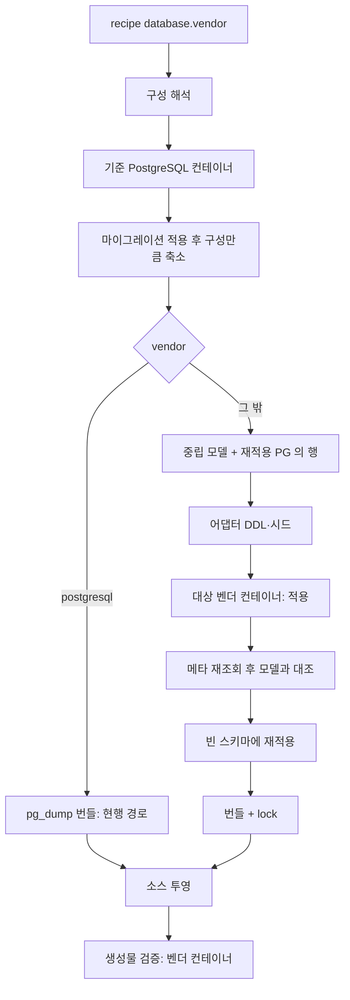

# 프로젝트 생성기 다중 DB 설계

- 상태: 승인([ADR-0047](decisions/ADR-0047-multi-database-composer-and-vendor-sql-boundary.md)). 단계 0 진행 중이며 벤더 구현은 시작 전이다
- 기준 커밋: 첫 실측 `a3a3b182f`, 수정안 실측 `ce06495c7`(V2_146까지 포함).
- 실측: 2026-10-30~31, 이 기계의 일회용 컨테이너. 저장소 변경 없음.
- 관련: [생성기 설계](project-composer-design.md) §6·§8 E, ADR-0020, ADR-0008, DEC-OPS-239·262·263

## 결론

PostgreSQL을 유일한 스키마 원본으로 두고, 생성할 때마다 **기준 PostgreSQL에서 구성한 최종 스키마와 시드 행**을 벤더 중립 모델로 뽑아 벤더 어댑터가 DDL·시드·런타임 설정을 만든다. 그 결과를 해당 벤더의 일회용 DB에 적용해 재검증을 통과해야 생성이 끝나고, 적합성 시험을 통과한 벤더만 화면에서 고를 수 있다.

- 마이그레이션 146개는 이식하지 않는다. 생성물은 지금도 V2 체인이 아니라 `V1_0` 기준선에서 시작하므로([generate-reusable-base-db.mjs:294](../../scripts/generate-reusable-base-db.mjs)) 벤더마다 최종 상태 하나만 만들면 된다.
- 어려운 일은 DDL이 아니라 앱과 의미다. DDL과 시드는 시제품으로 5개 벤더에 거의 들어갔다(아래 실측). 그러나 DDL이 들어갔다고 저장 범위까지 같은 것은 아니다. 남은 일은 네이티브 SQL 105문장 중 PostgreSQL 전용 구문, 벤더마다 다른 의미(빈 문자열, 잠금, 트리거, 오류 코드), Oracle 저장 용량을 원본과 어댑터에서 먼저 정리하는 것이다.
- **스키마 적용 실패는 측정한 5개 벤더 모두 0으로 해결했다**(§2의 수정안 적용 결과). 최신 main의 전체 기능 구성을 적용하고 시드를 넣은 뒤, 실제 테이블에서 받아야 할 값과 거부해야 할 값을 벤더별 36~44개 시험으로 확인했다.
- 다만 적용 성공과 호환은 다르다. 문장은 성공했는데 PostgreSQL과 다른 값을 받는 번역이 실측에서 여럿 나왔고, 벤더 고유 한계는 없앨 수 없어 §6.1에 남긴다. 앱은 아직 어느 벤더에서도 기동하지 않았다.
- Oracle·MariaDB·MySQL·SQL Server는 이 길로 도달할 수 있다. CUBRID는 쓸 수는 있으나 저하가 가장 크고, Tibero는 라이선스 파일이 없어 지금은 아무것도 잴 수 없다.

## 결정 카드

| D-n | 결정 | 관련 H | 영향 계약 파일 | 부정 시험 |
|---|---|---|---|---|
| D-1 | 벤더 id 는 이관 도구와 같은 7종(`postgresql`·`oracle`·`tibero`·`mysql`·`mariadb`·`mssql`·`cubrid`)으로 고정한다. 인증된 벤더만 고를 수 있고, 나머지는 화면에 사유와 함께 비활성으로 보인다. | H2 | `config/db-vendors.json`(신설), `project-composer-recipe.mjs`, `project-composer-server.mjs`, `index.html` | 미인증 벤더 recipe 가 CLI·서버 둘 다에서 `UNSUPPORTED_DATABASE` 로 거부된다 |
| D-2 | 스키마 정본은 PostgreSQL 마이그레이션 하나다. 벤더별 마이그레이션 체인·Liquibase·Hibernate DDL 생성을 두지 않는다. `postgresql` 출력 경로는 그대로 `pg_dump` 를 쓴다. | H1 | `generate-reusable-base-db.mjs`, `project-composer-db.mjs` | `postgresql` 의 번들 파일 해시·구성 해시가 변경 전후 같다 |
| D-3 | 중립 모델은 닫힌 문법이다. 모르는 타입·기본값·CHECK·인덱스·트리거가 나오면 건너뛰지 않고 `VENDOR_TRANSLATION_GAP` 으로 실패한다. 트리거는 호출 함수 본문까지 입력으로 읽고, 검토한 함수 해시와 의도를 묶는다. | H2·H3·H4 | `project-composer-vendor-ir.mjs`(신설), `project-composer-db.mjs` 의 `schemaSnapshotSql` | 새 CHECK 모양 픽스처, **트리거 선언은 두고 함수 본문만 바꾼 픽스처**(V2_143 과 같은 형태)가 빨갛다 |
| D-4 | 어댑터는 Node 내장 모듈만 쓰는 순수 함수 묶음이다. 생성은 기준 PostgreSQL + 대상 벤더 컨테이너 두 개로 돌고, 대상에 적용한 결과를 다시 읽어 모델과 대조한다. | H1 | `project-composer-vendor-*.mjs`(신설), `project-composer-postgres.mjs` | 벤더 DDL 에서 인덱스 하나를 빼면 대조가 빨갛다 |
| D-5 | 시드는 SQL 이 아니라 **재적용을 통과한 PostgreSQL 의 행**을 옮긴다. FK 위상 순서로 넣고, 적용 뒤 시퀀스·식별 컬럼의 다음 값을 최대값 뒤로 맞춘다. 초기 DB 시드와 권한 코드 재생성은 분리한다(§3). | H1·H3 | `generate-reusable-base-db.mjs`, `reusable-reference-data.mjs`, `project-composer-source.mjs:71`, `generate-permissions.mjs:64`, `reusable-governance-projection.mjs:128` | 벤더 DB 의 다음 값이 최대 ID 이하면 빨갛다. 벤더 프로젝트에서 권한 재생성이 기존 `V1_*` 체크섬을 바꾸면 빨갛다 |
| D-6 | 앱 SQL 은 원본에서 먼저 중립화한다. 이식 가능한 문장은 이식 가능한 형태로 고치고, 벤더마다 달라야 하는 일만 `VendorSqlDialect` 포트 뒤로 옮긴다. PostgreSQL 구현은 지금 SQL 그대로다. "이식 가능" 은 PostgreSQL CI 가 아니라 벤더 DB 실행으로 판정한다. 범위는 네이티브 SQL·JDBC·JPQL·QueryDSL 전부다. | H3·H4 | `foundation` 포트(신설), 아래 §4 표의 파일, `config/governance/vendor-sql-ledger.json`(신설) | 포트 밖에 `pg_advisory`·`pg_catalog`·`ON CONFLICT`·`CAST(... AS varchar`·SQL 문자열 연결 `||`·JPQL `''` 비교를 넣으면 신규 린터가 빨갛다 |
| D-7 | 의미는 벤더 기본값에 맡기지 않고 어댑터가 고정한다. **저장 범위를 먼저 보존한다**(DDL 을 Hibernate 기본값에 맞춰 줄이지 않고, 어긋나면 ORM 매핑을 고친다). 문자열 비교, 빈 문자열, 격리 수준, NULL 순서, 오류 분류를 §5 표대로 맞춘다. | H1·H3 | 어댑터, 엔티티 매핑, `GlobalExceptionHandler.java`, `OnlinePollService.java` | 벤더마다 §5 항목별 시험. 한글 4,000자·보충 문자·255바이트 초과 바이너리 저장·재조회 |
| D-8 | CHECK·FK·UNIQUE·보호 트리거는 조용히 떨어뜨리지 않는다. 번역은 문장 성공이 아니라 **PostgreSQL 차등 시험**으로 판정한다(같은 값을 넣어 받아들인 값이 같아야 한다). 감사 원장 허가는 PostgreSQL 밖에서 트랜잭션 범위 허가 표 하나로 통일한다. 대체가 없으면 벤더별 저하 목록에 올리고 승인·표시해야 인증된다. | H2·H3 | 어댑터의 `degradations`, `config/db-vendors.json` | 선언 없는 축소가 있으면 대조가 빨갛다 |
| D-9 | 인증은 벤더·버전 단위 원장이다. 상태는 `certified`·`preview`·`blocked` 이고 증거 실행 ID 와 **입력 해시**(중립 모델·어댑터·포트 구현·벤더 의존 SQL·엔티티 매핑·시험 코드와 원장)를 갖는다. 입력이 바뀌면 증거는 낡은 것이다. | H2 | `config/db-vendors.json`, `npm run regen`, 계약 시험 | 증거 없는 `certified`, 입력 해시가 다른 `certified` 가 빨갛다. 이미지 BLOB 매핑만 되돌린 변경도 빨갛다 |
| D-10 | 생성물 검증은 지금의 7단계를 유지하되 `schemaValidationTest` 를 그 벤더 컨테이너로 돌린다. 벤더에서 못 도는 시험은 원장에 사유와 대체 시험을 적는다. | H2·H5 | `verify-reusable-artifact.mjs`, `SharedPostgresMigrationTestSupport.java`, `config/governance/vendor-test-ledger.json`(신설) | 원장에 없는 시험이 빠지면 빨갛다 |
| D-11 | 생성물의 드라이버·방언·Flyway·설정·compose 는 벤더별로 투영한다. PostgreSQL 전용 자산(이관 도구 target, 백업·복원 도구, 격리 E2E 실행기, ZDM 린터)은 벤더 프로젝트에서 빼고 lock 에 기록한다. 번들 파일 집합 검사도 벤더별로 바꾼다. | H2 | `generate-reusable-base-source.mjs`, `project-composer-source.mjs:71`, `reusable-single-module.mjs`, `build.gradle` | 승인 목록과 다른 제거, 벤더 집합과 다른 번들 파일이 있으면 빨갛다 |
| D-12 | recipe 는 `schemaVersion: 1` 그대로 `database.vendor` 값만 늘린다. lock 에 벤더·엔진 버전·어댑터 버전·모델 해시를 남긴다. | H2 | `project-composer-recipe.mjs`, `project-composer-db.mjs:25`, `verify-reusable-artifact.mjs` | 벤더가 다른 DB 번들을 소스 생성기가 거부한다 |
| D-13 | 생성기 화면은 벤더 선택·저하 표시·이미지·메모리 사전 점검·두 컨테이너 정리를 지원한다. | - | `tools/project-composer/public/*`, `project-composer-preflight.mjs`, `project-composer-recovery.mjs` | 벤더 컨테이너가 남으면 기동 시 정리 시험이 빨갛다 |
| D-14 | CI 는 모든 PR 에서 모든 벤더의 **순수 번역**을 돌리고, 인증 벤더의 입력이 바뀐 PR 은 기존 required context 안에서 그 벤더의 동작·동시성 시험까지 돌린다. 비필수 검증만 받는 벤더는 `preview` 를 벗어나지 못한다. required context 수는 늘리지 않는다. | H2·H5 | `ci-change-scope.mjs`, `ci.yml`, `reusable-nightly.yml` | 번역 불가 CHECK 를 넣은 PR 이 빨갛다. 인증 벤더 upsert 를 덮어쓰기로 바꾼 PR 이 빨갛다 |
| D-15 | 순서는 공통 기반 → Oracle → MariaDB·MySQL → SQL Server → CUBRID → Tibero 다. | - | 설계서·ADR | 해당 없음 |

## 1. 지금 PostgreSQL 이 묶여 있는 곳

현재 차단 지점은 네 곳뿐이다: [recipe.mjs:46](../../scripts/project-composer-recipe.mjs), [recipe.mjs:128](../../scripts/project-composer-recipe.mjs), [db.mjs:25](../../scripts/project-composer-db.mjs), [server.mjs:64](../../scripts/project-composer-server.mjs). 여기를 풀어도 나머지가 PostgreSQL 전제다.

| 층 | 실측 | 근거 |
|---|---|---|
| 생성 파이프라인 | `pg_dump` 기준선, psql, 컨테이너 수명, 메타 조회 | `generate-reusable-base-db.mjs`, `reusable-db-postgres.mjs`, `project-composer-postgres.mjs:9` |
| 최종 스키마(전체 기능, `ce06495c7`) | 테이블 98, 컬럼 1,107, CHECK 134, FK 86, UNIQUE 24, 인덱스 208, 트리거 7(보호 5 + V2_145 동기화 2), 시퀀스 62(식별 52 + 독립 10), 시드 18,143행 | `schema-contract.json` 집계 |
| 컬럼 타입 | varchar 694(전부 4000 이하), timestamp 205, bigint 138, integer 41, numeric 17, `text` 4, `jsonb` 2, `date` 2, `uuid` 1, `bytea` 1 | 같음 |
| 앱 SQL | 네이티브 `@Query` 28 + `createNativeQuery` 6 + JDBC 호출 71 | `foundation`·`business-*`·`api-server` main |
| 생성물 | 4,301개 파일 중 454개가 PostgreSQL 언급(이관 도구 147, 문서 80, api-server 72, scripts 68 등) | 실제 생성한 `demo` 투영 |
| 통합 시험 | 생성물의 `schema-validation` 시험 52개 중 40개가 시험 코드에 PostgreSQL 전용 SQL 을 담고, 16개가 V2 번호를 참조한다 | `api-server/src/test/java/nuri/api/schema` |

유리한 점도 분명하다. `text`·`jsonb`·`uuid`·`bytea` 합쳐 8개뿐이고, 테이블·컬럼 이름은 최대 27자라 30자 제한에도 걸리지 않는다. 뷰·사용자 정의 타입·파티션·행 수준 보안이 없다. 다만 varchar 가 4000 이하여도 Oracle 저장 용량은 같지 않다. 기본 설정(`MAX_STRING_SIZE=STANDARD`)에서 `VARCHAR2(4000 CHAR)` 는 4,000바이트까지만 저장하므로 한글은 약 1,333자에서 잘린다. 길이가 2,000 이상인 컬럼이 50개 테이블에 66개 있고 게시글 본문(`tb_bbs_item.pst_cn`)도 그중 하나다.

## 2. 실측 결과

시제품은 저장소 밖의 일회용 코드다. `schema-contract.json` 과 재적용 DB 의 행만 입력으로 썼다. 벤더 컨테이너 하나씩 적용했고 대상은 전체 기능(`demo`, 22개) 구성이다.

### 수정안 적용 결과

최신 main(`ce06495c7`)을 실제 생성기로 다시 만들어 적용했다. 시험은 입력 허용·거부, 두 세션 허가 경합, 메뉴·작업·토큰·스크랩·로그 동기화·감사 원장을 실제 테이블로 본다.

| 벤더 | 스키마 문장 | 실패 | 시드 18,143행 | 동작 시험 | 비고 |
|---|---:|---:|---|---:|---|
| Oracle 19.3 EE | 445 | 0 | 오류 0 | 38/38 | 커뮤니티 이미지 |
| Oracle 23.26 Free | 445 | 0 | 오류 0 | 38/38 | CLOB 전환 포함, 트리거 컴파일 오류 0 |
| SQL Server 2022 | 446 | 0 | 오류 0 | 38/38 | 경고 1(토큰 키 1700바이트, 값은 64자) |
| MariaDB 11.4 | 454 | 0 | 오류 0 | 36/36 | 트리거 16개 |
| MySQL 8.4 | 464 | 0 | 오류 0 | 36/36 | 토큰 `=` 조회 인덱스 사용 확인 |
| CUBRID 11.4(ko_KR.utf8) | 612 | 0 | 오류 0 | 44/44 | FK 86개 전부 엔진 집행, 트리거 300개, CHECK 134개 전부 실제 평가. 동작 시험 뒤 키 전용 표로 바꿔 FK 시험을 따로 다시 돌렸다 |
| Tibero 7.2.6 | - | - | - | - | `license.xml` 부재로 미측정 |

CHECK 번역은 PostgreSQL 차등 시험으로 따로 판정했다. 규칙 8종, 값 104개를 같은 순서로 넣어 받아들인 값을 비교했다.

| 벤더 | 시제품 번역 불일치 | 수정안 불일치 | 수정안 |
|---|---:|---:|---|
| MySQL, MariaDB | 6 | 0 | `$` 는 끝 줄바꿈 앞에도 맞아 `20261030\n` 이 통과했다. `(?s)^...(?!.)` 로 끝을 표현한다. 백슬래시가 없어 `NO_BACKSLASH_ESCAPES` 에도 흔들리지 않는다(`\z` 는 이 모드에서 정상값까지 거부했다) |
| Oracle | 13 | 5 | `\z`, `c` 플래그, `COALESCE` 제거 시 `IS NOT NULL` 명시. 남은 5는 `''`=NULL 고유 동작 4와 실제로는 NOT NULL 인 컬럼의 표본 1 |
| SQL Server | 번역 없음(생략) | 0 | `LIKE` + `DATALENGTH`, 글자 수는 `_SC` 콜레이션 |
| CUBRID | 2 | 0 | `REGEXP BINARY`, NULL 가드가 붙은 위반 조건. 생성에 쓰는 번역기를 그대로 통과시킨 결과다 |

첫 실측의 CUBRID 는 이미지 기본 로케일이 `iso88591` 이어서(한글 3글자를 9글자로 센다) 문자열 결과를 믿을 수 없었다. 위 표는 `ko_KR.utf8` 로 다시 쟀다. 아래 첫 실측 표는 수정 전 실패가 무엇이었는지 보이는 기록이다.

### 첫 실측(수정 전)

| 벤더(이미지 기준) | 스키마 문장 | 실패 | 원인 | 의도적 생략 | 시드 18,140행 | 엔티티 컬럼 대조 |
|---|---|---:|---|---:|---|---|
| Oracle 23.26 Free | 436 | 0 | - | 3 | 오류 0 | 1,058/1,063 |
| Oracle 19.3 EE(커뮤니티 이미지) | 436 | 1 | boolean 등식 CHECK | 3 | 오류 0 | 미측정 |
| SQL Server 2022 | 428 | 1 | boolean 등식 CHECK | 11 | 오류 0 | 1,060/1,063 |
| MariaDB 11.4 | 436 | 2 | 자동 증가 참조 CHECK, 긴 키 | 4 | 오류 0 | 1,061/1,063 |
| MySQL 8.4 | 446 | 5 | 긴 키 4, 자동 증가 참조 CHECK | 4 | 오류 0 | 1,067/1,070 |
| CUBRID 11.4 | 436 | 6 | FK 가 PK 아닌 UNIQUE 참조 6 | 3 | 오류 0(행 수 미대조) | 미측정 |
| Tibero 7.2.6 | 미측정 | - | `license.xml` 부재로 기동 불가 | - | - | - |

의도적 생략은 부분·표현식·GIN 인덱스, DEFERRABLE, SQL Server 의 정규식 CHECK 8개다. 시제품은 이름 단축, COMMENT, 시퀀스 다음 값 맞춤을 다루지 않았다.

엔티티 대조는 Hibernate 7.4 메타모델을 각 벤더 DB 메타데이터와 전 컬럼 비교했다. 어긋난 컬럼은 다음이 전부다.

- `tb_cms_conts.conts_doc_cn`, `tb_cms_conts_rvsn.conts_doc_cn`: Oracle 시제품이 CLOB 로 만들었으나 Hibernate 는 JSON 을 기대한다.
- `tb_inst_cd.inst_cycl`, `tb_inst_cd_rcptn_log.inst_cycl`: 4개 벤더 공통. 엔티티가 `columnDefinition = "numeric(2)"` 인 Integer 다.
- `tb_srvy_tmplt.srvy_tmplt_img_info`: Oracle 에서 Hibernate 는 RAW(255), DB 는 BLOB.
- `tb_file_detail.file_detail_id`: MySQL 에서 Hibernate 는 BINARY(16), 시제품은 CHAR(36).
- `tb_auth_rfsh_tk.exprtn_dt`: SQL Server 에서 `Instant` 는 datetimeoffset.

이 대조는 타입 호환만 본다. 저장 용량, 앱 기동, 네이티브 SQL 실행, 동시성은 재지 않았다. DDL 실패 0 은 "문장이 받아들여졌다" 는 뜻이지 "PostgreSQL 과 같은 값을 저장한다" 는 뜻이 아니다.

### 의미 프로브

| 항목 | PostgreSQL | Oracle | MySQL | MariaDB | SQL Server | CUBRID |
|---|---|---|---|---|---|---|
| UNIQUE 대소문자 구분 | 구분 | 구분 | 구분(`0900_bin`) | 구분(`nopad_bin`) | 구분(`BIN2`) | 구분 |
| UNIQUE 뒤 공백 구분 | 구분 | 구분 | 구분 | 구분 | **같은 값 취급** | 구분 |
| NOT NULL 에 `''` | 허용 | **거부** | 허용 | 허용 | 허용 | 허용 |
| `'' = ''` | 참 | **참 아님** | 참 | 참 | 참 | 참 |
| 단일 UNIQUE 에 NULL 두 행 | 허용 | 허용 | 허용 | 허용 | **거부** | 허용 |
| 복합 UNIQUE 에 일부 NULL 중복 | 허용 | **거부** | 허용 | 허용 | **거부** | **거부** |
| CHECK 집행 | 집행 | 집행 | 집행 | 집행 | 집행 | **무시** |
| ASC 정렬의 NULL | 뒤 | 뒤 | **앞** | **앞** | **앞** | **앞** |
| 시각 정밀도 | 마이크로초 | 마이크로초 | 마이크로초 | 마이크로초 | 마이크로초 | **밀리초** |
| `LIMIT n OFFSET m` | 됨 | **안 됨** | 됨 | 됨 | **안 됨** | 됨 |
| `SELECT EXISTS(...)` | 됨 | 23 계열만 됨, **19c 안 됨** | 됨 | 됨 | **안 됨** | **안 됨** |
| `x::text` | 됨 | **안 됨** | **안 됨** | **안 됨** | **안 됨** | **안 됨** |
| 건너뛰는 잠금 | `SKIP LOCKED` | `SKIP LOCKED` | `SKIP LOCKED` | `SKIP LOCKED` | `READPAST` 힌트 | **없음** |
| upsert | `ON CONFLICT` | `MERGE` | `ON DUPLICATE KEY` | `ON DUPLICATE KEY` | `MERGE` | `MERGE` |

CUBRID 의 CHECK 무시는 [공식 문서](https://www.cubrid.org/manual/en/11.4/sql/schema/table_stmt.html)와 일치한다("parsed, but ignored"). Oracle 은 같은 문장이 23 계열에서 통과하고 19c 에서 `ORA-00936` 으로 실패했다. boolean 등식 CHECK 도 19c 에서만 실패했다. 23 계열 Free 만으로 인증하면 거짓 안전이 된다는 뜻이다.

### 감사 원장 보호

현재 보호 트리거 5개는 UPDATE 를 막고, 같은 트랜잭션에서 `set_config(..., true)` 로 허가한 DELETE 만 통과시킨다([AuditLedgerRetention.java:27](../../business-core/src/main/java/nuri/business/domain/log/AuditLedgerRetention.java), [CmsContentRevisionRepository.java:51](../../business-app/src/main/java/nuri/business/domain/cms/CmsContentRevisionRepository.java)).

PostgreSQL 밖에서는 **허가 표** 하나로 통일한다. 트랜잭션 안에서 허가 행을 넣고, 삭제한 뒤, 허가 행을 지우고 커밋한다. 커밋 전 행은 다른 세션에 보이지 않으므로 트랜잭션 범위가 되고, 롤백하면 허가도 사라진다. 측정한 5개 벤더 모두 같은 결과였다: 무허가 삭제·수정 거부, 다른 세션의 동시 삭제 거부, 허가 세션 삭제 통과, 커밋 뒤 다시 거부, 롤백 뒤 허가 없음. 첫 실측의 벤더별 방식(패키지 변수, 세션 컨텍스트, 세션 변수)은 버린다. MariaDB 세션 변수의 잔류 문제와 CUBRID 의 미해결이 함께 사라진다.

SQL Server 는 트리거의 허가 조회에 `WITH (READCOMMITTED)` 를 붙인다. 없으면 `READ UNCOMMITTED` 세션이 남의 미커밋 허가를 읽어 삭제에 성공했다(재현). 힌트를 붙이면 거부된다. MySQL·MariaDB 는 같은 조건에서 거부됐고, Oracle 과 CUBRID 는 미커밋 행을 읽는 격리 수준이 없다.

약점은 하나다. 허가 행을 지우지 않고 커밋하면 열린 채 남는다. 포트가 `withLedgerPermit(작업)` 하나만 공개해 같은 트랜잭션에서 지우고 지운 행 수를 확인하며, 기동 시 허가 표가 비어 있지 않으면 실패한다. MySQL 은 바이너리 로그가 켜진 기본 설정에서 앱 계정의 `CREATE TRIGGER` 가 ERROR 1419 로 거부되므로 `log_bin_trust_function_creators` 설정이나 권한 있는 계정의 기준선 적용이 필요하다.

## 3. 생성 경로



**중립 모델(D-3)** 입력은 이미 있는 `schemaSnapshotSql()` 결과에 COMMENT 를 더한 것이다. 타입은 논리 타입으로 옮기고, CHECK 는 작은 파서로 식 트리로 만든다. 현재 CHECK 134개는 약 30개 모양이다(`IN` 목록, 범위, 정규식, `char_length`, `btrim`, `jsonb_typeof`, 구간 비교, 조건식). 트리거는 SQL 본문을 옮기지 않고 `appendOnlyLedger(table, permitKey)` 같은 의도로 표현한다. 지금의 `schemaSnapshotSql()` 은 트리거 선언만 읽고 함수 본문을 읽지 않는데([project-composer-db.mjs:65](../../scripts/project-composer-db.mjs)), V2_143 은 선언을 두고 함수 본문만 바꿔 삭제 허가를 추가했다. 그래서 `pg_get_functiondef` 를 입력에 더하고, 의도 등록표가 검토한 함수 해시를 갖는다. 본문이 바뀌면 의도를 다시 검토할 때까지 번역을 멈춘다. 기본값도 의도로 표현한다(`nextval`, 현재 시각, `to_char(now() AT TIME ZONE 'Asia/Seoul')`).

**어댑터 계약(D-4)**

```js
{ id, label, engine: { image, ready, exec, introspectSql },
  emitSchema(model), emitSeed(model, rows), emitSequenceSync(model, rows),
  normalizeIntrospection(rows), runtime(): { driver, dialect, flywayModule, jdbcUrl, compose, settings },
  degradations }
```

**이름**: 제약·인덱스·트리거·시퀀스 이름 141개가 30자를 넘지만 Oracle 12.2 이상·MySQL·SQL Server·CUBRID 는 모두 받는다. Tibero 한도를 확인한 뒤 필요하면 어댑터가 해시 접미사로 줄이고 대응표를 lock 에 남긴다.

**시드(D-5)**: 재적용을 통과한 PostgreSQL 의 행을 읽어 벤더 INSERT 로 쓴다. `R__zz_seed_base_admin.sql` 의 `DO $$` 는 옮기지 않고 그 결과만 옮기므로 부트스트랩 분기를 벤더마다 다시 쓸 필요가 없다. 벤더 프로젝트의 시드는 `V1_1`~`V1_3` 일회 마이그레이션이 된다. 원본과 행이 같은지 대조한다(Oracle·Tibero 는 `''` 를 NULL 로 정규화해 비교).

**시드와 권한 재생성의 분리**: 지금은 번들 파일 다섯 개 이름이 고정이고([project-composer-source.mjs:71](../../scripts/project-composer-source.mjs)), 소스 투영의 `generatePermissions()` 가 `R__zz_seed_base_admin.sql` 의 생성 마커를 필수로 읽어 다시 쓴다([generate-permissions.mjs:64](../../scripts/generate-permissions.mjs), [reusable-governance-projection.mjs:128](../../scripts/reusable-governance-projection.mjs)). 출력만 `V1_*` 로 바꾸면 이미 적용된 마이그레이션이 재생성으로 수정된다. 그래서 다음을 계약으로 둔다.

- 벤더 프로젝트의 `generatePermissions()` 는 Java·TS·원장만 만들고 시드는 쓰지 않는다.
- 번들 파일 집합은 어댑터가 선언하고 `verifyCompositionDatabaseFiles` 가 벤더별로 대조한다.
- 생성 뒤 권한을 더하는 절차는 벤더 문법의 새 마이그레이션을 쓰는 것이다. 재생성은 기존 마이그레이션 체크섬과 회수된 권한을 건드리지 않는다.
- `R__zz_seed_base_admin.sql` 을 읽는 소비자는 생성물 기준으로 스크립트 6개(`generate-permissions`, `generate-reusable-base-db`, `export-deliverables-db`, `merge-main-regenerate`, `project-composer-menu-preview`, `project-composer-source`)와 그 시험, 하네스 2개(`SecurityAuthAnnotationLinterTest`, `BaseAdminBootstrapSeedIntegrationTest`)다. 단계 1 에서 벤더별 처리를 정한다.

## 4. 앱 SQL 중립화(D-6)

벤더 코드는 원본에 둔다. 템플릿으로 빼면 컴파일되지 않아 낡는다. `foundation` 의 `VendorSqlDialect` 포트에 벤더별 구현을 두고, 소스 생성기가 고른 벤더 구현만 남긴다. 어떤 구현을 쓸지는 `app.database.vendor` 로 정하고, 기동할 때 JDBC 제품명과 맞지 않으면 실패한다. H2 단위 시험도 PostgreSQL 구현을 쓴다(ADR-0047 결정 4).

| 처리 | 위치 | 방법 |
|---|---|---|
| Java 로 옮김 | `AuthorizationAdministrationService.java:204,289,346` `menu_sn::text` | 숫자로 읽어 Java 에서 문자열로 바꾼다. `CAST(... AS varchar)` 는 대안이 아니다(MySQL·MariaDB 미지원) |
| 포트 | `NavigationGrantRepository.java:31,45` `CAST(menu_sn AS varchar(20))` 조인, `BoardRepository.java:58,75,162`, `DtaUseStatsRepository.java:24` `CAST(... AS TIMESTAMP)`·`AS VARCHAR(8)` | 벤더별 문자열 변환식. 매개변수는 타입 있는 값으로 바인딩해 CAST 를 없앤다 |
| 이식 형태로 고침 | `JdbcAttachmentReferenceResolver.java:298`, `LoginIdReuseGuard.java:74` `SELECT EXISTS` | `CASE WHEN EXISTS` 또는 건수 조회 |
| 이식 형태로 고침 | `LoginLogRepository.java:20`, `BoardRepository.java:55`, `DtaUseStatsRepository.java:22` `TO_CHAR` 집계 | 기간별 행을 Java 에서 묶거나 포트 |
| 이식 형태로 고침 | 로그 저장소 4개, `E2EDataCleansingConfig` 의 대문자 `TB_` | 소문자. Linux MySQL 은 테이블 이름이 대소문자를 구분한다 |
| 이식 형태로 고침 | JPQL·QueryDSL 의 빈 문자열 비교 14곳: `SurveyResultRepository.java:30`, `ScheduleRepository.java:15,23,33,39,43`, `DeptJobBoxRepository.java:24`, `CmsContentRepository.java:53`, `CmsContentRevisionRepository.java:40,45`, `BoardPredicate.java` 외 | 검색어는 Java 에서 빈 문자열을 null 로 바꿔 `IS NULL` 로 비교. 값 비교는 명시적 NULL 안전 비교로 바꾼다. `COALESCE(r.contsExpln, '') <> COALESCE(c.contsExpln, '')` 는 Oracle 에서 UNKNOWN 이 되어 요약만 바뀐 페이지가 게시 대기 목록에서 빠진다 |
| 이식 형태로 고침 | `OnlinePollService.java:422` 제약 이름 문자열 검색 | 대소문자 무시 + `ConstraintViolationException` 이름. Oracle 은 이름을 대문자로 돌려준다 |
| **이식 형태로 고침(필수)** | `AttachmentSource.java:59`, `AttachmentReferenceIntegrityService.java:39` `file_url = '/api/v1/files/' \|\| ?` | 단일 첨부 판정은 Java 에서 값을 완성해 `file_url = ?` 로 바인딩한다. 행마다 값이 다른 무결성 집계는 포트의 문자열 연결식을 쓴다. MySQL·MariaDB 기본 설정에서 `\|\|` 는 논리 OR 이라 실측에서 1행이 아니라 **3행 전부**와 일치했다. 공유 첨부 접근 판정이 조용히 뚫린다(H3). `PIPES_AS_CONCAT` 은 보조 수단으로만 둔다 |
| 포트 | `CmsPageAdminService.java:378`, 저장소의 `ESCAPE '\'` | LIKE 리터럴 처리. MySQL·MariaDB 기본 설정에서 `ESCAPE '\'` 는 문법 오류다(실측), `ESCAPE '\|'` 는 동작한다. SQL Server 는 `[` 도 패턴이라 이스케이프 대상에 넣는다. `[ab]` 검색어를 차등 시험에 넣는다 |
| 이식 형태로 고침 | `LoginLogRepository.java:20,26` `\|\|` 와 `to_char` | 기간별 집계와 함께 Java 로 |
| 포트 | `UserLogRepository.java:48` upsert | 벤더별 upsert |
| Hibernate | `DurableJobRepository.java:24` `SKIP LOCKED` | `@Lock` 과 `lock.timeout` 힌트. Hibernate 가 벤더 문법을 만든다. CUBRID 는 상태 CAS |
| 포트 | `DurableWorkService.java:46`, `AdministCodeRepositoryCustomImpl.java:28` advisory 잠금 | Oracle `DBMS_LOCK`, SQL Server `sp_getapplock`, 그 밖은 슬롯 잠금 테이블 |
| 포트 | `AuditLedgerRetention.java:27`, `CmsContentRevisionRepository.java:51` 허가 | 벤더별 트랜잭션 범위 허가 |
| 포트 | `MenuRepository.java:19,52`, `DeptManageRepository.java:26`, `AuthorizationAdministrationService.java:346` `FOR NO KEY UPDATE`, `SmsAsyncProcessor.java:265` `SET LOCAL lock_timeout` | 벤더별 잠금 문장·대기 상한 |
| 포트 | `NavigationGrantRepository.java:71`, `AuthorizationAdministrationService.java:125,213,626`, `AttachmentReferenceIntegrityService.java:46` `LIMIT` | 벤더별 페이징 문장 |
| 포트 | `NavigationGrantRepository.java:69,81` `POSITION(:keyword IN ...)` 와 `:keyword=''` | 벤더별 부분 일치식(Oracle `INSTR`, SQL Server `CHARINDEX`). 빈 검색어는 Java 에서 null 로 정규화 |
| 포트 | `AuthorizationSchemaBarrierConfig.java:40` `information_schema` + `table_schema='public'` | 벤더별 메타 조회. MySQL·SQL Server 에서는 그대로 두면 0건으로 **조용히 통과**한다 |
| 포트 또는 제거 | `LogDurationReadinessConfig.java` `pg_catalog` 기동 검사(#1012) | 이행 전용 검사다. 벤더 프로젝트는 옛 데이터가 없으므로 뺀다. 남겨 두면 기동이 실패한다 |
| 분류 표 | `GlobalExceptionHandler.java:213,248` SQLState | 벤더별 오류 코드 표 |
| PG 전용 유지 | `IsolatedAuthorizationRehearsalConfig` | 벤더 프로젝트에서 제거 |

기존 게이트에 네이티브 SQL 을 보는 것이 없어(`gates.json` 에 관련 항목 없음) 신규 린터 하나를 둔다. `nativeQuery`·`JdbcTemplate`·JPQL 문자열·QueryDSL 템플릿에서 금지 구문을 찾고 포트 구현 패키지만 허용한다.

린터는 구문만 막는다. 이식 판정은 따로 한다. 위 표의 모든 위치를 `vendor-sql-ledger.json` 에 처리 방식·대응 시험과 함께 적고, "이식 형태로 고침" 으로 분류한 문장은 Oracle·MySQL·SQL Server 일회용 DB 에서 실제로 실행해 확인한다. 위 표의 `CAST(... AS varchar)` 처럼 PostgreSQL 에서 통과하고 선례가 있어도 다른 벤더에서 실패하는 문장이 있기 때문이다.

## 5. 의미 보존 규칙(D-7)

| 주제 | 규칙 | 시험 |
|---|---|---|
| 저장 범위 | 논리 모델에 글자 수와 바이트 용량을 나눠 적는다. 어댑터는 `n × 4` 바이트를 담는 물리 타입을 고른다. Oracle 은 기본 설정에서 n 이 1,000 을 넘는 컬럼 가운데 키가 아닌 것을 CLOB 로 두고 엔티티 매핑을 맞춘다(§14 결정). 기본 `VARCHAR2(4000 CHAR)` 는 4,000바이트를 넘는 값을 **거부**한다(한글 3,900자 입력 실측, 잘라서 저장하지 않는다). SQL Server 는 키가 아닌 컬럼을 `NVARCHAR(2n)`, n 이 2,000 을 넘으면 `NVARCHAR(MAX)` 로 둔다(이모지는 UTF-16 2칸이다). 키에 든 컬럼은 §6 을 따른다. `bytea` 는 BLOB 를 유지하고 RAW(255) 로 줄이지 않는다 | 한글 3,900자, 이모지 100자, 255바이트 초과 이미지 저장·재조회 |
| 문자열 비교 | MySQL `utf8mb4_0900_bin`, MariaDB `utf8mb4_nopad_bin`, SQL Server 는 컬럼에 `Korean_100_BIN2`(DB 기본은 CI 유지, 메타 식별자가 대소문자를 타지 않게), CUBRID 는 `utf8_bin` | 로그인 ID 대소문자 UNIQUE |
| 뒤 공백 | SQL Server 만 차이가 남는다. 저하 목록에 올린다 | 프로브 고정 |
| 빈 문자열 | Oracle·Tibero 는 `''` 가 NULL 이다. CHECK 의 `x <> ''` 는 NOT NULL 컬럼에서만 `x IS NOT NULL` 로 번역한다(현재 4개 모두 NOT NULL). NULL 허용 컬럼이면 정상 NULL 까지 거부하므로 그 항은 뺀다. `COALESCE(x, '') ~ p` 는 `x IS NOT NULL AND ...` 로 번역한다. 그냥 지우면 NULL 이 통과한다. 시드는 NULL 로 넣는다. NOT NULL 문자열 컬럼에 `""` 가 오면 400 으로 드러난다 | 통합 시험 |
| 격리 수준 | MySQL·MariaDB 는 Hikari `READ_COMMITTED` 고정. SQL Server 는 `READ_COMMITTED_SNAPSHOT ON` 을 기동 때 확인한다 | 동시성 시험 |
| NULL 순서 | `hibernate.order_by.default_null_ordering=last` 를 벤더 설정에 넣는다 | 정렬 시험 |
| 오류 분류 | 409·400 분기가 SQLState 에 묶여 있다. 벤더별 표로 같은 응답을 낸다 | 벤더별 위반 시험 |
| JSON | Oracle 은 19c 기준 CLOB + `IS JSON` 과 Hibernate 매핑을 맞춘다. 23 계열 기능에 기대지 않는다 | 스키마 검증 |
| UUID·Instant | 저장 범위가 같으면 DDL 을 Hibernate 벤더 기본 매핑에 맞추고, 다르면 ORM 매핑을 바꾼다 | 스키마 검증 |

## 6. 스키마 호환 처리(D-8)

아래는 모두 실측으로 적용·동작을 확인했다.

| 대상 | 벤더 | 처리 |
|---|---|---|
| `ck_tb_sys_job_job_no` boolean 등식 | Oracle 19c, SQL Server, CUBRID | `(A AND B) OR (NOT A AND NOT B)` 로 전개. 앞 컬럼이 NOT NULL 이라 의미가 같다 |
| `ck_menu_info_no_self_parent` | MySQL, MariaDB | 자동 증가 컬럼을 CHECK 가 못 본다. AFTER INSERT + BEFORE UPDATE 트리거로 대체. AFTER 라서 다음 자동 번호를 미리 부모로 준 입력도 거부한다 |
| `uk_tb_auth_rfsh_tk_rfsh_tkn`(4000) | MySQL | 저장값이 SHA-256 16진수 64자이므로 접두 UNIQUE `rfsh_tkn(768)`. `=` 조회가 같은 인덱스를 쓴다(EXPLAIN 확인). 해시 컬럼으로 두면 `rfsh_tkn = ?` 조회가 그 인덱스를 타지 못한다. 768자를 넘는 값을 저장하게 되면 재검토한다 |
| 같은 컬럼 | MariaDB | 긴 UNIQUE 를 엔진이 내부 해시로 처리해 그대로 둔다. 중복 거부 확인 |
| 같은 컬럼 | SQL Server | 그대로 두되 1,700바이트(850자) 초과는 거부된다. 저장값이 64자라 닿지 않는다. 시험으로 고정 |
| 같은 컬럼 | Oracle | LOB 에는 UNIQUE 를 걸 수 없어 CLOB 전환에서 빼고 `VARCHAR2(4000 BYTE)` |
| `uk_tb_bbs_scrap_...`(1000) | MySQL, SQL Server | 해시 생성 컬럼에 UNIQUE. 엔티티는 바꾸지 않는다. 끝 글자만 다른 1,000자 주소를 구분함을 확인 |
| `ix_tb_popup_info_file_url` | MySQL, MariaDB | 접두 768자 |
| 같은 인덱스 | SQL Server | 뺀다. 그대로 두면 850자 넘는 주소의 INSERT 가 실패한다. 팝업 표는 행이 적다 |
| `ix_tb_web_log_occr_ymd_url` | MySQL, MariaDB | `url(700)` 접두 |
| 같은 인덱스 | SQL Server | `(occr_ymd DESC) INCLUDE (url)` |
| NULL 허용 UNIQUE 8개 | SQL Server | 7개는 `WHERE ... IS NOT NULL` 필터 유일 인덱스. `domain_name` 은 FK 대상이라 필터 인덱스를 쓸 수 없어 UNIQUE 유지(NULL 1행 제한, 시드에 NULL 없음) |
| 복합 NULL 허용 UNIQUE 6개 | Oracle | 모든 키가 NOT NULL 일 때만 값을 내는 `CASE` 함수 기반 유일 인덱스 |
| 같은 6개 | CUBRID | 필터 UNIQUE 는 문법에서 막힌다. 그림자 키 컬럼 + AFTER 트리거 2개로 키를 채우고 진짜 UNIQUE 인덱스가 판정한다. 경합이 없다. 키는 `길이:값` 으로 이어 구분자 충돌이 없고, 수정 경로(중복 거부, NULL 전환, 재입력)까지 확인했다 |
| 정규식 CHECK 8개 | SQL Server 2022 | `LIKE` + `DATALENGTH` 로 정확히 번역. `LEN` 은 뒤 공백을 세지 않으므로 쓰지 않는다 |
| 글자 수 CHECK 4개 | SQL Server | `_SC` 콜레이션의 `LEN(x + N'.') - 1`. 이모지를 한 글자로 세고 뒤 공백도 센다 |
| 900바이트 넘는 복합 PK | SQL Server | `pk_meta_standard_words` 를 NONCLUSTERED 로 |
| 표현식 인덱스 `btrim(ocrn_ymd)` | 벤더별 | Oracle·CUBRID 함수 기반, MySQL 함수 키, MariaDB·SQL Server 계산 컬럼 |
| 부분 인덱스 `ix_tb_menu_info_del_yn` | Oracle, MySQL, MariaDB | 일반 인덱스로. 유일성이 없어 성능만 달라진다 |
| GIN `ix_tb_web_log_url_trgm` | 전 벤더 | 뺀다. 결과는 같고 URL 부분 검색만 느려진다. 기간 조건과 함께 쓰며 저하로 표시 |
| DEFERRABLE 자기 참조 FK | Oracle 외 | 시드는 부모 먼저. [MenuService.java:429](../../business-core/src/main/java/nuri/business/service/menu/MenuService.java) 는 자식부터 지우도록 원본을 고친다 |
| V2_145 동기화 트리거 2개 | 전 벤더 | 번역해 적용·동작 확인. 이행 전용이고 새 프로젝트에는 옛 데이터가 없으므로, Contract 뒤에는 입력에서 사라진다. 어댑터가 모르는 트리거가 생기면 `VENDOR_TRANSLATION_GAP` 으로 멈추는 것이 맞다는 실례다 |
| FK 5개(부모 키가 UNIQUE) | CUBRID | 부모의 PK 와 UNIQUE 를 맞바꾼다. 그 PK 를 참조하는 다른 FK 가 없어 FK 는 깨지지 않는다. 진짜 FK 로 집행된다. 다만 `meta_standard_domains.domain_name` 은 원본이 NULL 을 허용하는데 PK 가 되면서 NOT NULL 이 된다. 시드에 NULL 은 없고 이 표는 앱이 쓰지 않아 저하로 표시한다 |
| `fk_tb_login_policy_tb_user_info` | CUBRID | `tb_user_info` PK 는 다른 FK 12개가 참조해 맞바꿀 수 없다. `user_id` 만 담는 키 전용 표 `tb_user_info_key` 를 두고 진짜 FK 가 그 PK 를 본다. 사용자 입력·삭제·아이디 변경 때 트리거가 키 행을 맞춘다. 판정은 엔진이 해서 경합에도 고아가 없다. 두 세션 시험에서 트리거 FK 는 고아가 재현됐고, 키 전용 표는 어느 순서든 뒤 트랜잭션이 기다렸다가 FK 오류로 거부됐다. 다중 행 삭제도 확인했다 |
| CHECK 134개 | CUBRID | BEFORE INSERT·UPDATE 트리거 268개. 조건은 CHECK 식을 드모르간으로 푼 위반식이고 모든 잎에 NULL 가드를 붙인다. `COALESCE` 처럼 NULL 을 값으로 바꾸는 식이 비교에 들어오면 가드가 틀리므로 번역을 멈춘다(현재 134개에는 없다). 134개 전부를 복제 표에서 실제로 평가했고, 일부러 망가뜨린 조건이 붉어지는 것도 확인했다 |

### 6.1 없앨 수 없는 한계

| 벤더 | 한계 | 이유 | 처리 |
|---|---|---|---|
| Oracle | `''` 와 NULL 을 구분할 수 없다 | DB 의 정의다. 끌 수 없다 | NOT NULL 문자열에 `""` 가 오면 저장 실패, NULL 허용이면 `null` 로 돌아온다. 입력 정규화와 E2E 로 드러낸다 |
| Oracle(기본 설정) | 4,000바이트 초과 문자열을 `VARCHAR2` 에 못 담는다 | `MAX_STRING_SIZE=STANDARD` | CLOB 는 `=`·`DISTINCT`·`ORDER BY`·`GROUP BY`·인덱스를 못 쓴다. EXTENDED 는 되돌릴 수 없다(§14) |
| SQL Server | `=`·UNIQUE 가 뒤 공백을 무시한다 | 표준 패딩 비교. `BIN2` 로도 안 바뀐다 | `abc` 와 `abc ` 가 같은 키다. 키 값은 앱에서 잘라 저장하고 저하로 표시 |
| SQL Server | 인덱스 키 1,700바이트 | 엔진 상한 | 긴 컬럼 키는 해시·INCLUDE 로 우회 |
| SQL Server | 필터 유일 인덱스는 FK 대상이 못 된다 | 엔진 규칙 | `domain_name` 은 UNIQUE 유지, NULL 1행 제한 |
| MySQL·MariaDB | FK 를 지연 검사할 수 없다, 부분 인덱스가 없다 | 엔진 기능 부재 | 쓰는 순서를 원본에서 맞춘다. 부분 인덱스는 성능 저하 |
| MySQL | 앱 계정 트리거 생성에 서버 설정이나 높은 권한이 필요 | 바이너리 로그 안전 규칙 | 도입 조건으로 문서화 |
| MySQL·MariaDB·Oracle | DDL 이 자동 커밋이다 | 엔진 동작 | 실패한 마이그레이션이 반쯤 남는다. 벤더 프로젝트의 복구 절차를 따로 둔다 |
| CUBRID | CHECK 를 엔진이 집행하지 않는다 | 파서만 받고 무시 | 트리거로 대체하되 쓰기마다 평가한다. 시드 18,143행이 21초(트리거 없음, ISO 문자 집합)에서 34~52초가 됐다. 정밀 측정은 아니다 |
| CUBRID | 트리거 조건이 NULL 이면 결과가 번갈아 바뀐다 | 같은 입력이 거부·허용·거부로 나왔다 | 모든 조건을 NULL 없는 위반식으로 만든다. `IS FALSE` 는 평가 오류 |
| CUBRID | JSON 형식을 DB 가 보장하지 못한다 | `JSON` 타입 + UPDATE 트리거는 클라이언트가 종료된다. 트리거 안 JSON 함수는 평가 오류 | `STRING` + 첫 글자 검사. 깨진 JSON 은 앱이 막는다 |
| CUBRID | 시각이 밀리초다, `SKIP LOCKED` 가 없다, `DEFAULT` 에 UUID·시퀀스를 못 쓴다 | 엔진 기능 부재 | 값은 앱이 채운다. 작업 선점은 상태 CAS 로 처리량이 줄어든다 |
| CUBRID | Hibernate 방언은 커뮤니티, Flyway 플러그인은 직접 유지 | 공식 지원 없음 | 유지 비용을 저장소가 진다 |
| Tibero | 전부 미측정 | `license.xml` 없음 | 라이선스 전에는 어떤 주장도 하지 않는다 |
| 전 벤더 | 생성 뒤 스키마 변경은 벤더 문법으로 손수 쓴다 | 벤더 마이그레이션 체인을 두지 않기로 했다(D-2) | 원본의 새 마이그레이션이 생성된 프로젝트로 자동 전파되지 않는다 |
| 전 벤더 | 성능 동등성은 보장하지 않는다 | GIN·부분 인덱스 부재, 실행 계획 차이 | 기관 부하 시험 몫 |

## 7. 인증과 검증(D-9, D-10)

```json
{ "vendors": [{ "id": "oracle", "label": "Oracle", "status": "preview",
  "engines": [{ "version": "19", "image": "...", "evidence": null }],
  "degradations": ["..."] }] }
```

`certified` 조건은 벤더·버전마다 다음을 모두 통과한 실행 ID 다: 스키마 대조, 시드 행 대조, Hibernate validate, 통합 시험, §5·§6 적합성, 대표 E2E(로그인·권한·게시판·결재·감사 원장). 증거에는 입력 해시를 함께 적는다. 입력은 중립 모델, 어댑터, 포트 구현, 벤더 의존 SQL 파일, 엔티티 매핑(벤더 설정 포함), 벤더에서 도는 시험 코드와 시험 원장이다. 해시가 현재 저장소와 다르면 `npm run regen -- --check` 가 `VENDOR_EVIDENCE_STALE` 로 먼저 알리고, 계약 시험이 그 `certified` 를 거부한다. 그래서 야간 실패를 기다리는 동안 낡은 인증이 남지 않는다. 재검증 만료는 ADR-0018 처럼 기술 판정과 분리한다. 생성기는 기존 원칙대로 생성 작업마다 전체 검증을 돌리므로 인증은 선택 허용일 뿐 각 작업의 검증을 대신하지 않는다.

`schema-validation` 시험은 벤더 적합성의 뼈대다. 인가·동시성·감사 원장을 이미 실 DB 로 시험하고 있어 새로 쓰는 것보다 낫다. 다만 40개가 시험 코드에 PostgreSQL 전용 SQL 을 담고 있어 `SharedPostgresMigrationTestSupport` 를 벤더 중립 지원으로 나누고, 시험을 세 분류로 원장에 적는다: 그대로 실행, 픽스처 이식, 대체 시험 필요.

Oracle 은 19c 를 기준으로 삼는다. 공식 19c 이미지는 내려받을 수 없어 저장소가 이미 쓴 커뮤니티 이미지로 재되, 공식 이미지가 아니라는 점을 증거에 표시한다. CI 의 Oracle Free(23 계열)만 통과한 것을 19c 증거로 쓰지 않는다.

## 8. 벤더별 소스 투영(D-11)

| 벤더 | Hibernate | Flyway | 드라이버 |
|---|---|---|---|
| Oracle | `OracleDialect`(19 이상) | `flyway-database-oracle` | `ojdbc11`, Central |
| MySQL | `MySQLDialect`(8.0 이상) | `flyway-mysql` | `mysql-connector-j`, Central |
| MariaDB | `MariaDBDialect`(10.6 이상) | `flyway-mysql` | `mariadb-java-client`, Central |
| SQL Server | `SQLServerDialect`(12.0 이상) | `flyway-sqlserver` | `mssql-jdbc`, Central |
| CUBRID | 커뮤니티 `CUBRIDDialect` | Central 의 `flyway-database-cubrid` 는 10.26.0 에서 멈췄다. Flyway 12 용 플러그인을 직접 둔다 | `cubrid-jdbc`, `maven.cubrid.org` |
| Tibero | 없음. `OracleDialect` 상속 방언을 직접 둔다 | 없음. 플러그인을 직접 둔다 | 공개 저장소 없음. 도입자가 jar 제공 |

벤더 프로젝트에서 제거하고 lock 에 남기는 것: `migration-tool`(target 이 PostgreSQL 전용, `nuri/migration/postgres/*`), 백업·복원 도구와 런북, 격리 E2E 실행기, ZDM 린터 등 PostgreSQL DDL 을 읽는 하네스 7개 중 해당분. 하네스는 조용히 빼지 않고 기존 승인 목록(`acknowledgedRemovedGates`)과 같은 방식으로 벤더별 목록에 적는다. 같은 불변식을 `schemaValidationTest` 가 대신 보는지 항목마다 적는다. 단일모듈 어댑터도 이관 소스 세트를 빼야 한다.

생성물의 `docker-compose*.yml`, `.env.example`, `application*.yml`, `README`, `REUSABLE_*.md` 는 벤더 값으로 투영한다. compose 이미지는 개발용이며 운영 라이선스는 기관 몫이라고 적는다.

## 9. 식별과 실패(D-12, D-13)

- `compositionHash` 는 recipe 를 포함하므로 벤더가 다르면 해시가 다르다. `postgresql` recipe 의 해시는 변하지 않는다.
- `profile-lock.json` 에 `database: { vendor, engineVersion, adapterVersion, modelHash }` 를 더한다. `schemaSnapshotHash` 는 기준 PostgreSQL 값으로 유지한다.
- 새 작업 실패 코드: `VENDOR_TRANSLATION_GAP`(모델 번역 불가), `VENDOR_PARITY_FAILED`(대상 DB 대조 실패), `VENDOR_ENGINE_NOT_READY`(대상 컨테이너 미기동).
- 컨테이너 수명은 `project-composer-postgres.mjs` 를 일반화한다. 소유 표식은 같은 라벨을 쓰고 두 컨테이너를 한 작업 토큰으로 묶는다. 취소·기동 정리도 같은 경로를 탄다.
- 사전 점검에 벤더 이미지, 메모리(Oracle Free·SQL Server 약 2GB 이상), Tibero 라이선스 파일을 더한다.
- 화면은 기능 저하 칸에 벤더 저하를 함께 보이고, 카탈로그 응답에 인증 원장을 싣는다. 비밀번호는 지금처럼 임시 환경으로만 넘긴다.

## 10. CI(D-14)

| 경로 | 실행 | 비용 |
|---|---|---|
| 모든 PR 의 기존 custom 생성 | 기준 PostgreSQL 에서 뽑은 모델을 모든 어댑터로 **번역만** 한다 | 수 초 |
| 인증 입력(어댑터·포트 구현·벤더 의존 SQL·엔티티 매핑·벤더 시험)이 바뀐 PR | 해당 벤더 적용·대조·Hibernate validate. `certified` 벤더는 영향받는 동작·동시성 시험까지 기존 `backend-build` 안에서 돌린다 | 적용은 벤더당 1~3분(시제품 18~74초), 시험은 측정 전 |
| 야간 `reusable-nightly` | 벤더 × 대표 구성 전체 검증 | 무거움 |

required context 수는 늘리지 않는다. 벤더 작업이 비필수 야간에만 도는 동안 그 벤더는 `preview` 이고 선택할 수 없다. `certified` 로 올리는 것은 위 PR 경로가 required 안에서 돌기 시작한 뒤다.

## 11. 출시 순서(D-15)

| 단계 | 내용 | 끝나는 조건 |
|---|---|---|
| 0 | ADR 승인. §4 앱 SQL 중립화(PostgreSQL 동작 불변, L2 PR 1개), 신규 린터, 통합 시험 분류 | PostgreSQL 전체 CI green, 린터 red 증명, 모든 위치의 처리 방식·대응 시험이 원장에 있음, 이식 문장의 Oracle·MySQL·SQL Server 실행 확인, NULL 경계 시험(`NULL→값`, `값→NULL`, 양쪽 NULL) 통과 |
| 1 | 모델·어댑터 계약·생성 경로·번역 게이트. 벤더는 아직 숨김 | 5개 벤더 번역, 대조 시험 |
| 2 | Oracle 인증(19c·23 계열) | §7 조건 |
| 3 | MariaDB → MySQL 인증 | §7 조건 |
| 4 | SQL Server 인증 | §7 조건 |
| 5 | CUBRID: 보호 트리거 허가 해결 뒤 인증 | §7 조건 + 저하 승인 |
| 6 | Tibero: 라이선스 확보 뒤 측정부터 | §7 조건 |

Oracle 을 먼저 하는 이유는 공공 수요가 가장 크고, 빈 문자열처럼 가장 까다로운 의미를 먼저 드러내며, 이 결과가 Tibero 에 그대로 쓰이기 때문이다. 시제품에서 DDL 실패도 가장 적었다(23 계열 0, 19c 1).

## 12. 기각한 대안

| 대안 | 기각 이유 |
|---|---|
| 벤더별 마이그레이션 146개 이식 | 벤더 수만큼 정본이 늘어나 표류한다. 생성물은 최종 상태만 쓴다 |
| Liquibase 등 중립 변경 이력으로 전환 | 원본 스키마 정본을 다시 써야 하고 H1 근거가 약해진다 |
| Hibernate DDL 생성 | CHECK·트리거·인덱스·COMMENT 를 잃는다. 설계서 §6 이 이미 배제했다 |
| 외부 변환기(sqlglot 등) | 생성기 폐포가 Node 내장 모듈 원칙이고, 134개 CHECK 는 작은 문법으로 닫힌다 |
| 생성할 때 Java 소스를 문자열 치환 | 컴파일·시험되지 않아 낡는다. H4 위반 |
| 벤더 코드를 생성물 템플릿에만 둠 | 원본 CI 가 컴파일하지 않아 낡는다 |

## 13. 재지 못한 것과 위험

| 항목 | 영향 | 처리 |
|---|---|---|
| CHECK 134개 전체의 차등 시험 | 차등 시험은 규칙 8종만 했다. 나머지 모양은 적용과 표본 시험까지다 | 단계 1 의 번역 게이트 |
| 허가 표의 커넥션 풀·동시 파기 | 두 세션 시험까지 했다. 풀 재사용과 파기 작업 두 개의 동시 실행은 재지 않았다 | 단계 2 |
| 벤더에서 앱 기동·업무 흐름 미실행 | 시제품은 DDL·시드·타입만 봤다. 실제 공수는 §4 이후 드러난다 | 단계 2 첫 작업 |
| Oracle CLOB 전환의 영향 | DDL·시드·저장은 실측했다. 컬럼의 `DISTINCT`·`ORDER BY`·`=` 사용처와 Hibernate 매핑은 아직 재지 않았다 | 단계 0 에서 전수 집계 |
| Oracle 19c 앱 경로 미측정 | 스키마·시드·동작 시험은 통과했으나 엔티티 대조와 앱은 재지 않았다. 공공 운영의 주류 버전이다 | 단계 2 |
| 통합 시험 40개의 PostgreSQL 전용 SQL | 이식 공수가 가장 큰 미지수 | 단계 0 에서 분류 |
| 동시성 의미 | 잠금·격리·재시도 차이는 프로브로 못 잰다 | 기존 동시성 시험 재사용 |
| 빈 문자열 응답 변화 | Oracle 에서 `""` 가 `null` 로 돌아와 화면·계약이 달라질 수 있다 | E2E |
| Tibero | Hibernate 방언·Flyway·JDBC 모두 공개 경로 없음. 전부 추정 | 라이선스 뒤 측정 |
| CUBRID 커뮤니티 방언 | Hibernate 7.4 동작 미확인 | 단계 5 |
| 성능 | GIN 부재, 표현식 인덱스 축소, 이식한 집계 | 벤더별 측정은 기관 몫으로 표시 |

## 14. 사용자가 정할 것

| 결정 | 권고 |
|---|---|
| 지원 범위 | Oracle·MariaDB·MySQL·SQL Server 를 정식 목표로. CUBRID 는 저하를 표시한 제한 지원. Tibero 는 라이선스 뒤. Altibase 는 제외 |
| 최소 버전 | Oracle 19c, MariaDB 11.4, MySQL 8.4, SQL Server 2022 |
| Oracle 긴 문자열 | CLOB. EXTENDED 는 DBA 가 이미 켠 기관에서만 선택지로 |
| Oracle 빈 문자열 | 고유 동작으로 받아들이고 입력 정규화·E2E 로 드러낸다 |
| 감사 원장 허가 | PostgreSQL 밖은 허가 표로 통일 |
| MySQL·MariaDB 트리거 권한 | 도입 조건으로 명시 |
| SQL Server 뒤 공백 | 저하로 표시하고 키 값은 앱에서 자른다 |
| CUBRID 저하 | JSON·밀리초·작업 선점·CHECK 트리거 비용을 표시하고 제한 지원 |
| Tibero | 데모 라이선스 확보 후 측정 |
| 벤더 프로젝트의 이관 도구 | 제외 |
| 시작 | 단계 0 착수 승인 |


## 15. Codex 독립 검토 결과

모델 `gpt-6-astra`(추론 xhigh), 읽기 전용 샌드박스. 지적은 코드로 직접 대조한 뒤 받았다.

| 지적 | 판정 | 반영 |
|---|---|---|
| 트리거 함수 본문 변경을 모델이 못 본다 | 사실. V2_143 이 그 실례 | D-3, §3 |
| Oracle 4,000바이트 한도와 `bytea` 축소 | 사실. 66개 컬럼 영향 | D-7, §1, §5, §14 |
| 일회성 시드가 권한 재생성 계약과 충돌 | 사실. 파일 집합 고정·마커 필수 | D-5, D-11, §3 |
| `CAST(... AS varchar)` 는 공통 SQL 이 아니고 부서 잠금 경로 누락 | 사실. 시간 CAST 도 같은 문제 | D-6, §4 |
| JPQL 의 빈 문자열 NULL 비교 누락 | 사실. 14곳으로 확대 집계 | D-6, §4 |
| 인증 증거가 이후 변경과 연결되지 않음 | 사실 | D-9, D-14, §7, §10 |

2회차는 SOP §7.3 대로 바뀐 결정만 봤다. 5건 해소, 인증 증거 1건 일부 해소(모델·엔티티 매핑·시험 코드가 입력에서 빠짐), 새 major 1건(CLOB 전환과 `rfsh_tkn` UNIQUE 충돌, Oracle 공식 문서·DDL 로 확인)이었다. 두 건 모두 반영했다(D-9, §5, §6, §7, §10). SOP 상한 2회에 닿아 3회차는 돌리지 않았고, 이 두 건의 반영은 Codex 재확인을 받지 않았다.

3회차는 SOP 상한을 넘겼다. 감사 원장 보호와 첨부 인가의 의미를 바꾸는 결정이 새로 들어왔기 때문이다. 수정안 실측으로 바뀐 결정만 봤고, 지적은 재현으로 판정했다.

| 지적 | 판정 | 반영 |
|---|---|---|
| SQL Server 의 `READ UNCOMMITTED` 세션이 미커밋 허가를 읽는다 | 재현. MySQL·MariaDB 는 재현 안 됨 | `WITH (READCOMMITTED)`, 재현 후 거부 확인 |
| `domain_name` PK 전환이 NULL 범위를 줄인다 | 사실 | 저하로 표시(§6) |
| 그림자 키의 구분자 충돌 | 사실 | 길이 접두 인코딩, 시험 추가 |
| `NO_BACKSLASH_ESCAPES` 에서 `\z` 가 깨진다 | 재현. 정상값까지 거부 | 백슬래시 없는 `(?s)...(?!.)`, 두 순서 모두 확인 |
| `violation()` 이 NULL 흡수식을 잘못 푼다, 차등 시험이 번역기를 쓰지 않았다 | 사실. 현재 134개에는 없다 | 비지원 식은 번역 중단, 차등 시험이 번역기를 통과 |
| 무결성 집계의 `\|\|` 는 단일 바인딩으로 못 바꾼다 | 사실 | 포트의 연결식(§4) |
| SQL Server `LIKE` 의 `[` | 사실(공식 문서) | 이스케이프 대상 추가(§4). `ESCAPE '\\'` 문제도 함께 찾아 실측 |
